# BREWLITE — BÁO CÁO KIỂM THỬ SPRINT 1 (THÀNH VIÊN D)

**Dự án:** BrewLite — Website bán đồ uống  
**Người thực hiện:** Thành viên D — Testing  
**Ngày retest:** 26/10/2026  
**Nhánh làm việc:** `feature/member-d` (cần xác nhận bằng `git branch --show-current`)  
**Commit mã nguồn tại thời điểm retest:** Chưa ghi nhận; bổ sung bằng `git rev-parse --short HEAD` nếu có bằng chứng về phiên bản đã chạy.  
**Môi trường:** Windows, Chrome, Next.js `localhost:3000`, NestJS `localhost:3001`, PostgreSQL 18, Prisma.  
**Thư mục minh chứng:** `docs/Testing/evidence/`.

## 1. Mục tiêu và phạm vi

Kiểm tra API health, danh sách và chi tiết sản phẩm, giao diện, tính giá theo size/topping, trạng thái rỗng, lỗi/retry và thời gian phản hồi. `PASS (API)` chỉ chứng minh phản hồi API; không thay thế truy vấn kiểm tra trực tiếp PostgreSQL. Thời gian phản hồi chỉ được kết luận đạt chuẩn nếu nhóm có ngưỡng chấp nhận.

## 2. Lịch sử lỗi và khắc phục môi trường

- **Lần kiểm thử ban đầu (25/10/2026):** TC-D02 `GET /products` trả **404 Not Found**, được ghi **FAIL** tại thời điểm đó. Không xóa kết quả lịch sử.
- **Trong quá trình retest (26/10/2026):** Có thời điểm `GET /products` trả **500** do PostgreSQL chưa sẵn sàng / cấu hình kết nối chưa đúng; đây là vấn đề môi trường trong quá trình chuẩn bị retest.
- **Sau khắc phục:** PostgreSQL 18 chạy; Prisma migration `20261024160346_init_products` được áp dụng thành công; seed thành công **4 sản phẩm và 2 topping**; khởi động lại backend. `GET /products` trả **200 OK**.
- **TC-D06:** Ảnh lưu là tình huống lỗi `GET /products` trả 404 và giao diện có nút **Thử lại**. Người kiểm thử xác nhận đã kiểm tra toàn bộ quy trình retry và kết quả **PASS**; riêng ảnh hiện có chủ yếu thể hiện trạng thái lỗi/Network 404, chưa tự nó chứng minh phục hồi sau lỗi.

## 3. Bảng tổng hợp

| Mã     | Nội dung                         | Kết quả retest                     | Căn cứ / ghi chú                                                                  |
| ------ | -------------------------------- | ---------------------------------- | --------------------------------------------------------------------------------- |
| TC-D01 | Health API                       | **PASS**                           | HTTP 200, `status: ok`                                                            |
| TC-D02 | Product list API                 | **PASS (retest)**                  | HTTP 200, mảng 4 sản phẩm; lần đầu FAIL 404                                       |
| TC-D03 | Tính giá size/topping            | **PASS 6/6 trường hợp được chụp**  | Trường hợp 06 là L + Kem = 52.000đ, khác tên ảnh đang lưu                         |
| TC-D04 | Đường dẫn frontend không tồn tại | **PASS**                           | Thông báo không tìm thấy trang/sản phẩm                                           |
| TC-D05 | Danh sách sản phẩm rỗng          | **PASS (fixture)**                 | Hiển thị “Hiện chưa có sản phẩm.”                                                 |
| TC-D06 | Xử lý lỗi và retry               | **PASS (người kiểm thử xác nhận)** | Ảnh minh chứng lỗi và Network 404; nếu cần chứng minh hồi phục, bổ sung ảnh riêng |
| TC-D07 | Chi tiết sản phẩm hợp lệ         | **PASS (UI + API)**                | Giao diện và `GET /products/coffee-milk` HTTP 200                                 |
| TC-D08 | ID sản phẩm không hợp lệ         | **PASS (UI + API)**                | Giao diện không tìm thấy, API HTTP 404                                            |
| TC-D09 | Dữ liệu size                     | **PASS (API)**                     | S: 0, M: 5.000, L: 10.000; chưa đối chiếu trực tiếp SQL                           |
| TC-D10 | Dữ liệu topping                  | **PASS (API)**                     | Kem: 7.000, Trân châu: 5.000; chưa đối chiếu trực tiếp SQL                        |
| TC-D11 | Thời gian GET /products          | **ĐÃ ĐO**                          | HTTP 200, **57,645 ms**; chưa có ngưỡng đánh giá                                  |
| TC-D12 | Thời gian GET /products/:id      | **ĐÃ ĐO**                          | HTTP 200, **66,977 ms**; chưa có ngưỡng đánh giá                                  |

## 4. Chi tiết test case và minh chứng

### TC-D01 — Backend Health Check

- **Thao tác:** `curl.exe -i http://localhost:3001/health`
- **Mong đợi:** HTTP 200 và JSON `{"status":"ok","service":"brewlite-api"}`.
- **Thực tế:** Đúng mong đợi. **PASS**.

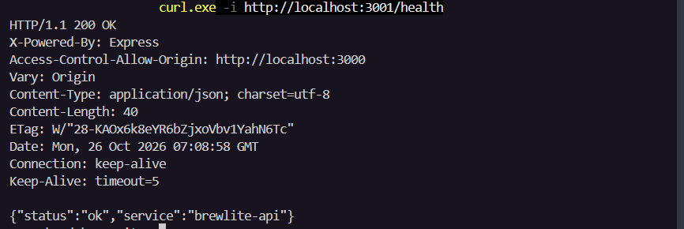

### TC-D02 — Danh sách sản phẩm API

- **Thao tác:** `curl.exe -i http://localhost:3001/products`
- **Mong đợi:** HTTP 200, JSON array danh sách sản phẩm.
- **Thực tế retest:** HTTP 200, trả 4 sản phẩm: Americano, Cappuccino, Cà phê sữa, Trà đào. **PASS (retest)**.
- **Lịch sử:** Lần đầu HTTP 404 **FAIL**; có lần HTTP 500 khi môi trường database chưa hoàn tất. Không thay thế lịch sử bằng kết quả mới.

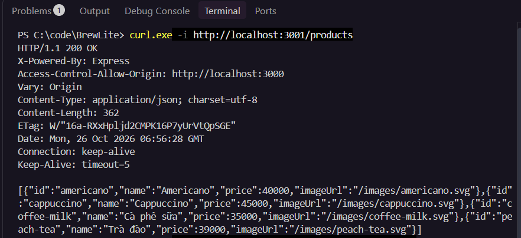

### TC-D03 — Tính giá sản phẩm Cà phê sữa

- **Giá gốc:** 35.000đ. **Công thức:** tổng = giá gốc + phụ thu size + các topping được chọn.
- **Phạm vi:** Kiểm thử thao tác chọn size/topping trên Chrome. Nếu dùng fixture, ghi nhận là kiểm thử frontend/fixture, không suy diễn truy vấn PostgreSQL.

| Lần | Size | Topping         | Giá mong đợi | Giá trên ảnh | Kết quả                               |
| --- | ---- | --------------- | -----------: | -----------: | ------------------------------------- |
| 01  | S    | Không           |      35.000đ |      35.000đ | PASS                                  |
| 02  | M    | Không           |      40.000đ |      40.000đ | PASS                                  |
| 03  | L    | Không           |      45.000đ |      45.000đ | PASS                                  |
| 04  | M    | Kem             |      47.000đ |      47.000đ | PASS                                  |
| 05  | L    | Kem + Trân châu |      57.000đ |      57.000đ | PASS                                  |
| 06  | L    | **Kem**         |  **52.000đ** |  **52.000đ** | PASS; **tên ảnh ghi Pearl chưa đúng** |

**Minh chứng TC-D03-01 — Size S:**

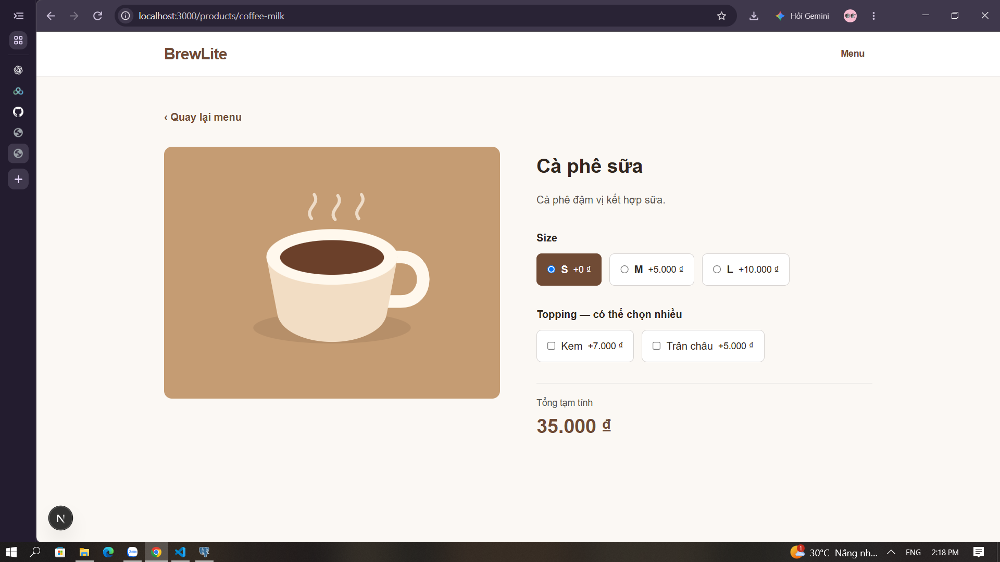

**Minh chứng TC-D03-02 — Size M:**

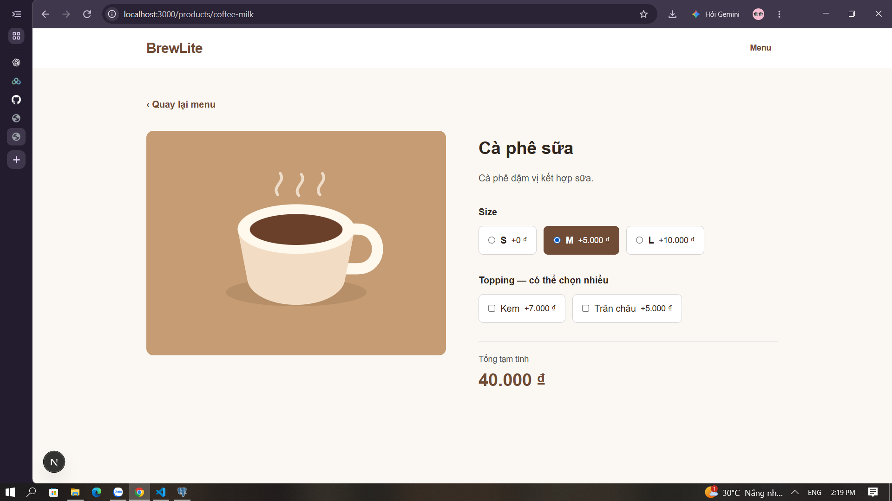

**Minh chứng TC-D03-03 — Size L:**

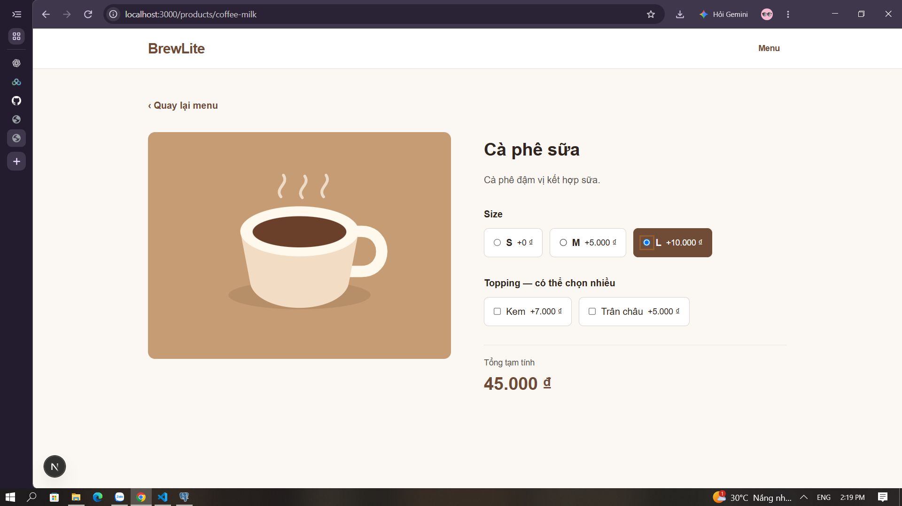

**Minh chứng TC-D03-04 — Size M + Kem:**

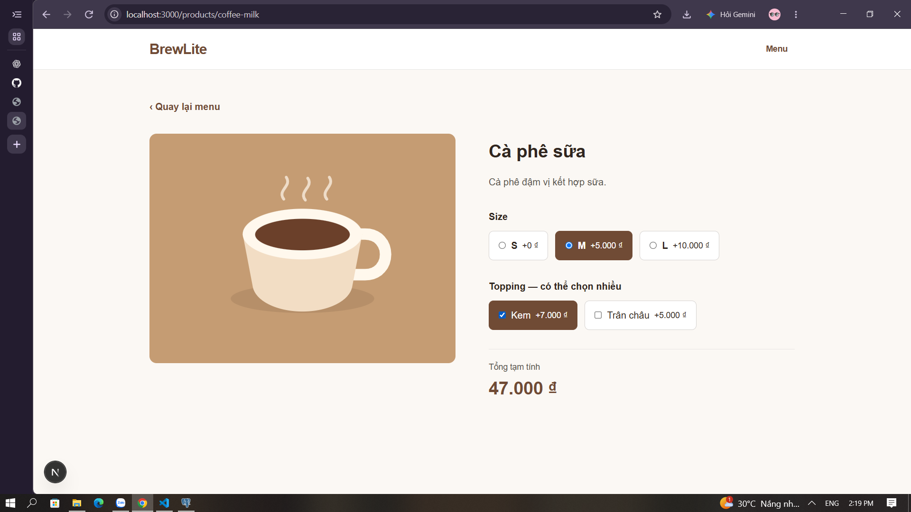

**Minh chứng TC-D03-05 — Size L + hai topping:**

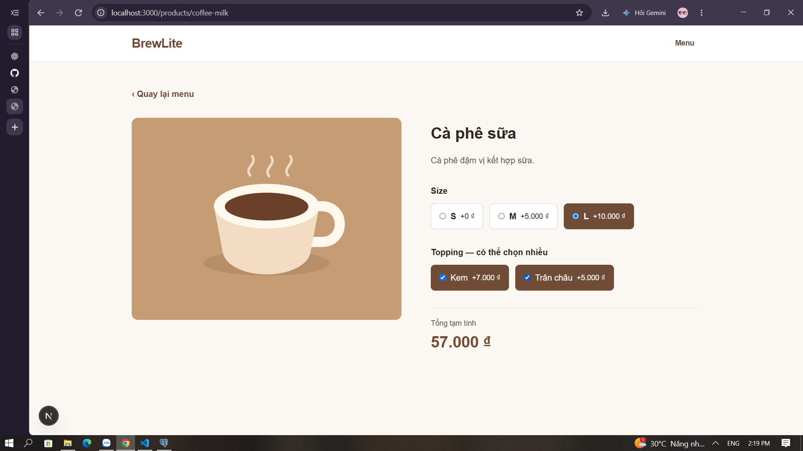

**Minh chứng TC-D03-06 — Size L + Kem (ảnh hiện tại):**

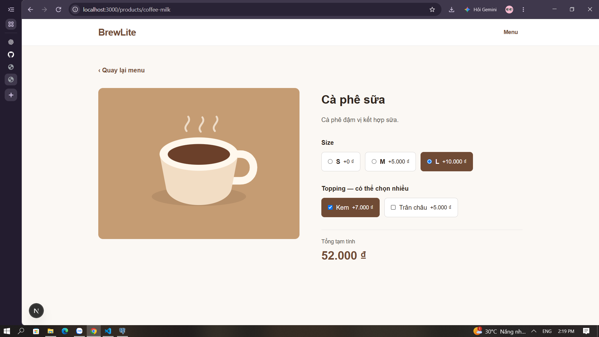

> **Cần chỉnh:** Nên đổi tên ảnh cuối thành `TC-D03_06_Size_L_Cream_PASS.png` và cập nhật đường dẫn Markdown tương ứng; hoặc chụp lại Size L + Trân châu = 50.000đ để đúng với tên `Pearl`. Báo cáo này giữ **tên file hiện có** để đường dẫn ảnh hoạt động ngay.

### TC-D04 — Đường dẫn frontend không tồn tại

- **Thao tác:** Mở `http://localhost:3000/trang-khong-ton-tai`.
- **Mong đợi:** Hiển thị giao diện không tìm thấy trang.
- **Thực tế:** Hiển thị “Không tìm thấy trang hoặc sản phẩm” và nút “Về menu”. **PASS**.

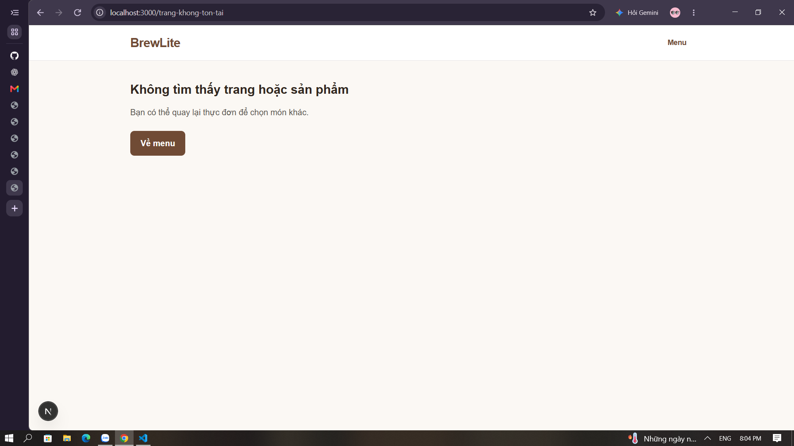

### TC-D05 — Danh sách sản phẩm rỗng

- **Thao tác:** Dùng fixture rỗng `[]` và mở trang menu.
- **Mong đợi:** Hiển thị trạng thái danh sách trống.
- **Thực tế:** “Hiện chưa có sản phẩm.” **PASS (fixture)**. Sau kiểm thử cần khôi phục dữ liệu mẫu.

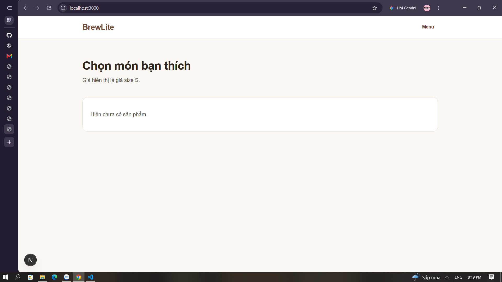

### TC-D06 — Xử lý lỗi tải menu và nút Thử lại

- **Thao tác:** Dùng nguồn `api`, tạo tình huống `GET /products` lỗi; quan sát thông báo, nút **Thử lại**, thao tác retry và trạng thái sau đó.
- **Mong đợi:** Hiển thị thông báo lỗi rõ ràng; nút Thử lại hoạt động, gửi lại request; khi dịch vụ sẵn sàng có thể tải lại dữ liệu.
- **Kết quả:** **PASS theo xác nhận của người kiểm thử đã chạy đầy đủ**. Ảnh hiện có xác nhận giao diện lỗi “Không tải được thực đơn” và request `GET /products` HTTP 404 trong Network. Nếu người review yêu cầu chứng minh quá trình phục hồi, cần thêm ảnh Network/request HTTP 200 sau retry.

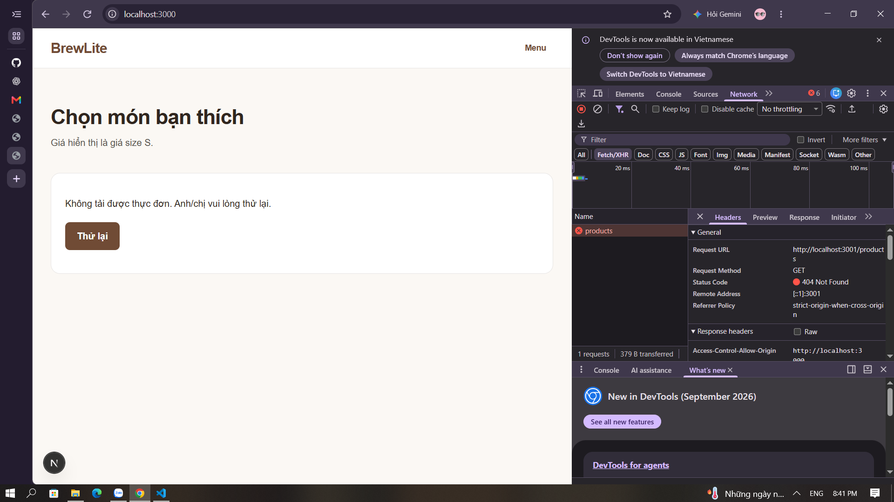

### TC-D07 — Chi tiết sản phẩm hợp lệ

- **Thao tác:** Mở `http://localhost:3000/products/coffee-milk`; gọi `GET /products/coffee-milk`.
- **Mong đợi:** Trang chi tiết có tên, mô tả, size, topping; API HTTP 200.
- **Thực tế:** Hiển thị Cà phê sữa, mô tả, các size S/M/L, topping Kem/Trân châu; API trả 200. **PASS**.

### TC-D08 — Sản phẩm không tồn tại

- **Thao tác:** Mở `http://localhost:3000/products/id-khong-ton-tai`; gọi `GET /products/id-khong-ton-tai`.
- **Mong đợi:** API HTTP 404; giao diện không tìm thấy sản phẩm.
- **Thực tế:** API trả `404 Not Found`, `Product not found`; Chrome hiển thị “Không tìm thấy trang hoặc sản phẩm”. **PASS**.

**Minh chứng API:**

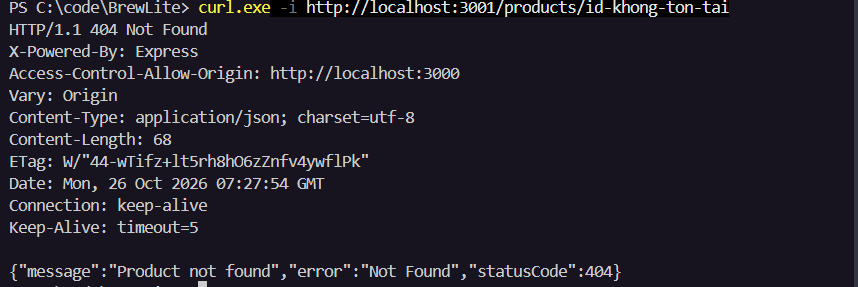

**Minh chứng giao diện:**

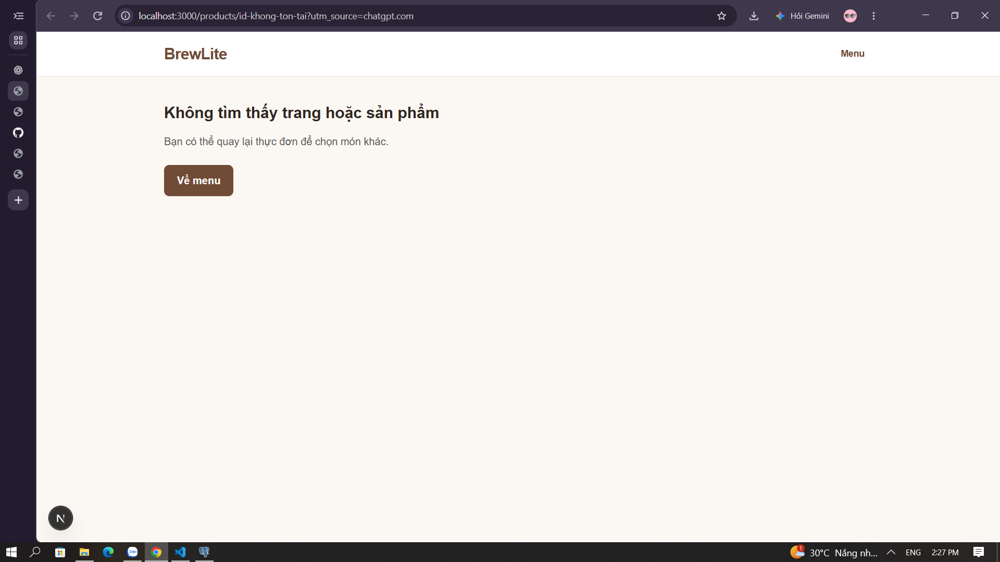

### TC-D09 — Dữ liệu size qua API

- **Thao tác:** `curl.exe -s http://localhost:3001/products/coffee-milk | ConvertFrom-Json | Select-Object -ExpandProperty sizes | Format-Table`
- **Mong đợi / thực tế:** `S = 0`, `M = 5000`, `L = 10000`. **PASS (API)**.
- **Giới hạn:** Chưa có ảnh truy vấn SQL trực tiếp PostgreSQL.

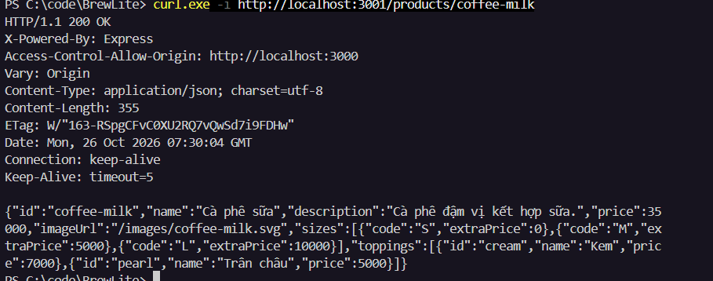

### TC-D10 — Dữ liệu topping qua API

- **Thao tác:** `curl.exe -s http://localhost:3001/products/coffee-milk | ConvertFrom-Json | Select-Object -ExpandProperty toppings | Format-Table`
- **Mong đợi / thực tế:** `cream` — Kem — 7000; `pearl` — Trân châu — 5000. **PASS (API)**.
- **Giới hạn:** Chưa có ảnh truy vấn SQL trực tiếp PostgreSQL.

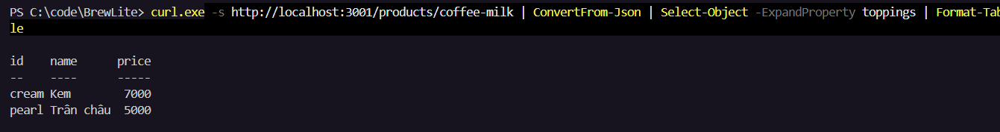

### TC-D11 — Đo thời gian GET /products

- **Thao tác:** `curl.exe -s -o NUL -w "HTTP Status: %{http_code}`nResponse Time: %{time_total} seconds`n" http://localhost:3001/products`
- **Thực tế:** HTTP 200; `0.057645` giây = **57,645 ms**.
- **Đánh giá:** Đã đo thành công; **chưa kết luận PASS về hiệu năng** vì chưa có ngưỡng yêu cầu.

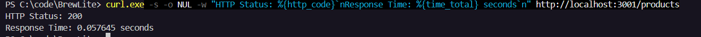

### TC-D12 — Đo thời gian GET /products/coffee-milk

- **Thao tác:** `curl.exe -s -o NUL -w "HTTP Status: %{http_code}`nResponse Time: %{time_total} seconds`n" http://localhost:3001/products/coffee-milk`
- **Thực tế:** HTTP 200; `0.066977` giây = **66,977 ms**.
- **Đánh giá:** Đã đo thành công; **chưa kết luận PASS về hiệu năng** vì chưa có ngưỡng yêu cầu.

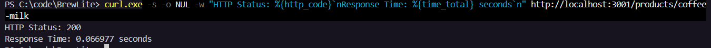

## 5. Kết luận và việc cần xác nhận trước khi merge PR #8

- **10/12 test case có kết quả PASS** trong phạm vi mô tả; TC-D11 và TC-D12 đã đo được thời gian nhưng cần tiêu chí chấp nhận để đánh giá hiệu năng.
- **TC-D02** đã chuyển từ **FAIL (HTTP 404)** ở lần đầu sang **PASS (HTTP 200)** sau khi cập nhật mã nguồn, cấu hình PostgreSQL, migration và seed; giữ nguyên lịch sử để theo dõi tiến độ sửa lỗi.
- **TC-D06:** người kiểm thử xác nhận PASS đầy đủ; nên bổ sung ảnh retry thành công nếu nhóm yêu cầu chứng cứ riêng cho bước khôi phục.
- **TC-D03-06:** đổi tên ảnh hoặc chụp lại để nội dung và tên file khớp nhau.
- **TC-D09/10:** nếu tiêu chí bắt buộc là xác minh dữ liệu trực tiếp trong PostgreSQL, bổ sung kiểm thử SQL thay vì chỉ dựa vào API.
- **Trước commit:** xác nhận các ảnh nằm trong `docs/Testing/evidence/`, kiểm tra link Markdown, tránh commit `.env` chứa mật khẩu và cấu hình thử nghiệm; bổ sung commit mã nguồn thực tế và mã AC từ hồ sơ Sprint 1 nếu nhóm yêu cầu.
