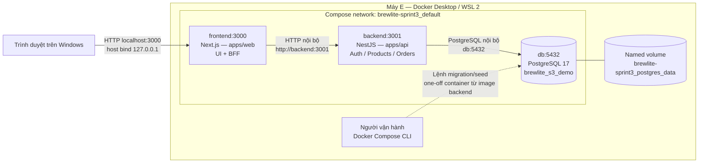

# Task 3.2 — Deployment BrewLite

Ngày lập: 10/11/2026.
Lead: E. Reviewer: C.
Trạng thái: DRAFT — local đã kiểm chứng; production chưa chốt.
Nền triển khai local: commit 0846f3a, PR #40.

## 1. Deployment local đã chạy

- Chỉ frontend publish cổng host 127.0.0.1:3000.
- Backend và database không publish cổng ra host.
- Browser gọi Product API qua /api/products.
- BFF và frontend server dùng BACKEND_INTERNAL_URL.
- Mock payment theo thiết kế chạy bên trong backend;
  chưa tích hợp workflow payment trong bản local này.
- Không có container payment gateway hoặc queue riêng.
- PostgreSQL Docker tách khỏi PostgreSQL cài trên Windows.

## 2. Ánh xạ tạo phẩm

| Thành phần | Tạo phẩm/cấu hình |
|---|---|
| Frontend | apps/web/Dockerfile, brewlite-web:sprint3 |
| Backend | apps/api/Dockerfile, brewlite-api:sprint3 |
| Database | postgres:17-bookworm |
| Điều phối | compose.yaml, đúng ba service |
| Dữ liệu bền | Named volume của service db |
| Secret local | .env.compose, không commit hoặc đưa vào image |
| Hướng dẫn chạy | ../SPRINT3_COMPOSE.md |
| Migration | apps/api/prisma/migrations |
| Catalog seed | apps/api/prisma/seed.ts |
| Demo seed | apps/api/prisma/seed-demo.ts |

## 3. Khởi động và kiểm tra

1. Build hai image theo lockfile.
2. Khởi động db và đợi pg_isready thành công.
3. Người vận hành chạy migrate deploy một lần.
4. Seed catalog; khởi tạo tồn demo có guard khi fixture mới.
5. Khởi động backend và frontend.
6. Backend kiểm tra /health; frontend kiểm tra HTTP /.
7. Smoke /api/products và kiểm tra dữ liệu PostgreSQL.

Migration/seed không tự chạy đồng thời ở mỗi app container.
Backend chờ db healthy; frontend chờ backend healthy.
UTC được cấu hình cho kết nối backend và demo seed.
Không dùng down -v trên dữ liệu cần giữ.

## 4. Bằng chứng local

Đã thực hiện trên máy E:
- Build hai image thành công.
- Ba migration áp dụng trên database Docker sạch.
- Seed catalog và demo thành công.
- Ba service Healthy.
- /api/products trả 200, đủ bốn sản phẩm.
- Bốn Product: stock 10, reservedStock 0, stockVersion 1.
- DEMO10 lưu đúng các mốc UTC.
- Restart container: API vẫn 200, còn bốn sản phẩm,
  tổng tồn 40.

Giới hạn:
- Chưa xác nhận chạy trên máy thành viên khác.
- Chưa xác nhận toàn luồng auth/cart/payment trong Docker.
- Chưa xác nhận UI bằng quan sát trình duyệt.
- Chưa kiểm thử backup/restore hoặc rollback deployment.
- Healthcheck không thay bằng chứng nghiệp vụ/E2E.

## 5. CI và production — chưa triển khai

Compose local là môi trường demo, chưa phải production HTTPS.
Hiện chưa có đủ thông tin để vẽ topology production đã xác nhận.

Các quyết định cần E phối hợp A/B/C chốt:
- Nhà cung cấp, tài khoản và quyền deploy thực tế.
- Chi phí được nhóm chấp thuận; không tự mua dịch vụ.
- Nơi chạy frontend/backend và PostgreSQL private.
- Domain, HTTPS/TLS và quyền cấu hình.
- Registry/image tag gắn commit nếu sử dụng container.
- CI runner, kiểm tra PR và quyền CD.
- Secret production được quản lý ngoài Git/image.
- Người chạy migration, backup/restore và rollback.
- URL health/smoke và bằng chứng truy cập bên ngoài.

Luồng CI/CD dự kiến để review:
PR checks → build tạo phẩm theo SHA → phê duyệt release
→ backup/migration có kiểm soát → deploy → smoke/health
→ xử lý rollback theo kế hoạch tương thích dữ liệu.

Chưa có bằng chứng chạy pipeline trên.
Rollback image không tự hoàn tác migration hoặc dữ liệu.

## 6. Điều kiện chốt Task 3.2

- Nhóm xác nhận nền tảng và quyền sử dụng thật.
- Bổ sung sơ đồ production đúng nền tảng đã chọn.
- C review ranh giới mạng, secret, health và deployment.
- D/E đối chiếu với kiến trúc Task 3.1.
- Ghi rõ phần đã triển khai và phần mới là thiết kế.
- Nghiệm thu theo cổng Task 1 → 5 của nhóm.