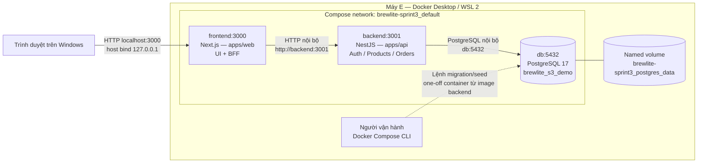
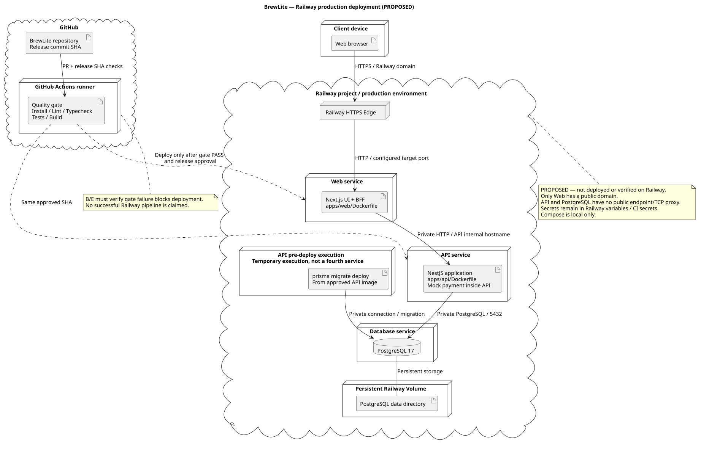
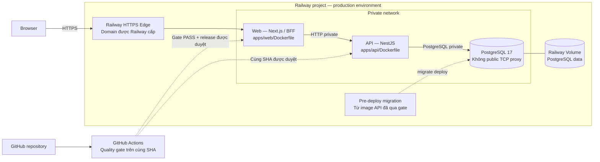

# Task 3.2 — Deployment BrewLite

Ngày lập: 10/11/2026.
Lead: E. Reviewer: C.
Trạng thái: DRAFT — local đã kiểm chứng; Railway production là phương án đề xuất, chờ duyệt tài khoản/ngân sách và kiểm chứng triển khai.
Nền triển khai local: commit 0846f3a, PR #40.

## 1. Deployment local đã chạy

- Chỉ frontend publish cổng host 127.0.0.1:3000.
- Backend và database không publish cổng ra host.
- Browser gọi Product API qua /api/products.
- BFF và frontend server dùng BACKEND_INTERNAL_URL.
- Mock payment theo thiết kế chạy bên trong backend;
  chưa tích hợp workflow payment trong bản local này.
- Không có container payment gateway hoặc queue riêng.
- PostgreSQL Docker tách khỏi PostgreSQL cài trên Windows.

## 2. Ánh xạ tạo phẩm

| Thành phần | Tạo phẩm/cấu hình |
|---|---|
| Frontend | apps/web/Dockerfile, brewlite-web:sprint3 |
| Backend | apps/api/Dockerfile, brewlite-api:sprint3 |
| Database | postgres:17-bookworm |
| Điều phối | compose.yaml, đúng ba service |
| Dữ liệu bền | Named volume của service db |
| Secret local | .env.compose, không commit hoặc đưa vào image |
| Hướng dẫn chạy | ../SPRINT3_COMPOSE.md |
| Migration | apps/api/prisma/migrations |
| Catalog seed | apps/api/prisma/seed.ts |
| Demo seed | apps/api/prisma/seed-demo.ts |

## 3. Khởi động và kiểm tra

1. Build hai image theo lockfile.
2. Khởi động db và đợi pg_isready thành công.
3. Người vận hành chạy migrate deploy một lần.
4. Seed catalog; khởi tạo tồn demo có guard khi fixture mới.
5. Khởi động backend và frontend.
6. Backend kiểm tra /health; frontend kiểm tra HTTP /.
7. Smoke /api/products và kiểm tra dữ liệu PostgreSQL.

Migration/seed không tự chạy đồng thời ở mỗi app container.
Backend chờ db healthy; frontend chờ backend healthy.
UTC được cấu hình cho kết nối backend và demo seed.
Không dùng down -v trên dữ liệu cần giữ.

## 4. Bằng chứng local

Đã thực hiện trên máy E:
- Build hai image thành công.
- Ba migration áp dụng trên database Docker sạch.
- Seed catalog và demo thành công.
- Ba service Healthy.
- /api/products trả 200, đủ bốn sản phẩm.
- Bốn Product: stock 10, reservedStock 0, stockVersion 1.
- DEMO10 lưu đúng các mốc UTC.
- Restart container: API vẫn 200, còn bốn sản phẩm,
  tổng tồn 40.
- Đã quan sát menu và trang chi tiết sản phẩm trên trình duyệt;
  bằng chứng được cập nhật tại commit c7eb6c9.

Giới hạn:
- Chưa xác nhận chạy trên máy thành viên khác.
- Chưa xác nhận toàn luồng auth/cart/payment trong Docker.
- Chưa kiểm thử backup/restore hoặc rollback deployment.
- Healthcheck không thay bằng chứng nghiệp vụ/E2E.

## 5. Production Railway — phương án đề xuất

Nhóm ưu tiên Railway cho Web Next.js, API NestJS và PostgreSQL 17.
Compose giữ cho local. Chưa tạo hoặc xác nhận deployment Railway,
chưa bật trả phí; cần nhóm duyệt tài khoản và ngân sách.

### 5.1 UML deployment production
Nguồn UML: [deployment-production.puml](deployment-production.puml).

Sơ đồ Mermaid bên dưới là bản tóm tắt luồng triển khai.

Sơ đồ là thiết kế mục tiêu, chưa phải bằng chứng hạ tầng đã chạy.
Không tạo thêm service payment gateway hoặc queue.
Migration là bước chạy tạm thời, không phải service thứ tư thường trực.
Mock payment vẫn ở trong backend theo thiết kế nghiệp vụ.

### 5.2 Cấu hình service

| Service | Cấu hình đề xuất |
|---|---|
| Web | Build context ở gốc repo; RAILWAY_DOCKERFILE_PATH=apps/web/Dockerfile |
| API | Build context ở gốc repo; RAILWAY_DOCKERFILE_PATH=apps/api/Dockerfile |
| PostgreSQL | Ghim image PostgreSQL 17 và lưu image/digest triển khai thực tế |
| DB volume | Mount đúng thư mục dữ liệu image PostgreSQL 17; không dùng ephemeral disk làm dữ liệu bền |
| Public networking | Chỉ Web có domain HTTPS Railway |
| Private networking | Web → API → DB trong cùng project/environment |
| Replica ban đầu | Một replica mỗi service; chưa tuyên bố high availability |

Cần kiểm tra trước deploy:
- Web hiện chạy port 3000; cấu hình PORT/target port phải khớp.
- API đọc PORT; xác nhận listen hỗ trợ private networking Railway.
- BACKEND_INTERNAL_URL của Web trỏ hostname private thực tế của API.
- DATABASE_URL của API dùng hostname private thực tế của PostgreSQL.
- Không dùng tên service Compose như backend/db nếu Railway không cấp tên đó.
- APP_ORIGIN và FRONTEND_ORIGIN khớp chính xác HTTPS origin của Web.
- Cookie production, Origin allowlist và BFF owner/session guard
  phải được kiểm thử lại qua HTTPS.
- UTC cho backend/seed và kiểm thử round-trip thời gian.
- Private network chỉ dùng ở runtime, không gọi DB khi build image.
- Không đưa secret vào NEXT_PUBLIC_*, Git, image hoặc log.

Không đổi Dockerfile/local scripts chỉ để giả định production đã chạy.
Mọi thay đổi PORT/listen phải có PR, review và test tương ứng.

### 5.3 Tài khoản và quyền

- Nhóm chỉ định Owner tài khoản/project, người duyệt và chịu billing.
- E cần quyền deploy, cấu hình service/variables/volume và xem log.
- B phối hợp quyền GitHub repository, workflow và GitHub integration.
- C/D cung cấp cấu hình ứng dụng và xử lý lỗi auth/workflow.
- Dùng tài khoản cá nhân và lời mời phân quyền, không chia sẻ mật khẩu.
- Nếu dùng CLI/CD token: lưu trong GitHub Secrets, giới hạn phạm vi
  project/environment khi nền tảng hỗ trợ.
- Gói Hobby/Pro và quyền cộng tác thực tế phải được kiểm tra
  trước khi nhóm duyệt; chưa có xác nhận tài khoản hiện hành.

### 5.4 Quality gate và phát hành

B phối hợp E thiết lập:
1. PR chạy npm ci, lint, typecheck, unit test, integration phù hợp
   trên DB test riêng và build.
2. Required checks chặn merge khi thất bại.
3. Workflow push trên main/release kiểm tra đúng SHA triển khai.
4. Nếu dùng Railway GitHub autodeploy, bật Wait for CI
   cho cả Web/API và kiểm chứng một lượt gate thất bại không deploy.
5. Phê duyệt release, chạy migration rồi đưa ứng dụng mới vào phục vụ.
6. Lưu commit SHA, deployment IDs, log gate và kết quả smoke.

Không để đồng thời hai đường deploy không qua cùng quality gate.
Chưa có bằng chứng pipeline Railway đã chạy.

### 5.5 Migration, seed, health và rollback

- API pre-deploy dự kiến:
  npm run db:deploy --workspace apps/api
- Xác nhận pre-deploy truy cập được private DB trong môi trường thật.
- Chỉ API chạy migration, không để Web và API cùng migrate.
- Sao lưu trước thay đổi schema; kiểm tra migration trên bản sao/test DB.
- Không chạy demo seed hoặc INIT_DEMO_STOCK tự động mỗi lần deploy.
- Seed production cần quy trình riêng được nhóm duyệt;
  guard hiện tại chỉ cho database demo, không nới guard để chạy tùy tiện.
- API deployment health: /health; Web deployment health: /.
- Healthcheck khởi động không thay giám sát liên tục hoặc kiểm thử nghiệp vụ.
- Smoke: HTTPS menu/Product BFF, register/login/me/logout,
  Order và payment trên bản tích hợp đã được nhóm chốt.
- Rollback ứng dụng về deployment/SHA trước chỉ khi tương thích schema.
- Không tự hoàn tác migration; restore dữ liệu cần người duyệt
  và chấp nhận mất các ghi sau thời điểm backup.
- Volume không thay thế backup; phải kiểm thử restore.
- Ghi thời điểm backup, thời gian giữ và nơi lưu trước nghiệm thu.

### 5.6 Dự toán sơ bộ — kiểm tra ngày 10/11/2026

Đơn vị USD, giả định chạy cả tháng với tải thấp.
Đây là giả định sử dụng trung bình, chưa phải số đo Railway.

| Thành phần | RAM trung bình | CPU trung bình | Ước tính/tháng |
|---|---:|---:|---:|
| Web | 0,25 GB | 0,05 vCPU | 3,50 |
| API | 0,25 GB | 0,05 vCPU | 3,50 |
| PostgreSQL | 0,25 GB | 0,05 vCPU | 3,50 |
| Volume 1 GB + egress 10 GB | — | — | 0,65 |
| Tổng giả định | | | 11,15 |

Cơ sở ước tính từ tài liệu Railway:
- RAM khoảng 10 USD/GB/tháng.
- CPU khoảng 20 USD/vCPU/tháng.
- Volume khoảng 0,15 USD/GB/tháng.
- Egress 0,05 USD/GB.
- Hobby tối thiểu 5 USD/tháng, đã bao gồm 5 USD usage;
  không cộng thêm 5 USD vào tổng usage đã vượt mức này.
- Pro tối thiểu 20 USD/tháng, bao gồm 20 USD usage.

Đề xuất nhóm duyệt:
- Hobby: dự phòng 15–25 USD/tháng nếu quyền dùng phù hợp.
- Pro: dự phòng 20–30 USD/tháng nếu cần workspace cộng tác.
- Chưa gồm thuế/phí thanh toán, backup hoặc dịch vụ phụ nếu có.
- Không cam kết Free/Trial đủ tài nguyên hoặc đủ thời gian chấm.
- Chưa bật trả phí. Nhóm phải chọn gói, Owner và ngân sách.
- Cấu hình cảnh báo/giới hạn chi phí sau khi duyệt;
  kiểm tra tác động dừng service khi chạm giới hạn.
- Theo dõi usage thực sau triển khai để cập nhật dự toán.

### 5.7 Trạng thái cần review

Đã chạy: Compose local và các bằng chứng ở mục 4.
Đề xuất: toàn bộ topology/config/pipeline Railway trong mục 5.

Chưa xác nhận:
- Tài khoản, quyền, gói trả phí và ngân sách được duyệt.
- Railway services/domain/volume và private connectivity.
- Quality gate, migration, backup/restore và rollback thực tế.
- Smoke/E2E trên HTTPS và chi phí đo được.
- Chưa hoàn thành production hoặc nghiệm thu Task 3.2.

Nguồn tham khảo chính thức:
- https://docs.railway.com/pricing
- https://docs.railway.com/pricing/understanding-your-bill
- https://railway.com/pricing
- https://docs.railway.com/networking/private-networking/how-it-works
- https://docs.railway.com/networking/public-networking
- https://docs.railway.com/deployments/pre-deploy-command
- https://docs.railway.com/deployments/healthchecks
- https://docs.railway.com/volumes
- https://docs.railway.com/projects/project-members
- https://github.com/railwayapp/docs/blob/main/content/docs/deployments/github-autodeploys.md
## 6. Điều kiện chốt Task 3.2

- Nhóm duyệt Railway, gói sử dụng, Owner và ngân sách.
- E được cấp quyền triển khai; B thống nhất quality gate/CD.
- C review mạng private, secret, HTTPS, health và cấu hình.
- D/E đối chiếu với kiến trúc Task 3.1 và workflow tích hợp.
- Sơ đồ UML deployment khớp cấu hình production dự kiến;
  khi triển khai phải cập nhật tên service/domain thực tế.
- Phân biệt rõ thiết kế đề xuất với bằng chứng đã chạy.
- Ghi SHA, URL, deployment IDs và kết quả kiểm chứng thực tế.
- Các phần chưa đạt tiếp tục ghi CHỜ, không tự đánh dấu PASS.
- Nghiệm thu theo cổng Task 1 → 5 của nhóm.

Bản tài liệu này chưa xác nhận production đã hoạt động.