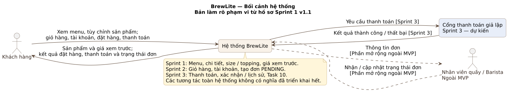
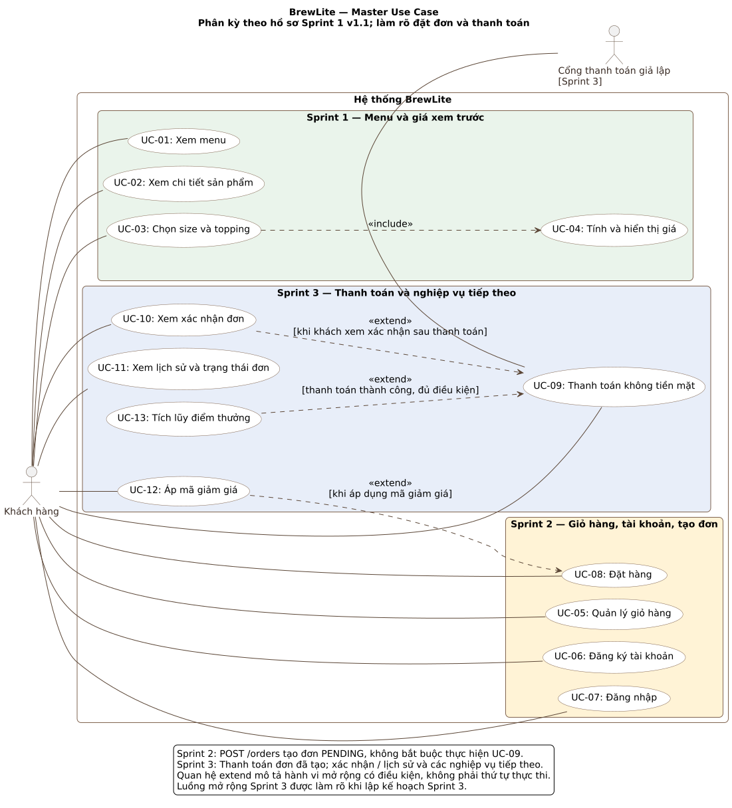
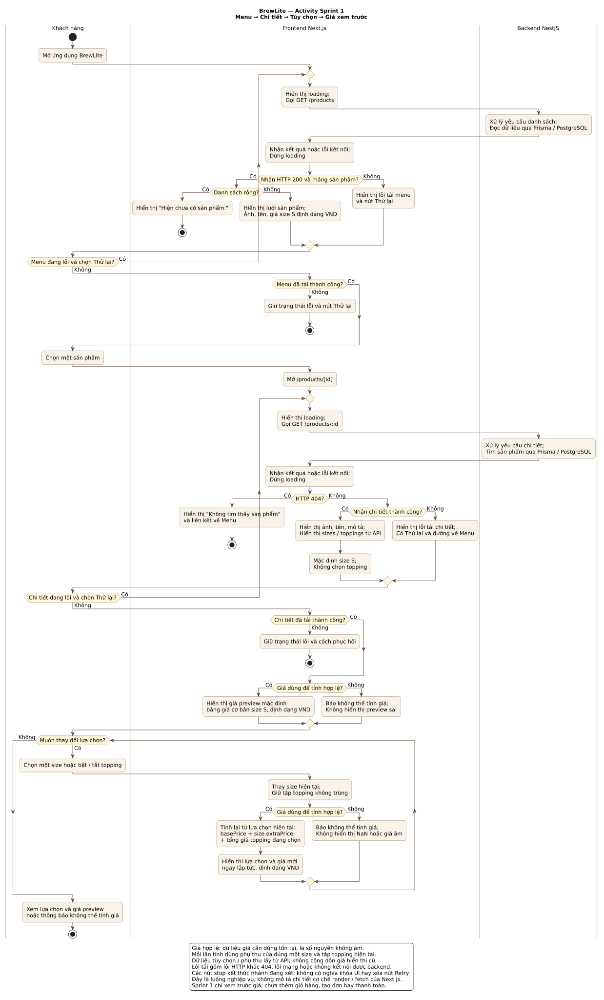
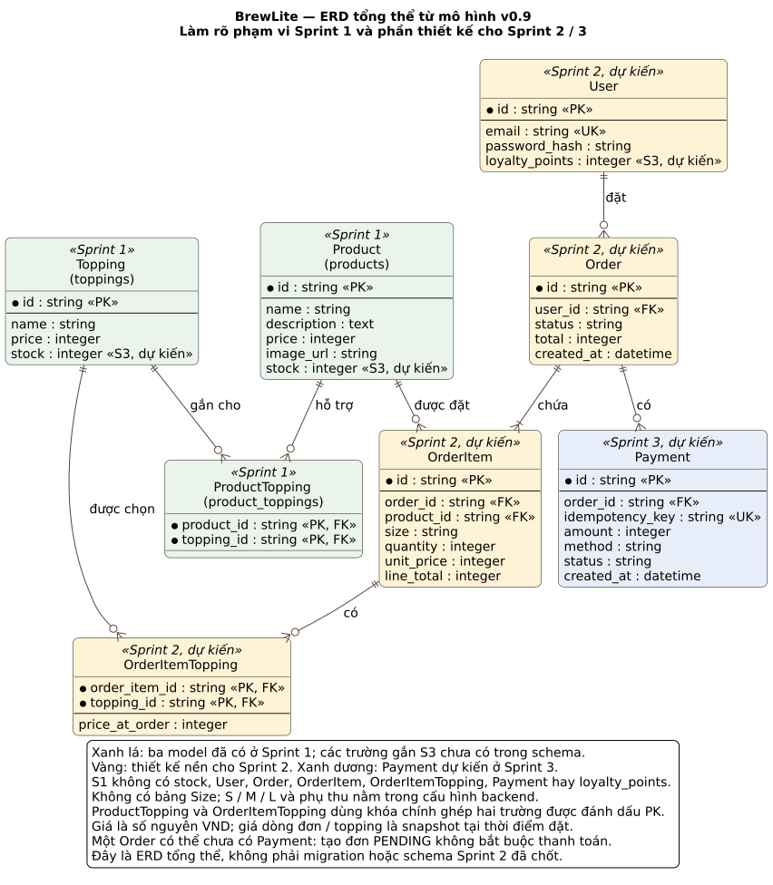

# Sơ đồ BrewLite — đối chiếu Sprint 1

Bộ sơ đồ chỉnh lý **r1, ngày 26/10/2026**, dựa trên hồ sơ
`BrewLite_Sprint1_Analysis_Design_v1.1.docx` và bốn đoạn PlantUML A tìm lại,
cung cấp ngày 26/10/2026. Bản gốc do A cung cấp được giữ trong
[`sprint1/originals/`](sprint1/originals/); đây không phải tuyên bố đã kiểm chứng
lịch sử tạo file hoặc ảnh trùng từng pixel với hình trong Word.

Bản chỉnh lý này là tài liệu để review; không tự thay thế baseline v1.1,
không xác nhận nghiệm thu Sprint 1 và không chốt thay bản thiết kế Sprint 2.
Không có thay đổi mã ứng dụng, API contract hay migration trong bộ này.

## Danh mục

| Sơ đồ | Mã nguồn | Ảnh | Phạm vi |
|---|---|---|---|
| Bối cảnh hệ thống | [PlantUML](sprint1/system-context.puml) | [SVG](sprint1/system-context.svg) | Toàn hệ thống; thanh toán Sprint 3, Barista ngoài MVP |
| Master use case | [PlantUML](sprint1/master-use-case.puml) | [SVG](sprint1/master-use-case.svg) | 13 UC, phân nhóm Sprint 1–3 |
| Activity Sprint 1 | [PlantUML](sprint1/activity-menu-detail.puml) | [SVG](sprint1/activity-menu-detail.svg) | Menu, chi tiết, tùy chọn và giá preview |
| ERD tổng thể | [PlantUML](sprint1/erd-overview.puml) | [SVG](sprint1/erd-overview.svg) | Ba model Sprint 1 và thiết kế nền cho các sprint sau |

## Các hình

### Bối cảnh hệ thống



### Master use case



### Activity Sprint 1

Sơ đồ dài; mở liên kết SVG trong danh mục để phóng to.



### ERD tổng thể



## Phạm vi đã triển khai và phạm vi dự kiến

Schema đối chiếu: [`backend/prisma/schema.prisma`](../../backend/prisma/schema.prisma)
tại mốc `b5990767892453a8eceb8435070a9a3f12dce7c4`.
Sprint 1 có `Product`, `Topping`, `ProductTopping`, ánh xạ tới `products`,
`toppings`, `product_toppings`. `imageUrl` trong Prisma ánh xạ sang `image_url`.
Hai trường của bảng liên kết tạo khóa chính ghép.

Các trường `stock`, `loyalty_points` và những entity phục vụ tài khoản,
đơn hàng, thanh toán trong ERD là phần thiết kế nền, chưa hiện diện ở schema
Sprint 1. Không có bảng `Size`; Sprint 1 dùng cấu hình size S/M/L với phụ thu
0/5.000/10.000 VND. Việc bổ sung schema Sprint 2 phải theo bản thiết kế
Sprint 2 được chốt và migration riêng, không sao chép ERD tổng thể để áp dụng ngay.

ERD này giữ mô hình v0.9 trong hồ sơ v1.1. Các quyết định kỹ thuật Sprint 2
đang thảo luận như phiên đăng nhập, sổ yêu cầu tạo đơn/idempotency và snapshot
mở rộng chưa được thêm vào đây. Chúng cần xuất hiện trong ERD Sprint 2 khi
được chốt, không được hiểu là đã triển khai hoặc bị bỏ khỏi kế hoạch.

## Ghi nhận chỉnh lý r1

| Sơ đồ | Điều chỉnh so với mã gốc A cung cấp | Lý do / ảnh hưởng |
|---|---|---|
| Context | Ghi rõ phạm vi Sprint 1, 2, 3; thanh toán Sprint 3 và Barista ngoài MVP | Tránh hiểu mọi tương tác toàn hệ thống đã được triển khai trong Sprint 1 |
| Master use case | Giữ đủ 13 UC, phân nhóm theo traceability v1.1; bỏ `UC08 include UC09` | Phụ lục A v1.1 đã quy định `POST /orders` tạo đơn `PENDING` ở Sprint 2, `POST /payments` thuộc Sprint 3; tạo đơn không bắt buộc thanh toán ngay |
| Master use case | Thêm liên kết khách hàng với UC-10; ghi điều kiện cho các quan hệ `extend` còn lại | Giữ định hướng UC-10/12/13 từ bản gốc; điều kiện và extension point chi tiết sẽ được đối chiếu khi thiết kế Sprint 3. Đây không phải sơ đồ luồng/thứ tự thực thi |
| Activity | Thể hiện thử lại menu/chi tiết, đường về Menu, kiểm tra giá trước preview và tính lại từ lựa chọn hiện tại | Làm rõ US01-AC-04 và US02-AC-03 đến US02-AC-08; không thêm AC hay chức năng ngoài Sprint 1 |
| ERD | Giữ tám entity và quan hệ tổng thể; phân biệt model Sprint 1 với entity/trường của Sprint 2/3; thêm tên bảng thực tế Sprint 1 | Khớp schema đã tích hợp; không tạo migration mới và không tự chốt schema Sprint 2 |

Trong activity, thao tác truy cập Prisma/PostgreSQL chỉ diễn ra khi yêu cầu
tới được backend. Nhánh lỗi API cũng bao gồm lỗi kết nối nên frontend có thể
không nhận được HTTP response. Các điểm dừng kết thúc lần xét luồng; UI vẫn
giữ liên kết về Menu/nút thử lại theo trạng thái được mô tả. Không thêm nút
giỏ hàng, tạo đơn hay thanh toán vào Sprint 1.

Khi đưa thay đổi vào tài liệu baseline tiếp theo, ghi lại các điều chỉnh này
trong Decision Log và tăng phiên bản tài liệu. Không sửa âm thầm bản v1.1.

## Render lại ảnh khi thay đổi mã

Ảnh SVG đã được cung cấp sẵn, không cần cài công cụ để xem trên GitHub.
Các ảnh hiện tại được render từ chính bốn file `.puml` chỉnh lý bằng
**PlantUML 1.2025.2**, Java, font DejaVu Sans và layout Smetana.
Không dùng server render bên ngoài. Có thể tái tạo từ thư mục gốc repo:

```powershell
java -Djava.awt.headless=true -jar "DUONG_DAN_DEN_PLANTUML_JAR" -charset UTF-8 -tsvg "docs/diagrams/sprint1/*.puml"
```

Chỉ dẫn tới bốn file trong `sprint1/`, không render lại `originals/` để thay
ảnh chỉnh lý. Khi sửa mã, commit cả `.puml` và `.svg` tương ứng sau khi xem ảnh.
Khi sang sprint sau, giữ bộ Sprint 1 làm mốc và tạo sơ đồ tương ứng trong
thư mục sprint sau nếu nghiệp vụ/schema thay đổi.

## Liên kết tài liệu hiện có

- [API contract](../API_CONTRACT.md)
- [Checklist Sprint 1](../SPRINT1_CHECKLIST.md)
- [Báo cáo kiểm thử của D](../Testing/MEMBER_D_TEST_RESULTS.md)
- [Bàn giao database Sprint 1](../SPRINT1_E_DATABASE.md)
