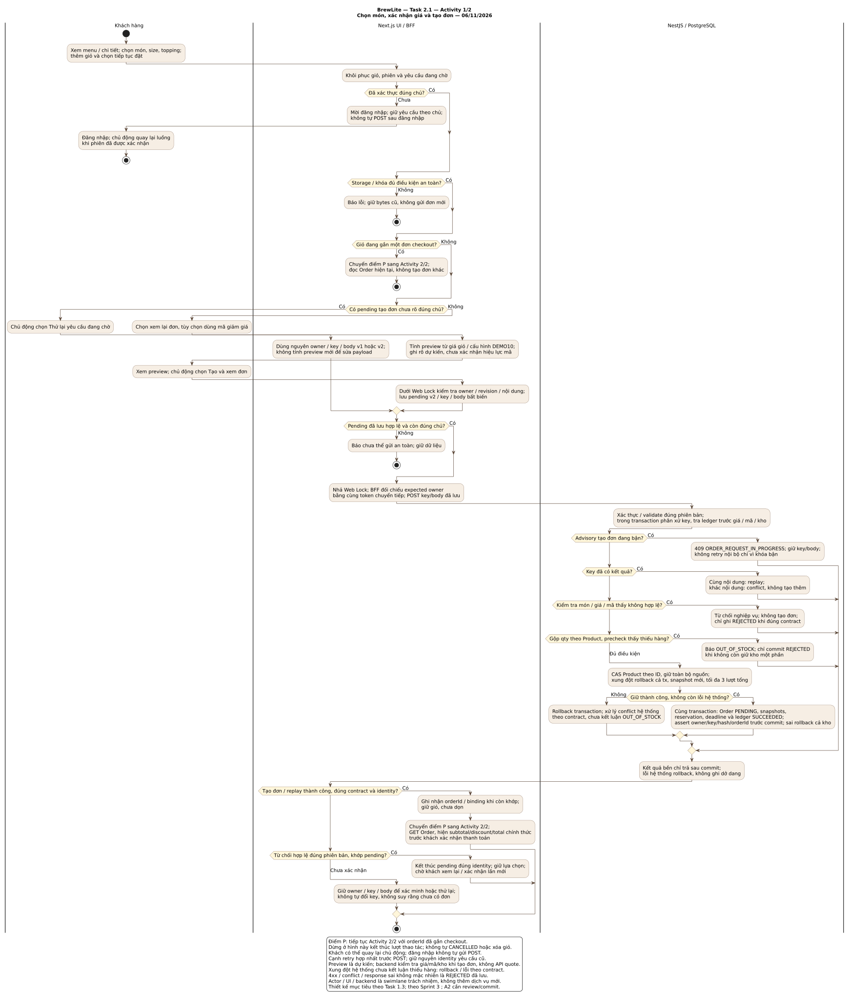
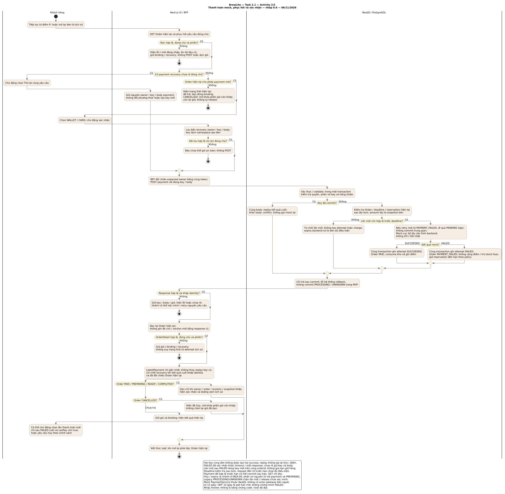

# BrewLite Assignment 2 — Task 2.1: Activity checkout

**Quy ước:** M-01…M-05 và A-/E- là nhánh của [UC-09](../requirements/use-case-checkout.md); các mã C- thuộc [ngữ cảnh hỗ trợ](../requirements/checkout-supporting-flows.md). Tạo đơn và hủy/expiry không là đặc tả trọng tâm thứ hai.

| Thông tin | Giá trị |
|---|---|
| Ngày cập nhật | 10/11/2026 |
| Trạng thái | Đã có trên main qua PR #29; đang hiệu đính truy vết, chưa xác nhận code/test đạt |
| Căn cứ | [Bối cảnh và phạm vi](../requirements/context-and-scope.md), [SRS](../requirements/srs.md), [Task 1.3 — UC-09](../requirements/use-case-checkout.md) |
| UC trọng tâm Task 1.3 | Chỉ UC-09 Thanh toán không tiền mặt; activity vẫn bao quát UC-08 và toàn luồng end-to-end |
| Nguồn | [activity-checkout.puml](activity-checkout.puml), chứa hai khối sơ đồ nối tiếp |
| Hình kết xuất | [Tạo đơn](activity-checkout-order.svg) · [Thanh toán](activity-checkout-payment.svg) |

## Nền sử dụng và trạng thái

Tài liệu gốc được đưa lên repo qua PR #29 đã merge; lượt cập nhật này đồng bộ câu chữ và truy vết với Task 1 ở PR #42. Thiết kế kế thừa **Sprint 3** và nền Sprint 2 main `a1a0e4ae92de681deac538685e24407b3190866b`. PO đã chọn phương án Sprint 3 làm cơ sở thực hiện; chưa thay xác nhận review của từng thành viên hoặc minh chứng kiểm thử Assignment 2. Giữ nguyên 17 FR, 12 NFR, 59 AC, 14 mã UC và 10 lớp domain.

Chi tiết kế thừa nằm tại [contract dùng chung](../assignment2/CONTRACTS.md). Hạn cả hai assignment là **15/11/2026 theo thông tin PO cung cấp**; giờ nộp LMS cần PO xác nhận. Xem [kế hoạch giao nhóm](../assignment2/TEAM_PLAN.md); lịch là mục tiêu đề xuất, chưa ghi nhận các bạn đã nhận việc.

## 1. Cách đọc và ranh giới

Một luồng checkout được chia thành **hai hình** để đọc được ở kích thước bình thường. Hình 1 đi từ menu/chi tiết và giỏ tới Order PENDING; **điểm P** chuyển sang đầu hình 2 để đọc Order, thanh toán và xem xác nhận. Hình 2 cũng có thể bắt đầu khi khách mở lại đơn từ lịch sử. Hai hình không tạo hai use case mới hoặc thay master 14 mã UC.

Ba swimlane phân trách nhiệm: Khách hàng thực hiện lựa chọn/xác nhận; Next.js UI/BFF lưu/hiển thị/gửi yêu cầu; NestJS/PostgreSQL kiểm tra, phân xử và commit nghiệp vụ. NestJS/PostgreSQL dùng chung lane để giữ sơ đồ hoạt động gọn; sequence ở Task 2.2 sẽ tách lời gọi API/DB/mock. Mock PaymentService vẫn nằm trong NestJS.

Các diamond là điều kiện rẽ nhánh; `endif` hợp nhất các nhánh còn tiếp tục. Nhánh kết thúc sớm kết thúc **lượt thao tác**, không tự xóa pending, hủy Order, release kho hoặc logout. Quay lại là hành động chủ động của khách, bắt đầu lại với phiên/chủ và trạng thái hiện tại; không có vòng tự POST. Activity đầu dùng giỏ hợp lệ không rỗng; lỗi chọn món/giỏ rỗng được xử lý trước xác nhận theo FR-02/03.

## 2. Hình 1 — Giá dự kiến, xác nhận và tạo đơn

Hai đường tạo mới và thử lại cùng pending hợp nhất trước POST. **Tạo mới** hiển thị preview dự kiến rồi khách chọn Tạo và xem đơn; **retry chưa rõ** giữ nguyên owner/key/body v1/v2, không tính preview lại để sửa nội dung cũ. Không có API báo giá riêng. Việc lưu pending và kiểm tra lại revision/chủ diễn ra trước HTTP; Web Lock được nhả trước khi chờ network.

Backend tra kết quả đã lưu trước tính lại giá/mã/kho. Với request mới, giá thay đổi, mã không hợp lệ hoặc thiếu hàng dẫn đến từ chối phù hợp. Lỗi optimistic version/hệ thống không tự bị diễn đạt là chắc chắn thiếu hàng: rollback và xử lý theo contract. Không commit giữ kho từng phần; nhánh REJECTED có ledger chỉ commit khi đã bảo đảm không còn tác động dở dang. Precheck toàn bộ Product trước stock write; chỉ ghi REJECTED khi chưa ghi kho. Bận advisory tạo đơn trả 409 ORDER_REQUEST_IN_PROGRESS, giữ identity; không đưa lỗi bận khóa vào retry kho. Giữ assertSucceededRequest đối chiếu Order/ledger trước commit. CAS conflict rollback cả transaction và retry snapshot mới, tối đa ba lượt tổng; không dùng savepoint hoặc retry lồng.

Tạo Order, snapshot, reservation, deadline và ledger thành công cùng transaction. UI nhận đúng kết quả thì gắn đơn với giỏ, **chưa dọn giỏ tại PENDING**; GET Order hiển thị tổng chính thức trước xác nhận thanh toán. Timeout/5xx/body sai/conflict không tự chứng minh chưa có đơn hoặc cho phép đổi key. Nhánh lỗi auth/DTO trước transaction chưa mặc nhiên có ledger REJECTED. Giữ classifier v1: VALIDATION_ERROR hợp lệ theo contract nền có thể kết thúc pending để sửa; lỗi không nhận diện được vẫn UNKNOWN, không giả có ledger. V2 dùng schema riêng đã định nghĩa; xem E-01 của UC-09 và C-E03 của ngữ cảnh hỗ trợ.

## 3. Hình 2 — Thanh toán, phục hồi và xác nhận

Đầu hình luôn đọc Order hiện tại đúng chủ. Có recovery chưa rõ thì khách chủ động thử lại cùng key/body, kể cả Order hiện tại không còn cho **lần mới**; backend vẫn phải kiểm tra quyền và identity. Không có recovery thì lần mới cần trạng thái/policy/reservation hợp lệ và chưa đến hạn tại điểm kiểm tra sau lấy lock Order.

Mock SUCCEEDED/FAILED được phân nhánh rõ rồi hợp nhất trước commit. SUCCEEDED commit attempt cuối, PAID, consume kho và điểm nguyên tử. FAILED commit attempt cuối/PAYMENT_FAILED, không trừ stock thực hoặc cộng điểm; giữ reservation đến hạn. Lỗi DB/crash trước commit rollback, không lưu FAILED để che lỗi hệ thống. Không giữ transaction qua lúc khách xem/chọn phương thức, không gọi I/O ngoài trong transaction mock.

Mất response sau commit phục hồi cùng key, không gọi mock hoặc áp kho/điểm lại. UI đọc lại Order hiện tại trước khi dọn giỏ; attempt SUCCEEDED lịch sử không kéo Order CANCELLED về PAID. Dọn chỉ khi owner/order/revision/snapshot còn khớp và Order hiện tại xác nhận đã trả; CANCELLED mở khóa phần còn khớp, không tự chèn lại giỏ đã dọn. GET lỗi/đổi chủ giữ binding/recovery, không quyết định từ trạng thái cũ.

Kết quả FAILED cuối + còn canPay mới cho khách xác nhận payment key mới trên cùng orderId; không tạo lại Order hoặc gia hạn giữ hàng. Timeout là **chưa rõ ở client**, không thêm Order.status UNKNOWN hoặc attempt PROCESSING/UNKNOWN mới. Dữ liệu legacy chưa rõ được chặn và chuyển tiếp theo kế hoạch review.

## 4. Đối chiếu yêu cầu đề và đặc tả

| Điểm cần có | Vị trí trên hình / cách xử lý | Đặc tả UC-09 / ngữ cảnh hỗ trợ | FR và tiêu chí SRS chính |
|---|---|---|---|
| Bắt đầu/kết thúc, hành động người dùng/hệ thống | Cả hai hình có start/stop và ba swimlane; điểm P nối cùng Order | C-01…C-06 (ngữ cảnh) và M-01…M-05 (UC-09) | FR-03, FR-07, FR-09, FR-11 |
| Decision/merge thành công và thất bại | Rẽ nhánh ở preview, ledger, hàng, mock; nhánh còn tiếp tục hợp nhất trước POST/commit/đọc Order | C-02…C-06 và M-02…M-05, C-A02/C-A03/C-A04/C-A07 và A-05/A-06/A-07 | AC-FR-07-1, AC-FR-07-2, AC-FR-09-1 |
| Chưa đăng nhập | Hình 1 kiểm tra chủ/phiên; mời login và chờ hành động chủ động, không auto POST | A-01 | AC-FR-05-2 |
| Hết hàng | Hình 1: kiểm tra tồn Product; Topping chỉ cấu hình/giá; OUT_OF_STOCK, không commit giữ một phần | C-A04, E-05 | AC-FR-14-1, AC-FR-14-2 |
| Thanh toán thất bại | Hình 2: nhánh FAILED khác mất response; Order PAYMENT_FAILED, chưa cộng điểm/trừ stock thực | A-05/A-06 | AC-FR-09-1, AC-FR-10-2 |
| Tạo đơn trùng hoặc mất response | Hai đường retry/tạo mới; ledger replay/conflict và giữ identity | C-A07, C-E03 | AC-FR-08-1, AC-FR-08-2 |
| Payment trùng hoặc chưa rõ | Recovery trước canPay lần mới; replay trước mock và GET Order hiện tại | A-07, E-04 | AC-FR-10-1, AC-FR-10-2 |
| Quyền/chủ, phản hồi cũ và dọn giỏ | Kiểm tra đầu/ cuối hình; không dọn theo attempt lịch sử | A-10, E-01/E-06 | AC-FR-03-3, AC-FR-11-2, AC-NFR-03-1 |
| Transaction, optimistic locking | Hình 1 giữ kho có version; hình 2 tác động nguyên tử, rollback khi lỗi | C-05/C-X02, M-04/E-05 | AC-NFR-04-1, AC-NFR-04-2 |

## 5. Các nhánh được tham chiếu thay vì vẽ lại toàn bộ

Đề Task 2.1 yêu cầu các chức năng chính của luồng end-to-end; không bắt buộc mỗi nhánh phụ có một hình riêng. Bản này tham chiếu chi tiết sau trong UC-09 hoặc ngữ cảnh hỗ trợ để tránh lặp nhiều sơ đồ:

| Nhánh | Cách liên kết với activity |
|---|---|
| Hủy PENDING/PAYMENT_FAILED hoặc PAID trước PREPARING — C-A08 | Khách chọn hủy từ đơn hiện tại; backend phân xử cùng Order, release trước trả hoặc hoàn mock/kho/điểm nguyên tử sau PAID. Sau đó đọc lại và xử lý CANCELLED như hình 2; hủy lặp không bù trừ thêm |
| Hết hạn — C-X01; A-09 là nhánh UC-09 khi quá hạn thanh toán | Hình 2 chặn payment mới sau deadline. Task expiry/catch-up backend xử lý đơn chưa trả đủ điều kiện độc lập browser; GET chỉ đọc. Không release dữ liệu legacy chưa xác minh |
| Storage/khóa — E-02 | Hình 1 và lúc lưu recovery hình 2 dừng trước POST nếu chưa lưu an toàn; giữ bytes hiện có |
| Auth/DTO — E-01 | Backend luôn xác thực/validate trước mutation; yêu cầu bị từ chối không chạy nhánh ghi đơn/mock. Lỗi phiên do DB/mạng không tự thành logout |
| Rollout/legacy — E-07 | Retry v1/v2 giữ nguyên body; dữ liệu thiếu policy/reservation hoặc attempt cũ chưa rõ chặn lần mới/release tự động, theo O-04 |

Các BR trong SRS vẫn chờ review. Thiết kế quy định startup catch-up/tick 60 giây/batch 50 và CLI pha chế có cờ bật nội bộ; O-03 yêu cầu kiểm chứng độ trễ và quyền, không coi cấu hình tick là SLA giải phóng kho. NFR UI 15 giây/BFF 10 giây là giới hạn chờ, không là thời điểm kết luận nghiệp vụ thất bại.

## 6. Kiểm tra tài liệu và bước tiếp theo

- [x] Có nguồn PlantUML và hai SVG đúng hai khối trong nguồn; đã kết xuất và xem hình.
- [x] Có ba swimlane, điểm đầu/cuối, decision/merge và ba trường hợp bắt buộc của Task 2.1.
- [x] Có liên kết bước/nhánh Task 1.3, FR và AC; không thêm mã UC hoặc chức năng ngoài phạm vi.
- [ ] Nhóm review BR/điểm mở, đối chiếu code/schema và kiểm chứng bằng test khi hiện thực.
- [x] Tài liệu Task 1 và activity gốc đã được merge qua PR #29; hiệu đính Task 1 ở PR #42 và lượt đồng bộ này cần được review riêng.
- [x] Có [Task 2.2 sequence](sequence-checkout.md) và [Task 2.3 class](class-domain.md) đã được đưa vào main qua PR #29.
- [ ] Nhóm review/chốt đủ Task 2; hai hình activity riêng lẻ chưa tự hoàn thành toàn bộ Task 2.

Kiểm tra tài liệu chỉ xác nhận nội dung, nguồn/hình và tham chiếu tài liệu, không xác nhận các AC đã chạy đạt. Kế thừa luồng activity Sprint 3 hiện hành; không sửa hồ sơ Sprint 2, migration hoặc code.
