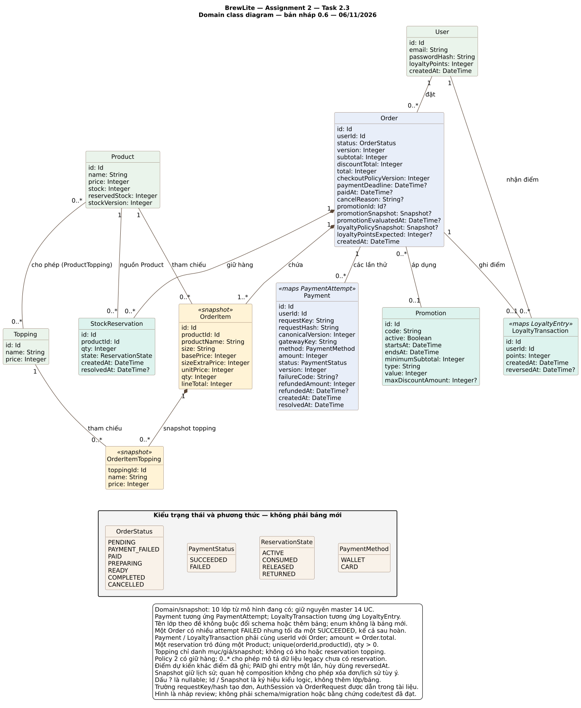

# BrewLite Assignment 2 — Task 2.3: Domain class diagram

**Quy ước:** M-01…M-05 và A-/E- là nhánh của [UC-09](../requirements/use-case-checkout.md); các mã C- thuộc [ngữ cảnh hỗ trợ](../requirements/checkout-supporting-flows.md). Tạo đơn và hủy/expiry không là đặc tả trọng tâm thứ hai.

| Thông tin | Giá trị |
|---|---|
| Ngày cập nhật | 10/11/2026 |
| Trạng thái | Đã có trên main qua PR #29; chưa là schema/migration hoặc xác nhận code/test đạt |
| Căn cứ | [SRS](../requirements/srs.md), [Task 1.3](../requirements/use-case-checkout.md), [activity](activity-checkout.md), [sequence](sequence-checkout.md) |
| Đối chiếu dữ liệu | ERD Sprint 3 hiện hành và `docs/sprint3/DESIGN.md`, ngày 06/11/2026; kế thừa Sprint 2 v0.6 |
| Nguồn và hình | [class-domain.puml](class-domain.puml) · [class-domain.svg](class-domain.svg) |

## Nền sử dụng và trạng thái

Tài liệu gốc được đưa lên repo qua PR #29 đã merge; lượt cập nhật này đồng bộ câu chữ và truy vết với Task 1 ở PR #42. Thiết kế kế thừa **Sprint 3** và nền Sprint 2 main `a1a0e4ae92de681deac538685e24407b3190866b`. PO đã chọn phương án Sprint 3 làm cơ sở thực hiện; chưa thay xác nhận review của từng thành viên hoặc minh chứng kiểm thử Assignment 2. Giữ nguyên 17 FR, 12 NFR, 59 AC, 14 mã UC và 10 lớp domain.

Chi tiết kế thừa nằm tại [contract dùng chung](../assignment2/CONTRACTS.md). Hạn cả hai assignment là **15/11/2026 theo thông tin PO cung cấp**; giờ nộp LMS cần PO xác nhận. Xem [kế hoạch giao nhóm](../assignment2/TEAM_PLAN.md); lịch là mục tiêu đề xuất, chưa ghi nhận các bạn đã nhận việc.

## 1. Mục tiêu và mức mô hình

Theo Task 2.3, sơ đồ thể hiện các lớp domain tối thiểu User, Product, Order, OrderItem, Payment, Promotion và LoyaltyTransaction; có thuộc tính chính, quan hệ, multiplicity và enum trạng thái. Ba lớp bổ trợ Topping, OrderItemTopping và StockReservation đều lấy từ mô hình đã có để mô tả tùy chọn/snapshot/kho chính xác.

**Tổng là 10 lớp domain/snapshot, không phải 10 bảng bổ sung.** Class diagram mô tả khái niệm và liên hệ nghiệp vụ; ERD mô tả dữ liệu cần lưu. Sơ đồ không đổi master 14 UC, không thêm chức năng hoặc quyết định thêm bảng. Đây là góc nhìn domain, không phải sơ đồ controller/service/repository, màn hình hoặc toàn bộ schema Prisma.

`Id`, `Snapshot` và `DateTime` là ký hiệu kiểu logic; `?` nghĩa có thể null. Chúng không tạo lớp hoặc bảng mới trên hình. `Integer` dùng cho số nguyên; tiền là VND nguyên theo SRS và vẫn phải kiểm tra miền hợp lệ khi hiện thực. Sơ đồ không quyết định UUID hay kiểu cột vật lý chỉ từ tên `Id`.

Màu nhóm trách nhiệm, không chỉ Sprint hay trạng thái đã hoàn thành. Không vẽ phương thức vì đề yêu cầu mô hình domain/thuộc tính/quan hệ; guard, điều phối transaction và adapter đã được mô tả ở sequence, sẽ được tổ chức module trong Task 3.

## 2. Sơ đồ

## 3. Ánh xạ với mô hình dữ liệu hiện có

| Lớp trên hình | Model ERD thiết kế hiện tại | Trách nhiệm / ý nghĩa |
|---|---|---|
| User | User | Tài khoản, chủ đơn và số dư điểm |
| Product | Product | Danh mục đồ uống, giá hiện tại, stock/reservedStock/stockVersion |
| Topping | Topping | Danh mục topping, giá và cấu hình được phép; không có stock/reservedStock/stockVersion |
| Order | Order | Tổng/snapshot chính sách, trạng thái/hạn, version và lịch sử đơn |
| OrderItem | OrderItem | Dòng món với snapshot tên/size/giá/số lượng |
| OrderItemTopping | OrderItemTopping | Snapshot tên/giá topping của một dòng; model hiện có dùng định danh ghép orderItemId/toppingId |
| Payment | PaymentAttempt | Một lần thử thanh toán; chính lớp Payment theo yêu cầu đề, không thêm Payment song song với PaymentAttempt |
| Promotion | Promotion | Cấu hình mã ưu đãi hiện tại; Order giữ snapshot áp dụng lịch sử |
| LoyaltyTransaction | LoyaltyEntry | Một bản ghi điểm gốc của đơn; reversedAt đánh dấu thu hồi, không thêm bảng LoyaltyTransaction song song |
| StockReservation | StockReservation | Giữ/consume/release/return kho theo đơn và Product |

Tên **Payment** và **LoyaltyTransaction** dùng đúng thuật ngữ đề bài. Mapping không bắt buộc rename model, migration hoặc API. Tên `LoyaltyEntry` xuất hiện trong sequence là cùng khái niệm với `LoyaltyTransaction` trên hình; `paymentId` tương ứng id của PaymentAttempt. Trong phương án hiện tại Payment không phải một “lần trả tổng hợp” chứa nhiều attempt khác bên dưới: mỗi instance chính là một attempt.

Các model dữ liệu sau vẫn tồn tại trong phạm vi thiết kế nhưng không cần thêm thành lớp domain trên hình:

| Model không vẽ riêng | Cách thể hiện / lý do |
|---|---|
| ProductTopping | Quan hệ nhiều–nhiều Product–Topping biểu diễn danh sách cấu hình được phép; bảng liên kết đã có, không tạo lại |
| AuthSession | Chi tiết phiên/thu hồi được giữ trong ERD/SRS và guard ở sequence; ownership của Order dùng User, không gắn với một session có thể hết hạn |
| OrderRequest | Ledger idempotency tạo đơn; sequence vẫn tra trước giá/mã/kho. Không bỏ model vì nó không có trong class diagram mức domain |

Order.requestKey/requestHash và một số trường lưu vết như Payment.updatedAt không được lặp hết trên hình để giữ gọn; vẫn giữ theo ERD/contract. Các FK orderId/orderItemId thể hiện qua association/composition; chúng không bị xóa khỏi schema. PasswordHash trên User là dữ liệu nội bộ, không là DTO được phép trả cho browser.

## 4. Quan hệ và multiplicity

Đọc số ghi cạnh **một đầu** là số instance ở đầu đó tương ứng với một instance ở đầu đối diện.

| Quan hệ | Multiplicity và quy tắc |
|---|---|
| User–Order | Một User có 0..* Order; mỗi Order có đúng 1 User |
| Order–OrderItem | Một Order chứa 1..* dòng; mỗi dòng thuộc đúng 1 Order. Hình dùng composition cho phần thuộc đơn |
| Product–OrderItem | Một Product được tham chiếu bởi 0..* dòng lịch sử; mỗi dòng tham chiếu đúng 1 Product |
| OrderItem–OrderItemTopping | Một dòng có 0..* snapshot topping; mỗi snapshot thuộc đúng 1 dòng |
| Topping–OrderItemTopping | Một Topping được tham chiếu bởi 0..* snapshot; mỗi snapshot có đúng 1 Topping |
| Product–Topping | 0..* ở cả hai đầu: cấu hình được phép qua ProductTopping; không phải mọi topping tự động hợp lệ với mọi sản phẩm |
| Order–Payment | Một Order có 0..* lần thử, mỗi lần thuộc đúng 1 Order; số lần SUCCEEDED tối đa là 1, kể cả đã hoàn mock |
| Order–Promotion | Một Order dùng 0..1 Promotion; một Promotion có thể được 0..* Order tham chiếu. Khi không có mã, promotionId/snapshot/evaluatedAt null và discountTotal=0 |
| Order–LoyaltyTransaction | Một Order có 0..1 bản ghi điểm; mỗi bản ghi thuộc đúng 1 Order. Chưa trả thì chưa có; PAID theo policy mới ghi đúng một lần, có thể points=0 |
| User–LoyaltyTransaction | Một User có 0..* bản ghi; mỗi bản ghi thuộc đúng 1 User và phải cùng chủ với Order |
| Order–StockReservation | Một Order có 0..* bản ghi giữ kho; mỗi bản ghi thuộc 1 Order. Policy mới yêu cầu đủ bản ghi cho từng nguồn; 0..* bao gồm dữ liệu legacy chưa có giữ hàng |
| StockReservation–Product | Mỗi reservation trỏ đúng 1 Product; mỗi Product có 0..* reservation. productId bắt buộc, unique(orderId,productId); không toppingId/XOR |

Multiplicity không tự diễn tả mọi ràng buộc: “tối đa một success”, duy nhất orderId/productId, cùng chủ và duy nhất theo cặp đơn/nguồn cần invariant và cơ chế hiện thực. Composition nói về sở hữu phần–toàn bộ, không tự cho phép API xóa đơn hoặc database cascade xóa lịch sử. Product/Topping/Promotion đang được tham chiếu phải giữ lịch sử theo chính sách FK/deactivate được review.

## 5. Enum và vòng đời

Các enum là kiểu giá trị, không phải bảng mới. Trạng thái Order, Payment và Reservation là ba vòng đời khác nhau; không gộp chúng thành một cột.

| Kiểu | Giá trị | Ý nghĩa / giới hạn |
|---|---|---|
| OrderStatus | PENDING, PAYMENT_FAILED, PAID, PREPARING, READY, COMPLETED, CANCELLED | COMPLETED/CANCELLED kết thúc; luồng hợp lệ theo FR-13. Timeout browser không tạo cạnh chuyển trạng thái |
| PaymentStatus | SUCCEEDED, FAILED | MVP mock chỉ commit kết quả cuối. Không thêm PENDING/PROCESSING/UNKNOWN bền; dữ liệu cũ chưa rõ cần kế hoạch chuyển tiếp |
| ReservationState | ACTIVE, CONSUMED, RELEASED, RETURNED | ACTIVE → CONSUMED khi PAID hoặc → RELEASED trước trả; CONSUMED → RETURNED khi hủy PAID hợp lệ. Không quay về ACTIVE |
| PaymentMethod | WALLET, CARD | Hai nhãn phương thức mô phỏng; không lưu thông tin thẻ thật |

Order PAYMENT_FAILED không có nghĩa mọi payment đều lỗi hệ thống; chỉ được ghi sau FAILED nghiệp vụ đã xác nhận. Hủy PAID không đổi Payment SUCCEEDED thành FAILED: giữ amount/resolvedAt gốc, thêm refundedAmount/refundedAt và tăng version; trạng thái Order là CANCELLED. Refund không cần enum REFUNDED hoặc lớp Refund mới trong phương án này.

Size dùng tập S/M/L theo dữ liệu danh mục kế thừa; không thêm lớp/bảng Size. Promotion.type hiện chỉ PERCENT theo BR-05, chưa chọn FIXED. Nếu nhóm đổi phạm vi thì phải cập nhật đồng bộ, không suy ra chức năng mới từ tên kiểu.

## 6. Bất biến dữ liệu và transaction

| Nhóm | Bất biến cần bảo vệ khi hiện thực |
|---|---|
| Tiền/snapshot | OrderItem.qty nguyên dương; unitPrice và lineTotal theo cấu hình đã chốt, lineTotal=unitPrice×qty; subtotal là tổng dòng, total=subtotal−discountTotal và từ 1đ. Payment.amount=Order.total. Đọc/retry không lấy giá danh mục hiện tại để sửa snapshot |
| Policy và phiên bản | checkoutPolicyVersion độc lập schemaVersion/canonicalVersion. Order policy mới có deadline/snapshot điểm/điểm dự kiến đầy đủ; dấu ? trên hình để chứa dữ liệu legacy, không cho phép đơn mới bỏ trường bắt buộc |
| Idempotency | OrderRequest vẫn unique(userId,requestKey), v1/v2 chung namespace; PaymentAttempt có namespace/key/hash riêng. Mỗi Order có một ledger tạo thành công; assertSucceededRequest đọc lại owner/key/hash/orderId trước commit, sai phải rollback cả kho mới; replay không ghi tác động lại |
| Kho | stock≥0, 0≤reservedStock≤stock; reservedStock nhất quán với tổng ACTIVE theo nguồn. Mỗi đơn/Product chỉ có một reservation với productId bắt buộc và qty dương; không FK kho Topping. Cập nhật CAS theo stockVersion và transaction; thiếu một nguồn rollback toàn bộ |
| Chủ và điểm | Payment.userId và LoyaltyTransaction.userId cùng Order.userId; khai báo FK riêng chưa đủ chứng minh cùng chủ. loyaltyPointsExpected chưa là điểm đã nhận. Bản ghi điểm giữ points gốc; reversal đúng một lần và số dư hợp lệ |
| Lịch sử | Giữ snapshot món/topping/ưu đãi/chính sách điểm; không tính lại theo cấu hình mới, không xóa success hoặc entry gốc khi hủy |

Transaction tại sequence phải bảo vệ các lớp liên quan:

- **Tạo đơn:** ledger + Order/snapshot/policy/deadline + reservation ACTIVE và tăng reservedStock nguyên tử.
- **SUCCEEDED:** Payment kết quả cuối + PAID + ACTIVE→CONSUMED, giảm stock/reserved + LoyaltyTransaction và User balance cùng commit.
- **FAILED:** Payment FAILED + PAYMENT_FAILED, không consume kho/cộng điểm; giữ hàng đến hạn.
- **Hủy trước trả/hết hạn đủ điều kiện:** CANCELLED + ACTIVE→RELEASED, giảm reserved, không tăng stock thực.
- **Hủy PAID trước PREPARING:** metadata hoàn mock + CONSUMED→RETURNED/tăng stock + reversal điểm/balance + CANCELLED nguyên tử; không tăng reserved.

Ràng buộc liên bảng và race không được coi đã bảo vệ chỉ vì có đường nối trên hình hoặc một CHECK từng hàng. Schema/unique/FK/partial index/lock/CAS phải được nhóm review và kiểm thử PostgreSQL nhiều kết nối. Không tạo service hay bảng mới chỉ để vẽ mỗi transaction.

## 7. Truy vết với yêu cầu và các sơ đồ trước

| Lớp / nhóm | FR chính | Use case / sequence | Tiêu chí SRS tiêu biểu |
|---|---|---|---|
| Product có kho; Topping chỉ cấu hình/giá | FR-01/02/14 | UC-01…04; sequence tạo đơn | AC-FR-02-1, AC-FR-02-2, AC-FR-14-1 |
| User | FR-04/05/12/16 | UC-06, UC-07, UC-11, UC-13; guard và ownership xuyên suốt | AC-NFR-02-1, AC-NFR-03-1 |
| Order/OrderItem/OrderItemTopping | FR-07/08/11/12/13/15 | UC-08, UC-10, UC-11, UC-12; sequence tạo đơn, đọc xác nhận | AC-FR-07-1, AC-FR-08-1, AC-FR-11-2, AC-FR-13-1 |
| Payment | FR-09/10/17 | UC-09; sequence payment và hủy | AC-FR-09-1, AC-FR-10-1, AC-FR-10-2, AC-FR-17-1 |
| StockReservation | FR-14/17 | Tạo đơn/payment/hủy/expiry, C-A04/C-A08/C-X01/C-X02 | AC-FR-14-2, AC-FR-17-2, AC-NFR-04-2 |
| Promotion | FR-15 | UC-12 mở rộng UC-08; snapshot tại tạo đơn | AC-FR-15-1, AC-FR-15-2 |
| LoyaltyTransaction và User balance | FR-16 | UC-13 mở rộng UC-09; SUCCEEDED/hủy PAID | AC-FR-16-1, AC-FR-16-2 |

Đây là mapping thiết kế, chưa là ma trận code/test hoàn chỉnh. Không đánh dấu AC đã đạt từ class diagram hoặc ERD. Sơ đồ hoạt động quyết định các nhánh, sequence quyết định tương tác/transaction và class quyết định dữ liệu/quan hệ; cả ba dùng cùng trạng thái và policy.

## 8. Review và trạng thái bàn giao

- [x] Có đủ bảy lớp tối thiểu theo đề; các lớp bổ trợ đều có mapping trong ERD hiện có.
- [x] Có thuộc tính chính, association/composition, multiplicity và enum trạng thái.
- [x] Có nguồn PlantUML/SVG cùng phiên bản, đã kết xuất và xem hình.
- [x] Có mapping Payment/PaymentAttempt, LoyaltyTransaction/LoyaltyEntry, FK/lớp không vẽ và các invariant ngoài multiplicity.
- [ ] Nhóm review BR/O trong SRS, tên model/schema thực, ràng buộc, dữ liệu legacy và rollout.
- [x] Tài liệu Task 1–2 gốc đã được merge qua PR #29; hiệu đính Task 1 ở PR #42 và lượt đồng bộ này cần được review riêng.
- [ ] Hiện thực và chạy các test AC có bằng chứng; chưa được ghi đạt từ đợt soạn này.

Tài liệu **Task 2.1–2.3** đã được đưa vào main qua PR #29. Việc có tài liệu trên repo chưa tự xác nhận Task 2 đã được nghiệm thu; kết quả review và quyết định chốt được ghi trên PR. Task 3 tiếp tục đối chiếu kiến trúc/module/ADR và deployment trên cùng phạm vi; phần đóng góp frontend/BFF/PWA đã có trong [tài liệu kiến trúc](../architecture/frontend-bff-pwa.md), chưa thay kiến trúc tổng thể hoặc nghiệm thu Task 3.

Không sửa ERD Sprint 3, tài liệu Sprint 2, schema/migration hoặc code trong thao tác vẽ class. Các phương án demo/snapshot/legacy vẫn ở trạng thái được SRS ghi rõ, chưa biến thành quyết định đã được cả nhóm chấp nhận.
