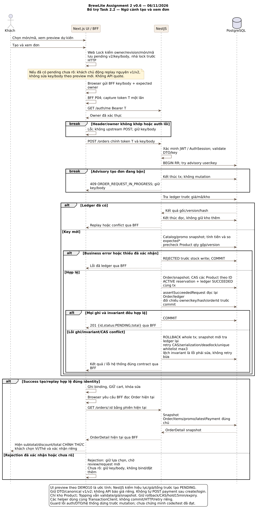
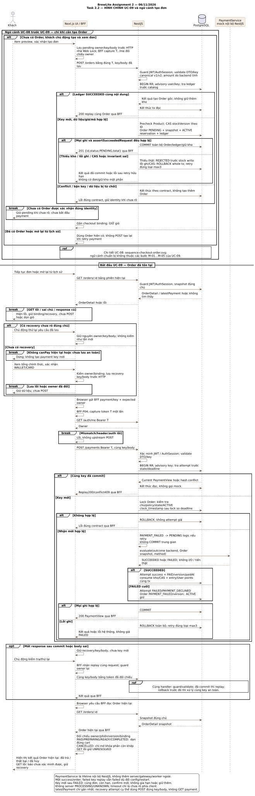
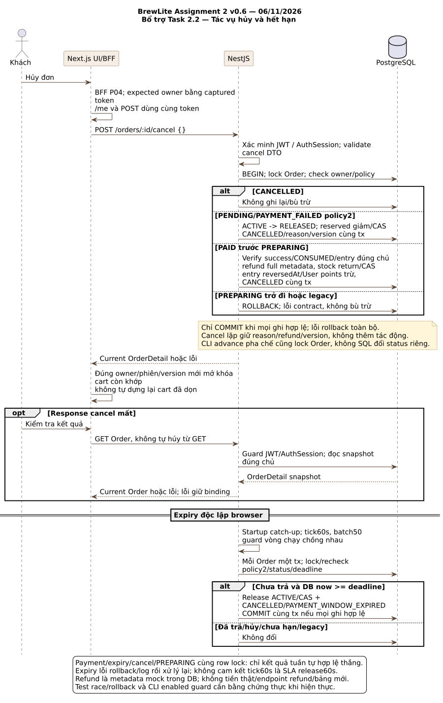

# BrewLite Assignment 2 — Task 2.2: Sequence checkout

**Quy ước:** M-01…M-05 và A-/E- là nhánh của [UC-09](../requirements/use-case-checkout.md); các mã C- thuộc [ngữ cảnh hỗ trợ](../requirements/checkout-supporting-flows.md). Tạo đơn và hủy/expiry không là đặc tả trọng tâm thứ hai.

| Thông tin | Giá trị |
|---|---|
| Ngày cập nhật | 10/11/2026 |
| Trạng thái | Đã có trên main qua PR #29; mô tả thiết kế mục tiêu, chưa xác nhận code/test đạt |
| Căn cứ | [SRS](../requirements/srs.md), [Use case Task 1.3](../requirements/use-case-checkout.md), [Activity Task 2.1](activity-checkout.md) |
| Nguồn | [sequence-checkout.puml](sequence-checkout.puml), ba khối sơ đồ của cùng luồng checkout |
| Hình | [1 — Tạo đơn](sequence-checkout-order.svg) · [2 — Thanh toán](sequence-checkout-payment.svg) · [3 — Hủy/hết hạn](sequence-checkout-cancel-expiry.svg) |

## Nền sử dụng và trạng thái

Tài liệu gốc được đưa lên repo qua PR #29 đã merge; lượt cập nhật này đồng bộ câu chữ và truy vết với Task 1 ở PR #42. Thiết kế kế thừa **Sprint 3** và nền Sprint 2 main `a1a0e4ae92de681deac538685e24407b3190866b`. PO đã chọn phương án Sprint 3 làm cơ sở thực hiện; chưa thay xác nhận review của từng thành viên hoặc minh chứng kiểm thử Assignment 2. Giữ nguyên 17 FR, 12 NFR, 59 AC, 14 mã UC và 10 lớp domain.

Chi tiết kế thừa nằm tại [contract dùng chung](../assignment2/CONTRACTS.md). Hạn cả hai assignment là **15/11/2026 theo thông tin PO cung cấp**; giờ nộp LMS cần PO xác nhận. Xem [kế hoạch giao nhóm](../assignment2/TEAM_PLAN.md); lịch là mục tiêu đề xuất, chưa ghi nhận các bạn đã nhận việc.

## 1. Phạm vi và cách đọc

**Hình 2 — sequence-checkout-payment.svg là hình chính Task 2.2**: khung đầu mô tả ngữ cảnh UC-08 tạo Order/giữ kho bằng transaction và optimistic locking; ranh giới “Bắt đầu UC-09” xác định phần thanh toán trọng tâm Task 1.3. Order đã có thì bỏ qua tạo mới; payment retry không tạo Order khác. Hình 1 chi tiết hóa ngữ cảnh UC-08 theo tham chiếu; hình 3 bổ trợ hủy/expiry tác động đến Order. Chúng không phải ba đặc tả trọng tâm. Khi review/nộp, đọc hình 2 trước, rồi xem hình 1/3 theo tham chiếu. Không gộp create và payment thành một request/transaction qua thao tác khách.

| Lifeline | Trách nhiệm và ranh giới |
|---|---|
| Customer | Xem lại/xác nhận, chọn phương thức, chủ động thử lại/hủy |
| Next.js UI / BFF | Cùng một lifeline để giữ tối đa năm cột. Phần browser lưu/hiển thị, BFF bảo vệ request và chuyển phiên server-side; browser không đọc JWT |
| NestJS API | Guard, validate, giá chính thức, điều phối transaction và quyết định nghiệp vụ |
| PostgreSQL | AuthSession, ledger/snapshot/Order, kho, payment và điểm; commit/rollback theo transaction |
| PaymentService mock nội bộ NestJS | Hàm cục bộ SUCCEEDED/FAILED không I/O/charge ngoài DB, được gọi trong transaction payment |

Hình 2 có đủ năm lifeline đề yêu cầu. Hình 1/3 không gọi mock payment nên chỉ giữ bốn lifeline liên quan; hoàn mô phỏng là metadata trong DB, không gọi cổng ngoài. Danh sách lifeline trong đề không buộc Database phải gọi PaymentService: **NestJS gọi DB và mock theo trách nhiệm**.

Mũi tên liền là lời gọi, nét đứt là response. `alt/else` chọn nhánh theo điều kiện, `opt` chỉ chạy khi điều kiện xảy ra; `break` kết thúc lượt tương tác khi điều kiện trên khung đúng. `ref` ở nhánh retry áp lại handler với cùng key/body, không tạo worker hoặc dịch vụ mới. Không có transaction giữ qua lúc khách xem lại/chọn phương thức.

Tên API/field trên hình kế thừa phương án Sprint 3, là contract thiết kế cần nhóm đối chiếu code/schema khi tích hợp; không xác nhận route đã tồn tại trên main. Sơ đồ không thêm bảng/token quote hoặc API refund riêng.

## 2. Hình 1 bổ trợ — Giá dự kiến, xác nhận và tạo đơn

- **Tạo mới:** UI hiển thị preview dự kiến từ giá giỏ/cấu hình DEMO10, chưa xác nhận hiệu lực mã; khách chọn Tạo và xem đơn. UI kiểm tra owner/revision/nội dung rồi lưu pending v2 bất biến trước HTTP; không gọi API quote.
- **Phục hồi:** pending v1/v2 chưa rõ được gửi nguyên key/body, không tính preview mới để thay giá/mã/nội dung; giỏ có thể đã rỗng theo dữ liệu cũ nhưng không dựng lại request từ giỏ mới.
- **Backend:** guard JWT + AuthSession và validate trước mutation. Trong transaction, phân xử user/key và tra ledger trước danh mục hiện tại; cùng nội dung replay, khác nội dung conflict. Với key mới mới kiểm tra món/giá/mã và giữ Product bằng optimistic version; Topping chỉ kiểm tra cấu hình/giá và lưu snapshot.
- **Tính nguyên tử:** Order/snapshot/policy/deadline/reservation/ledger SUCCEEDED cùng commit. Giữ assertSucceededRequest trước commit, đọc lại owner/key/hash/orderId và rollback toàn bộ khi lệch. Thiếu một nguồn không commit phần giữ của nguồn khác. Precheck toàn bộ Product trước stock write; REJECTED ghi trước ghi kho. CAS conflict rollback toàn bộ rồi retry snapshot mới, tối đa ba lượt tổng, không savepoint/retry lồng.
- **Kết quả UI:** thành công chỉ gắn checkout, chưa dọn giỏ; đọc Order hiện tại, hiển thị tổng chính thức rồi mở bước khách xác nhận thanh toán riêng nếu được phép. Từ chối nhận diện hợp lệ theo đúng phiên bản mới kết thúc pending đúng identity; conflict/timeout/body sai không tự cho đổi key.

Khóa UI/Web Lock được nhả trước chờ HTTP; khóa DB thuộc transaction riêng. Bận advisory tạo đơn trả 409 ORDER_REQUEST_IN_PROGRESS như Sprint 2, không retry nội bộ chỉ vì key đang bận. Nhánh retry DB (CAS/serialization/deadlock/unique đúng whitelist) là hữu hạn, giữ key/body và phải recheck ledger trong transaction mới; không query tiếp transaction đã bị PostgreSQL abort. Lỗi CAS/hệ thống chưa đủ để khẳng định OUT_OF_STOCK. Retry thành công phải trả kết quả đã commit; chỉ khi hết retry mới trả lỗi hệ thống.

## 3. Hình 2 chính Task 2.2 — UC-09 Thanh toán, idempotency và xác nhận

Đầu hình có khung ngữ cảnh UC-08: guard/validate, tra ledger, tạo Order và CAS/giữ Product trong cùng transaction, COMMIT hoặc rollback; đây không phải bước M-01 mới của UC-09. Sau ranh giới UC-09, luồng đọc Order hiện tại đúng chủ. Recovery chưa rõ đi theo nhánh chủ động thử lại cùng owner/key/body; chỉ nhánh **lần mới** mới kiểm tra canPay để cho khách chọn WALLET/CARD và lưu key mới. Backend vẫn kiểm tra quyền/identity với mọi request; replay không dùng điều kiện lần mới để che kết quả đã có.

Sau guard/validate, một transaction phân xử key và hàng Order. Cùng key/body đã commit thì replay, không gọi mock; khác body conflict. Lần mới phải hợp lệ về chủ, trạng thái, reservation/policy và deadline kiểm tra sau lấy lock. Browser không quyết định amount hoặc kết quả mock.

Nhánh `alt SUCCEEDED/FAILED` khác nhau về kết quả nghiệp vụ: success ghi PAID, consume kho và cộng điểm; FAILED ghi PAYMENT_FAILED, không trừ stock thực/cộng điểm. Mọi ghi tương ứng cùng transaction, chỉ trả kết quả sau commit; lỗi bất kỳ bước ghi nào rollback toàn bộ. Request được phân xử hợp lệ trước hạn có thể commit sau hạn; retry không gia hạn giữ hàng.

**Timeout không phải FAILED.** Mất response giữ key/body/giỏ; khách chủ động thử lại. Nếu commit trước đó thì replay; nếu rollback thì handler cùng key có thể xử lý lại an toàn. UI đọc Order hiện tại trước dọn giỏ hoặc chốt recovery; GET lỗi/đổi chủ/phản hồi cũ giữ binding và dữ liệu, không suy Order từ attempt lịch sử. Chỉ đúng owner/order/revision/snapshot và trạng thái hiện tại xác nhận đã trả mới được dọn.

FAILED cuối + còn canPay cho khách xác nhận lần mới với key mới trên cùng orderId. Hai key cùng Order không được tạo hai success. Attempt SUCCEEDED gốc giữ lịch sử kể cả sau hoàn; response payment cũ không kéo CANCELLED về PAID.

## 4. Hình 3 bổ trợ — Hủy, bù trừ và hết hạn

Khách yêu cầu hủy trên Order của mình. PENDING/PAYMENT_FAILED đủ điều kiện thì release reservation, stock thực không tăng; PAID trước PREPARING thì hoàn mock toàn phần, return kho và thu hồi đúng điểm cùng transaction với CANCELLED. CANCELLED lặp không bù trừ thêm; PREPARING trở đi từ chối. Lỗi một bước rollback tất cả, không tự chắp dữ liệu legacy thiếu.

Tick/catch-up expiry là nhánh backend độc lập lúc browser đã đóng, không phải POST tự động từ UI. Khóa và kiểm tra Order/deadline hiện tại; chưa trả/đến hạn/đủ dữ liệu thì release + CANCELLED nguyên tử. GET chỉ đọc. Hủy/expiry/payment/nhận PREPARING tranh cùng Order phải được phân xử; payment success thắng trước không có nghĩa mọi yêu cầu hủy sau đó đều bị từ chối, vì nhánh PAID trước PREPARING vẫn có thể hợp lệ.

Lifeline API tự gọi tick thể hiện tác vụ trong backend; không thêm server/worker đối soát payment. Phương án: startup catch-up/tick 60 giây/batch 50, CLI pha chế có cờ bật nội bộ; O-03 còn việc kiểm chứng độ trễ và quyền. Legacy PROCESSING/UNKNOWN không được mặc nhiên coi FAILED để release hoặc nhận lần mới.

## 5. Guard và giới hạn cần áp dụng xuyên suốt

1. BFF kiểm tra exact Origin, JSON media type và custom header trước forward POST, kể cả retry; thiếu/sai thì dừng. Lifeline gộp không có nghĩa browser giữ JWT.
2. Mỗi API bảo vệ, kể cả GET, phải xác minh JWT và AuthSession đúng sub/sid/thời hạn/chưa thu hồi; quyền tài nguyên lấy từ phiên. Các call AuthSession/validate được ghi guard gộp trên hình để tránh lặp nhiều khung; việc kiểm tra phiên vẫn truy vấn PostgreSQL theo contract, không chỉ kiểm chữ ký JWT. Không chạy mutation nếu guard hoặc validate không qua.
3. Lỗi xác minh phiên do DB/mạng là lỗi hệ thống, không mặc nhiên là phiên hết hạn/logout thành công. Dữ liệu khác chủ không được lộ; 404 theo contract đề xuất cho tài nguyên không thuộc khách.
4. UI dừng chờ network/body trong 15 giây, BFF upstream 10 giây, phân biệt 502/504 theo SRS. Đây là thời gian chờ, không kết luận giao dịch đã rollback hoặc payment FAILED.
5. Các POST/GET trong hình đều phải xử lý lỗi theo Task 1.3. Sơ đồ tập trung nhánh nghiệp vụ chính; không lặp toàn bộ exception của transport vào mỗi mũi tên. Không tự retry POST vô hạn hoặc tự gửi sau login.

## 6. Truy vết đề, use case và tiêu chí chấp nhận

| Nội dung | Hình | Đặc tả UC-09 / ngữ cảnh hỗ trợ | FR / AC trong SRS |
|---|---|---|---|
| Request/response, guard JWT/validate | 1/2/3, guard xuyên suốt | C-01…C-06 (ngữ cảnh) và M-01…M-05 (UC-09), A-01, E-01 | FR-05/07/09; AC-NFR-02-1, AC-NFR-02-2 |
| Preview dự kiến, giá chính thức và xác nhận | 1 | C-02…C-04, C-A02/C-A03 | AC-FR-07-1, AC-FR-07-2, AC-FR-15-1, AC-FR-15-2 |
| Tạo đơn và cập nhật kho trong transaction | 2 (ngữ cảnh trước UC-09), chi tiết 1 | C-05, C-A04/C-X02, E-05 | AC-FR-14-1, AC-FR-14-2, AC-NFR-04-1, AC-NFR-04-2 |
| Replay/conflict tạo đơn và rollback/retry khi lỗi ghi | 1 | C-A07, C-E03/C-X02 | AC-FR-08-1, AC-FR-08-2 |
| Alt payment thành công/thất bại | 2 | M-02…M-04, A-05/A-06 | AC-FR-09-1, AC-FR-09-2, AC-FR-16-1 |
| Idempotency payment và mất response | 2 | A-07, E-04/E-05 | AC-FR-10-1, AC-FR-10-2 |
| Thông báo cuối, giỏ và lịch sử | 1/2/3 | C-06/M-05, A-10, E-06 | AC-FR-03-3, AC-FR-11-1, AC-FR-11-2, AC-FR-12-1 |
| Hủy, hoàn mock/kho/điểm và expiry | 3 | C-A08/C-X01; A-09 của UC-09 | AC-FR-17-1, AC-FR-17-2, AC-FR-16-2 |
| Recovery/storage/legacy | 1/2/3 | E-02/C-E03/E-04/E-07 | AC-NFR-05-1, AC-NFR-05-2, AC-NFR-11-1, AC-NFR-11-2 |

Ma trận này là đối chiếu thiết kế, chưa là kết quả test. Các test đồng thời/rollback phải chạy trên PostgreSQL nhiều kết nối theo SRS; hình COMMIT/ROLLBACK không thay bằng chứng chạy thật.

## 7. Trạng thái review và bước tiếp theo

- [x] Có nguồn PlantUML và ba SVG cùng phiên bản; đã kết xuất và xem hình.
- [x] Có đủ lifeline tối thiểu trong hình payment, request/response, guard/validate, transaction, alt và replay.
- [x] Có liên kết với SRS, Task 1.3 và activity; đồng bộ chính sách, giữ master 14 UC.
- [ ] Nhóm review BR-01…06/O-01…05, lock/CAS/schema và rollout trước hiện thực.
- [x] Tài liệu gốc đã được merge qua PR #29; hiệu đính Task 1 ở PR #42 và lượt đồng bộ này cần được review riêng.
- [x] Có tài liệu [Task 2.3 — class diagram](class-domain.md) và đối chiếu mô hình dữ liệu.
- [ ] Nhóm review/chốt đủ Task 2; sequence riêng lẻ chưa tự hoàn thành toàn bộ Task 2.

Tài liệu Task 2.2 đã được đưa vào main qua PR #29; việc merge tài liệu không tự xác nhận đã nghiệm thu Task 2 hoặc chạy đạt AC. Thay đổi chỉ có tài liệu, không sửa code, migration hoặc hồ sơ Sprint 2. Nguồn sơ đồ và SVG được đối chiếu với nội dung thiết kế. Lịch sử thay đổi trên repo theo commit/PR.
