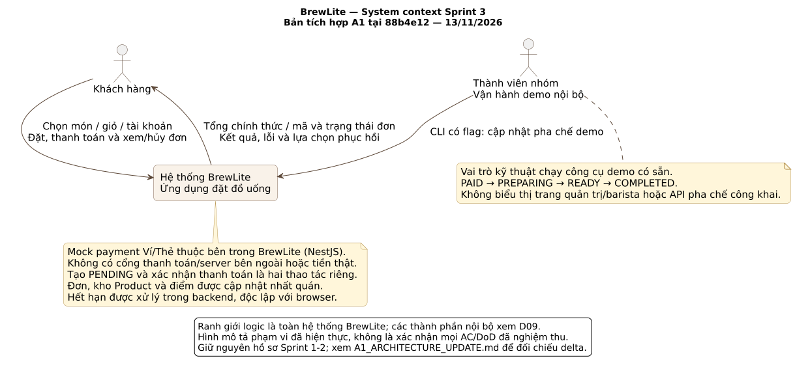
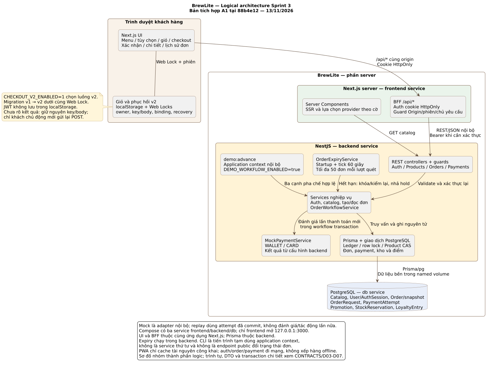

# BrewLite Sprint 3 sơ đồ triển khai

Ngày 13/11/2026: bổ sung D08/D09 đối chiếu bản tích hợp `88b4e12` sau merge
#53, #49 và #51. Bộ Sprint 3 hiện có bảy nguồn PlantUML sinh mười một SVG.
D01–D07 giữ thiết kế ngày 06/11/2026; D08/D09 ghi kiến trúc hiện thực tại mốc
đối chiếu. Hình không thay kết quả kiểm thử hoặc quyết định nghiệm thu.

Xem [thay đổi kiến trúc và nguồn đối chiếu](../../sprint3/A1_ARCHITECTURE_UPDATE.md).

| Mã | File SVG | Dùng để đọc |
|---|---|---|
| D01 | master-use-case-sprint3.svg | 14 mã UC, hai extend, mock nội bộ không actor ngoài |
| D02A | activity-sprint3-order.svg | Preview/create, tổng chính thức trước payment; BFF owner và Product CAS |
| D02B | activity-sprint3-payment.svg | Payment/recovery và giỏ tới paid-current |
| D03 | sequence-checkout-order.svg | UI/BFF/same captured token, ledger và tx tạo đơn |
| D04 | sequence-checkout-payment.svg | Atomic payment, replay, mất response |
| D05 | sequence-checkout-cancel-expiry.svg | Cancel/refund/expiry, lock và bù trừ |
| D06 | state-order-sprint3.svg | Chín cạnh nghiệp vụ theo đề 9.1 |
| D07A | erd-sprint3-core.svg | Chín model nền và field mở rộng |
| D07B | erd-sprint3-business.svg | Bốn model mới và quan hệ; không tính trùng model |
| D08 | [system-context-sprint3.svg](system-context-sprint3.svg) | Khách, toàn hệ thống và công cụ demo; mock không là hệ thống ngoài |
| D09 | [logical-architecture-sprint3.svg](logical-architecture-sprint3.svg) | UI/storage, Next.js/BFF, NestJS/workflow/mock/expiry/CLI và PostgreSQL |

## Hai góc nhìn tổng hợp tại bản tích hợp

Nguồn D08: [system-context.puml](system-context.puml).

Nguồn D09: [logical-architecture.puml](logical-architecture.puml).

Mock PaymentService là adapter nội bộ NestJS. Thành viên chạy CLI là người
vận hành demo, không thêm UC/trang quản trị/barista. Expiry ở backend; UI và
BFF thuộc cùng ứng dụng Next.js. Compose vẫn ba service, xem chi tiết ở
[hồ sơ kiến trúc](../../sprint3/A1_ARCHITECTURE_UPDATE.md).

## Ghi chú thiết kế D01–D07

Types/nullable/default/mapping/indices/checks chi tiết ở docs/sprint3/CONTRACTS.md. State Order có PAYMENT_FAILED, trạng thái attempt là FAILED; client UNKNOWN không là enum server. Năm backend endpoint; không endpoint public pha chế/refund hay worker thứ tư. Hình master là sơ đồ tổng quan kế thừa, không phải backlog mới phải code thêm.

 bỏ API quote và GET payment riêng. GET Order có latestPayment đầy đủ; recovery chính key dùng POST payment cùng key/body, không suy identity từ latestPayment. Chỉ kho Product, không reservation hoặc field stock trên Topping. Giữ13model/14mãUC/27AC, hold15phút và expiry backend. UI hiện tổng chính thức từ Order trước khách xác nhận payment.

Nền triển khai sau chốt Sprint 2: main `a1a0e4ae92de681deac538685e24407b3190866b`. Hiệu đính auth/logout và contract lỗi kế thừa đọc cùng CONTRACTS/TEAM_PLAN hiện hành. Nguồn PlantUML và chín SVG không thay đổi trong lượt đồng bộ nền này.
