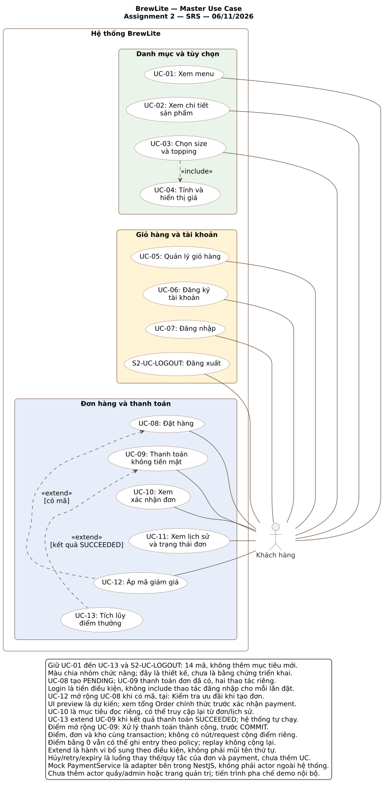

# BrewLite Assignment 2 — Đặc tả yêu cầu phần mềm rút gọn

| Thông tin | Giá trị |
|---|---|
| Tạo phẩm | Task 1.2 — Yêu cầu chức năng và phi chức năng |
| Ngày cập nhật | 06/11/2026 |
| Trạng thái | Đang review, chưa là baseline được phê duyệt |
| Nền phạm vi | [context-and-scope.md](context-and-scope.md) |
| Master use case | [Nguồn PlantUML](../diagrams/master-use-case.puml) và [hình SVG](../diagrams/master-use-case.svg) |
| Đường dẫn dự kiến | `docs/requirements/srs.md` |

## Nền sử dụng và trạng thái

Bản giao nhóm ngày 06/11/2026, đồng bộ **Sprint 3** và nền Sprint 2 main `a1a0e4ae92de681deac538685e24407b3190866b`. PO đã chọn phương án Sprint 3 làm cơ sở thực hiện; chưa thay xác nhận review của từng thành viên hoặc minh chứng kiểm thử Assignment 2. Giữ nguyên 17 FR, 12 NFR, 59 AC, 14 mã UC và 10 lớp domain.

Chi tiết kế thừa nằm tại [contract dùng chung](../assignment2/CONTRACTS.md). Hạn cả hai assignment là **15/11/2026 theo thông tin PO cung cấp**; giờ nộp LMS cần PO xác nhận. Xem [kế hoạch giao nhóm](../assignment2/TEAM_PLAN.md); lịch là mục tiêu đề xuất, chưa ghi nhận các bạn đã nhận việc.

## 1. Mục đích và cách sử dụng

BrewLite phục vụ khách chọn đồ uống, đặt đơn, thanh toán Ví/Thẻ mô phỏng và theo dõi đơn để nhận đồ tại quầy. Tài liệu này chuyển phạm vi Task 1.1 thành yêu cầu có mã và tiêu chí chấp nhận để dùng khi đặc tả use case, thiết kế và viết test.

Các yêu cầu mô tả hành vi mục tiêu, không xác nhận code hoặc test đã đạt. Mọi tiêu chí trong bản này có trạng thái **CHƯA KIỂM CHỨNG theo SRS Assignment 2**; có thể tái sử dụng bằng chứng cũ nếu đối chiếu đúng yêu cầu, phiên bản và điều kiện chạy. Tài liệu được quản lý trên nhánh PR #29; việc đưa tài liệu lên repo không tự xác nhận đã tạo ticket hoặc giao việc mới.

Task 1.3 đã có [đặc tả UC-09 Thanh toán không tiền mặt](use-case-checkout.md), kèm sơ đồ phạm vi. Activity/sequence/class thuộc Task 2; kiến trúc/ADR/deployment thuộc Task 3; CI/CD, test chạy thật và production thuộc Task 4–5. Việc có tài liệu không tự xác nhận các task đó đã hoàn thành hoặc được nghiệm thu.

### 1.1. Ký hiệu

- **FR-xx:** yêu cầu chức năng. Nhiều FR có thể phục vụ cùng use case; số FR không phải số màn hình hoặc chức năng mới.
- **NFR-xx:** yêu cầu chất lượng hoặc ràng buộc có thể kiểm chứng.
- **AC-FR-xx-y / AC-NFR-xx-y:** mã tiêu chí chấp nhận, chưa phải mã test đã chạy.
- **UC-01…UC-13 và S2-UC-LOGOUT:** giữ mã kế thừa từ Assignment 1, tổng 14 mã. Không đánh lại UC theo thứ tự FR.
- **BR-01…BR-06:** chính sách đề xuất từ Sprint 3, cần nhóm review trước khi chốt baseline. AC tham chiếu BR được đánh giá theo đúng phiên bản chính sách đã chấp nhận.

### 1.2. Ưu tiên MoSCoW

| Mức | Ý nghĩa trong bản SRS |
|---|---|
| Must | Cần có cho phạm vi MVP/đầu ra bắt buộc đang xét; không có nghĩa đã triển khai hoặc được phép bỏ qua review |
| Should | Nên có; nếu chưa làm phải ghi lý do, ảnh hưởng và quyết định khi review |
| Could | Có thể cân nhắc khi còn năng lực. Bản hiện tại chưa chọn thêm yêu cầu Could để giữ phạm vi gọn |
| Won’t | Không thực hiện trong MVP hiện tại; các mục OUT-01…OUT-08 của Task 1.1 thuộc mức này |

Ưu tiên dưới đây là đề xuất để nhóm review. Must của chức năng cốt lõi không biến mọi cấu hình demo hoặc lựa chọn triển khai trong BR thành yêu cầu do giảng viên ấn định.

## 2. Người sử dụng và ranh giới

Actor chính của master là **Khách hàng**. Khách chưa đăng nhập có thể xem menu/chi tiết và quản lý giỏ; tạo đơn, thanh toán và đọc đơn cá nhân đòi hỏi phiên hợp lệ, đúng chủ. Không vẽ actor riêng chỉ vì khách chuyển từ chưa đăng nhập sang đã đăng nhập.

Payment Service hiện là mock nội bộ NestJS, không phải actor bên ngoài. Nhân viên quầy, quản lý, giảng viên và nhóm phát triển là stakeholder theo Task 1.1; không tự thêm giao diện barista/admin vào MVP. Dù chưa có giao diện quầy, chuyển trạng thái pha chế vẫn phải có cơ chế được phép và có thể kiểm chứng; khách không được tự cập nhật các bước đó.

Frontend Next.js hỗ trợ giao diện/BFF, NestJS kiểm tra và xử lý nghiệp vụ, PostgreSQL lưu dữ liệu. Ranh giới này sẽ được thiết kế chi tiết ở Task 3; SRS không quy định thêm server/container chỉ vì sơ đồ sequence có lifeline riêng.

## 3. Danh mục yêu cầu chức năng

| Mã | Yêu cầu | MoSCoW | Phạm vi Task 1.1 | UC liên quan |
|---|---|---|---|---|
| FR-01 | Xem menu | Must | IN-01 | UC-01 |
| FR-02 | Xem chi tiết, chọn tùy chọn và giá xem trước | Must | IN-02 | UC-02, UC-03, UC-04 |
| FR-03 | Quản lý và khôi phục giỏ hàng | Must | IN-03 | UC-05 |
| FR-04 | Đăng ký tài khoản | Must | IN-04 | UC-06 |
| FR-05 | Đăng nhập và khôi phục phiên | Must | IN-04 | UC-07 |
| FR-06 | Đăng xuất đúng phạm vi phiên | Must | IN-04 | S2-UC-LOGOUT |
| FR-07 | Xác nhận giá và tạo đơn | Must | IN-05 | UC-08 |
| FR-08 | Chống tạo đơn trùng khi gửi lại | Must | IN-05 | UC-08 |
| FR-09 | Thanh toán Ví/Thẻ mô phỏng | Must | IN-06 | UC-09 |
| FR-10 | Chống xử lý thanh toán trùng và phục hồi chưa rõ | Must | IN-06 | UC-09 |
| FR-11 | Xem xác nhận đơn | Must | IN-07 | UC-10 |
| FR-12 | Xem lịch sử và trạng thái đơn của mình | Must | IN-07 | UC-11 |
| FR-13 | Bảo vệ vòng đời đơn hàng | Must | IN-08 | UC-08, UC-09, UC-11 |
| FR-14 | Kiểm soát tồn kho đồng thời | Must | IN-09 | UC-08, UC-09 |
| FR-15 | Áp mã giảm giá hợp lệ | Must | IN-10 | UC-12, UC-08 |
| FR-16 | Ghi và thu hồi điểm theo kết quả đơn | Must | IN-10 | UC-13, UC-09 |
| FR-17 | Hủy đơn và xử lý hết hạn an toàn | Must | IN-08, IN-09 | Luồng thay thế UC-08, UC-09; đọc ở UC-11 |

FR-13/14/17 là quy tắc và luồng liên quan của các mục tiêu đã có, không thêm ba oval vào master. Ưu đãi, điểm và tồn kho kế thừa phạm vi Assignment 1; giữ giới hạn MVP tại Task 1.1.

### FR-01. Xem menu

Hệ thống cung cấp danh sách đồ uống với mã, tên, ảnh và giá; khách có thể chọn món để xem chi tiết.

- **AC-FR-01-1:** Với dữ liệu mẫu có món, API trả danh sách và UI hiển thị đúng tên/ảnh/giá; chọn một món mở đúng chi tiết theo ID.
- **AC-FR-01-2:** Danh sách rỗng hiển thị empty state; khi chờ có loading; khi API lỗi có thông báo và hành động thử lại, không hiển thị lỗi như một menu rỗng hợp lệ.

### FR-02. Chi tiết và tùy chọn

Khách xem thông tin món, chọn size/topping được phép và số lượng; UI tính giá xem trước từ dữ liệu tùy chọn do backend cung cấp.

- **AC-FR-02-1:** Với món có size/topping, đổi lựa chọn làm đơn giá và thành tiền thay đổi đúng phụ thu; món không có topping vẫn chọn size và thêm giỏ được. ID không tồn tại cho kết quả không tìm thấy.
- **AC-FR-02-2:** Size/topping ngoài danh mục được phép hoặc số lượng không hợp lệ bị chặn; dữ liệu giá xem trước không được thay thế kiểm tra giá chính thức trong FR-07.

### FR-03. Giỏ hàng

Khách thêm, gộp cấu hình trùng, sửa số lượng và xóa món; giỏ và yêu cầu đang chờ được lưu/khôi phục đúng chủ. Vòng đời giỏ trong checkout theo BR-01.

- **AC-FR-03-1:** Thêm cùng sản phẩm/size/tập topping gộp số lượng; cấu hình khác tạo dòng riêng. Sửa/xóa cập nhật tổng và badge theo tổng số ly; tải lại khôi phục dữ liệu hợp lệ.
- **AC-FR-03-2:** Hai tab không làm mất thay đổi đã ghi hợp lệ; dữ liệu storage hỏng/không ghi được phải báo lỗi và chưa gửi đơn mới. Đổi tài khoản hoặc phản hồi cũ không hiển thị/xóa giỏ của chủ khác.
- **AC-FR-03-3:** Theo BR-01, tạo PENDING chưa dọn giỏ; thanh toán FAILED/chưa rõ giữ phần giỏ gắn đơn và chặn sửa. Chỉ dọn sau khi trạng thái hiện tại xác nhận đã thanh toán thành công, khớp chủ/đơn/revision/snapshot; hủy chỉ mở khóa phần còn khớp, không tự chèn lại giỏ đã dọn.

### FR-04. Đăng ký

Khách tạo tài khoản bằng email và mật khẩu hợp lệ; đăng ký thành công không tự cấp phiên đăng nhập.

- **AC-FR-04-1:** Email hợp lệ, chưa tồn tại và mật khẩu đáp ứng policy kế thừa tạo một tài khoản; response không có mật khẩu/hash. Email trùng bị từ chối rõ; UI báo đăng ký thành công và chuyển sang đăng nhập, giữ giỏ.
- **AC-FR-04-2:** Kiểm tra độc lập mốc 14/15 Unicode code point và 72/73 byte UTF-8; từ chối NUL/surrogate đơn. Không trim/cắt/normalize mật khẩu; gửi dữ liệu sai trực tiếp API cũng bị từ chối. Mức bcrypt 12 thuộc policy Sprint 2, không phải con số đề bài ấn định.

### FR-05. Đăng nhập và phiên

Thông tin đúng tạo phiên thời hạn cố định một giờ; backend xác nhận phiên khi khôi phục và khi truy cập tài nguyên bảo vệ.

- **AC-FR-05-1:** Đăng nhập đúng tạo phiên và cookie HttpOnly; JSON cho browser không có JWT. Tải lại hoặc gọi kiểm tra phiên không gia hạn expiresAt; sai thông tin không cấp phiên, không tiết lộ tài khoản có tồn tại hay không.
- **AC-FR-05-2:** API bảo vệ từ chối token thiếu/sai/hết hạn hoặc phiên đã thu hồi; lỗi DB/mạng không được diễn đạt là chắc chắn hết phiên. Đăng nhập lại không tự gửi đơn; đúng chủ mới phục hồi yêu cầu đang chờ.

### FR-06. Đăng xuất

Đăng xuất kế thừa P05 và hiệu đính A9 đã chốt trên Sprint 2: nhận diện đúng phiên bằng session binding, thu hồi với chính token được capture; không hủy đơn hoặc xóa yêu cầu chưa rõ. Expected owner của checkout không thay expected session của logout.

- **AC-FR-06-1:** Giỏ có món thì hỏi xác nhận; hủy hộp thoại giữ nguyên trạng thái. Logout gửi expected-session; BFF đối chiếu binding với token capture một lần. Sau 204 scope session/local hợp lệ, UI gọi lại /me trong ngân sách 15 giây còn lại trước cleanup: chỉ dọn theo kết quả không còn phiên được xác nhận và checkpoint phiên vẫn hợp lệ cho logout đó; nếu còn phiên sống, kể cả cùng owner khác binding, hoặc kết quả chưa rõ thì giữ dữ liệu. Luôn giữ pending/recovery theo chủ; scope local không tuyên bố đã thu hồi phiên server hoặc mọi thiết bị.
- **AC-FR-06-2:** Kiểm tra token còn hạn/hết exp/đã thu hồi, thiếu cookie, chữ ký sai, sid/sub sai, phiên không còn và lỗi DB/mạng. Chỉ đúng 401 SESSION_INVALID được BFF chuyển thành 204 local; lỗi hệ thống giữ trạng thái. Logout/me không gửi Set-Cookie xóa cookie cố định. Kiểm tra response logout cũ sau khi tab khác login cùng hoặc khác owner: không xóa cookie/giỏ của phiên mới. Ngoại lệ bỏ kiểm tra hết exp chỉ áp dụng thao tác thu hồi.

### FR-07. Xác nhận giá và tạo đơn

Khách xem giá dự kiến và chủ động chọn Tạo và xem đơn; backend xác thực, validate, tính giá/mã, đối chiếu expectedUnitPrice/expectedTotal và lưu đơn PENDING cùng snapshot. Giá trước tạo đơn chỉ là dự kiến; giá chính thức đọc từ Order đã tạo và phải hiển thị trước xác nhận thanh toán, theo BR-06.

- **AC-FR-07-1:** Yêu cầu hợp lệ, giá khớp và đủ hàng tạo một đơn PENDING của đúng chủ, có mã đơn/tổng và snapshot tên/size/topping/giá/số lượng. Không chấp nhận userId, tổng tiền hoặc trạng thái tùy ý do browser quyết định.
- **AC-FR-07-2:** Món/tùy chọn sai, thiếu hàng hoặc giá/mã thay đổi bị từ chối rõ, không tạo đơn một phần hoặc âm thầm bỏ mã/tăng tiền để đặt. Khách phải xem lại và xác nhận yêu cầu mới; tạo PENDING chưa tự gọi payment.

### FR-08. Idempotency tạo đơn

Yêu cầu tạo đơn được nhận diện bằng đúng chủ, key và nội dung bất biến; kết quả đã lưu được phát lại trước việc tính lại theo danh mục hiện tại.

- **AC-FR-08-1:** Gửi hai lần cùng chủ/key/nội dung, kể cả đảo thứ tự các dòng/topping tương đương theo canonical kế thừa, chỉ tạo một đơn; replay trả cùng mã đơn/giá lịch sử. Kết quả từ chối đã lưu cũng được replay đúng nội dung và ánh xạ lỗi về dòng của request hiện tại.
- **AC-FR-08-2:** Cùng key khác nội dung trả conflict; mất phản hồi/5xx không tự đổi key/body. Bận advisory tạo đơn trả 409 ORDER_REQUEST_IN_PROGRESS, giữ identity để khách chủ động retry. Giữ assertSucceededRequest trước commit: đọc lại owner/key/hash/orderId giữa Order và ledger; sai phải rollback toàn bộ Order/snapshot/ledger và giữ kho mới. Kiểm thử hai request đồng thời, lỗi ghi và lệch các giá trị này không để kết quả dở dang.

### FR-09. Thanh toán mô phỏng

Khách đã xác thực chọn WALLET hoặc CARD cho đơn được phép thanh toán. Số tiền lấy từ snapshot đơn; cấu hình demo ở backend theo BR-03.

- **AC-FR-09-1:** Demo được thành công và thất bại xác nhận cho cả WALLET/CARD. Thành công ghi PAID và tác động kho/điểm tương ứng; thất bại ghi PAYMENT_FAILED, không trừ kho thực hoặc cộng điểm, giữ giỏ và giữ hàng trong hạn theo policy.
- **AC-FR-09-2:** Khác chủ, đơn đã trả/hủy hoặc không còn đủ điều kiện bị từ chối trước lần mới. Browser không gửi amount, kết quả mong muốn hoặc dữ liệu thẻ thật; lỗi DB không được giả thành thanh toán bị từ chối.

### FR-10. Idempotency thanh toán và kết quả chưa rõ

Mỗi yêu cầu thanh toán có key riêng, tách namespace tạo đơn. Gửi lại cùng yêu cầu không làm phát sinh tác động thanh toán, kho hoặc điểm thêm lần nữa.

- **AC-FR-10-1:** Mất response sau commit rồi gửi lại cùng chủ/key/body nhận cùng paymentId và kết quả đã ghi, kể cả đổi cấu hình mock. Cùng key khác orderId hoặc method trả conflict; hai key cùng đơn không được tạo hai success. Nếu đã có attempt mới hơn, recovery key cũ vẫn nhận đúng paymentId/kết quả của key cũ; latestPayment không thay thế lookup này.
- **AC-FR-10-2:** Crash/lỗi trước commit không để kết quả cuối hoặc tác động kho/điểm nửa chừng. UI timeout giữ key/body và hiển thị chưa rõ, không tự gán PAYMENT_FAILED. Chỉ sau FAILED đã xác nhận và khách chủ động xác nhận lần mới mới tạo payment key mới nếu đơn còn được phép thanh toán.

### FR-11. Xem xác nhận

Khách xem mã, số tiền và trạng thái hiện tại của đơn; có thể mở lại từ thông tin đơn/lịch sử, không chỉ trong lần thanh toán.

- **AC-FR-11-1:** Sau thanh toán thành công, khách đọc được đơn hiện tại đúng chủ và thấy mã đơn/tổng/trạng thái; mở lại cùng đơn hiển thị dữ liệu hiện tại từ server. GET Order có latestPayment đầy đủ hoặc null; không cần API đọc payment riêng.
- **AC-FR-11-2:** Không dùng riêng response tạo đơn hoặc attempt lịch sử để ghi đè trạng thái mới hơn. GET lỗi hoặc đổi chủ không dọn/mở khóa giỏ theo dữ liệu cũ; request sai chủ không lộ chi tiết đơn.

### FR-12. Lịch sử và trạng thái cá nhân

Khách xem danh sách đơn của mình, mở chi tiết và tiếp tục hành động còn được phép trên đơn đang chờ.

- **AC-FR-12-1:** Tài khoản A chỉ thấy đơn của A, mới nhất trước; tài khoản chưa có đơn thấy empty state. Đổi sang B hoặc đoán ID đơn của B không đọc được dữ liệu của A/B trái quyền.
- **AC-FR-12-2:** Từ lịch sử có thể mở đúng đơn và biết hành động đang được phép. MVP trả danh sách không phân trang, sắp createdAt giảm dần rồi id giảm dần; không thêm cursor, filter, totalCount hoặc polling vào phạm vi hiện tại.

### FR-13. State machine đơn

Backend chỉ cho phép chuyển trạng thái theo sự kiện và điều kiện hợp lệ; COMPLETED và CANCELLED là trạng thái kết thúc.

FR-13 và state machine chín cạnh thuộc phạm vi bắt buộc. Ba bước PAID → PREPARING → READY → COMPLETED được thực hiện qua CLI nội bộ gọi cùng service và assertTransition, chỉ bật khi DEMO_WORKFLOW_ENABLED=true; CLI phục vụ vận hành demo/test, không cấp quyền cho khách tự đổi trạng thái và không cập nhật status trực tiếp bằng SQL. D16 của baseline Sprint 1 chỉ đặt Barista UI/giao diện quầy đầy đủ ngoài MVP; không loại chức năng quản lý trạng thái khỏi phạm vi. Master giữ 14 UC; FR-13 được truy vết qua UC-08, UC-09, UC-11 và S3-ORD-01/02, không thêm actor/UC quầy trong lần hiệu đính này. Cơ chế này cần được hiện thực và kiểm thử; tài liệu chưa xác nhận đã chạy đạt.

- **AC-FR-13-1:** Kiểm thử luồng PENDING → PAID → PREPARING → READY → COMPLETED; thất bại thanh toán sang PAYMENT_FAILED. Lần mới hợp lệ phải đi PAYMENT_FAILED → PENDING, rồi PENDING → PAID hoặc PAYMENT_FAILED trong cùng transaction, không commit PENDING trung gian; replay không tạo cạnh mới. Các cạnh hủy theo BR-04 được kiểm tra riêng.
- **AC-FR-13-2:** Thử chuyển PENDING thẳng READY, COMPLETED về PAID, hoặc khách tự cập nhật bước pha chế đều bị chặn và dữ liệu không đổi. Replay hoặc timeout không tự tạo chuyển trạng thái mới.

### FR-14. Tồn kho

Chỉ Product được giữ/trừ/giải phóng theo BR-02; Topping vẫn được kiểm tra cấu hình/giá và lưu snapshot; cập nhật đồng thời phải bảo đảm không bán vượt tồn với transaction và optimistic locking.

- **AC-FR-14-1:** Với tồn khả dụng bằng 1 và hai khách cùng yêu cầu 1, trong điều kiện không có lỗi khác chỉ một đơn giữ được nguồn đó. Không âm stock/reserved và reserved không vượt stock; kiểm tra trên PostgreSQL nhiều kết nối, không chỉ mock hoặc khóa nút UI.
- **AC-FR-14-2:** Gộp số ly theo từng Product trên toàn đơn, kể cả khác size/topping; không tính lượng kho Topping. Một nguồn thiếu hoặc lỗi ghi giữa nhiều nguồn phải hoàn tác toàn bộ phần giữ; PAID consume đúng một lần; hủy trước trả chỉ release, hủy sau PAID hợp lệ return stock đúng một lần.

### FR-15. Khuyến mãi

Khách chọn một mã; backend kiểm tra hiệu lực/điều kiện và chốt snapshot ưu đãi cùng đơn. Cấu hình mẫu theo BR-05.

- **AC-FR-15-1:** Với seed DEMO10 còn hiệu lực, đơn 50.000đ giảm 5.000đ; đơn 300.000đ giảm 20.000đ theo trần. Mã sai/hết hạn/đơn chưa đủ tối thiểu bị từ chối rõ; không tự bỏ mã để đặt với giá cao hơn.
- **AC-FR-15-2:** Payment lại cùng đơn dùng snapshot giảm/tổng đã chốt, kể cả mã vừa hết hiệu lực. Đặt đơn mới kiểm tra lại. Tổng dưới 1đ bị từ chối trước tạo/giữ hàng, không tự sửa mức giảm.

### FR-16. Điểm thưởng

Backend tự ghi điểm khi thanh toán thành công, không có nút hoặc request cộng điểm riêng. Số điểm và bù trừ theo BR-04/05, giữ lịch sử gốc.

- **AC-FR-16-1:** Đơn trả 81.000đ theo BR-05 ghi 8 điểm đúng một lần cùng kết quả PAID; FAILED không cộng. Replay/race không cộng thêm; đơn được 0 điểm vẫn có thể ghi entry 0 theo policy đề xuất.
- **AC-FR-16-2:** Hủy PAID hợp lệ thu hồi đúng điểm đã ghi một lần, giữ entry gốc và dấu reversal; không tính lại theo cấu hình mới hoặc làm số dư âm. Lỗi ghi điểm làm toàn bộ giao dịch tương ứng rollback.

### FR-17. Hủy và hết hạn

Khách được hủy theo trạng thái hiện tại; backend xử lý hết hạn đơn chưa trả theo BR-02/04, độc lập với việc browser còn mở hay không.

- **AC-FR-17-1:** Hủy PENDING/PAYMENT_FAILED an toàn giải phóng giữ kho; hủy PAID trước PREPARING bù trừ mock/kho/điểm toàn phần; từ PREPARING trở đi từ chối. Gọi hủy lặp không bù trừ thêm; race giữa hủy, payment và nhận pha chế chỉ cho kết quả hợp lệ.
- **AC-FR-17-2:** Payment mới tại/sau deadline bị từ chối dù chưa quét hết hạn. Gọi bộ xử lý hết hạn cho đơn đủ điều kiện chuyển CANCELLED/release nguyên tử; có task backend và catch-up khi khởi động, GET chỉ đọc. Phương án: catch-up lúc khởi động, tick 60 giây, tối đa 50 ID mỗi batch; từng đơn có transaction/recheck riêng, lỗi rollback và xử lý lại. Tick 60 giây không là cam kết release trong 60 giây; đo độ trễ khi nghiệm thu, dữ liệu legacy chưa rõ không tự release.

## 4. Yêu cầu phi chức năng

Các ngưỡng đo mới dưới đây là đề xuất kiểm chứng để nhóm review, không phải kết quả đã đo hoặc ngưỡng phổ quát của công nghệ. Chưa có cam kết uptime production theo phần trăm.

| Mã | Nhóm | MoSCoW | Căn cứ chính |
|---|---|---|---|
| NFR-01 | Hiệu năng API | Must | Mục tiêu kế thừa Assignment 1; Task 1.2 |
| NFR-02 | Bảo mật tài khoản và request | Must | Task 1.2; contract Sprint 2 |
| NFR-03 | Quyền riêng tư và sở hữu dữ liệu | Must | Task 1.2; IN-04/07 |
| NFR-04 | Toàn vẹn và đồng thời | Must | Nghiệp vụ Assignment 1, Task 2/5 |
| NFR-05 | Khả dụng khi lỗi và phục hồi | Must | Task 1.2; policy kết quả chưa rõ |
| NFR-06 | Mobile-first và tính dễ dùng | Must | Assignment 2 mục 1.1, Task 4 |
| NFR-07 | Khả năng dùng như PWA | Must | Assignment 2 mục 1.1; tiêu chí tối thiểu đề xuất |
| NFR-08 | Bảo trì và kiểm soát phiên bản | Must | Task 4.1/4.2/4.4 |
| NFR-09 | Triển khai và vận hành | Must | Task 3 và Task 5 |
| NFR-10 | Kiểm thử và truy vết | Must | Task 5.2 và mục 8 |
| NFR-11 | Tương thích nền và dữ liệu cũ | Must | Kế thừa Task 1.1 C-04 |
| NFR-12 | Thao tác bằng bàn phím | Should | Tính dễ dùng; kế thừa định hướng UI Sprint 2 |

### NFR-01. Hiệu năng

API có mục tiêu phản hồi dưới 500 ms với dữ liệu mẫu theo Assignment 1. Đề xuất phép đo: một người dùng, database đã seed, ba lượt làm nóng và mười lượt đo hợp lệ cho mỗi endpoint chính; request ghi dùng key mới và dọn dữ liệu thử có kiểm soát.

- **AC-NFR-01-1:** Ghi rõ commit, máy/môi trường, dữ liệu, endpoint và thời gian từng lượt, bao gồm các API auth/orders/payment khi đã có. Mỗi lượt trong mẫu phải dưới 500 ms để ghi đạt mục tiêu này; không dùng replay nhanh thay toàn bộ phép đo tạo mới hoặc tính cả thời gian người dùng suy nghĩ.
- **AC-NFR-01-2:** Phân biệt thời gian xử lý NestJS, thời gian qua BFF và thời gian UI. Chậm hơn mục tiêu phải ghi chưa đạt và phân tích; không tự hạ bcrypt cost hoặc bỏ kiểm tra để đổi kết quả. Phép đo cuối cùng cần nhóm chốt tại O-02.

### NFR-02. Bảo mật

- **AC-NFR-02-1:** Mật khẩu lưu dạng hash bcrypt native 6.0.0 cost 12 theo nền đã chốt (bcryptjs chỉ fixture dev), không có mật khẩu/hash trong JSON/log; JWT hợp lệ vẫn phải đi cùng AuthSession hợp lệ ở route bảo vệ. Kiểm tra token sai chữ ký, hết hạn, phiên thu hồi và gọi API trực tiếp bỏ qua UI.
- **AC-NFR-02-2:** Browser POST qua BFF thiếu/sai exact Origin cấu hình, JSON media type hoặc X-BrewLite-Request bị từ chối. Cookie HttpOnly/Lax/Path phù hợp, Secure trên HTTPS; JWT và thông tin kết nối DB không lộ ra JavaScript. Secret dùng cấu hình môi trường, không commit hoặc ghi log.

### NFR-03. Quyền sở hữu

- **AC-NFR-03-1:** Thay ID/chủ trong các request đọc/ghi đơn hoặc payment không cấp quyền. Các API tài nguyên khác chủ trả 404 theo contract đề xuất, không lộ chi tiết; backend lấy owner từ phiên, không tin userId do client gửi.
- **AC-NFR-03-2:** Response cũ, cache hoặc đổi tài khoản không làm lộ đơn/giỏ của chủ trước. BFF so expected owner bằng chính token capture một lần dùng cho /auth/me và mutation; lệch chủ không forward POST và giữ key/body. Header không thay xác thực/ownership ở NestJS. Dữ liệu tài khoản/đơn riêng tư không dùng cache chung; các response auth và đọc riêng có chính sách no-store tương ứng.

### NFR-04. Toàn vẹn

- **AC-NFR-04-1:** Gây lỗi giữa ghi đơn/snapshot/ledger hoặc giữa payment/đơn/kho/điểm không để trạng thái một phần được commit. Kiểm tra tổng đơn, snapshot, reservation và điểm nhất quán sau rollback/replay.
- **AC-NFR-04-2:** Các ca tranh chấp ở FR-08/10/14/17 chạy trên PostgreSQL nhiều kết nối và có điểm đồng bộ để tái lập. Test không được ghi đạt kiểm soát race chỉ từ các lời gọi tuần tự hoặc mock lỗi retryable.

### NFR-05. Khả dụng và phục hồi

- **AC-NFR-05-1:** UI dừng chờ network và đọc body trong 15 giây; BFF dừng upstream trong 10 giây, phân biệt 502 kết nối và 504 timeout theo Sprint 2. Nút thoát loading; lỗi không tạo vòng tự retry POST hoặc tự gán kết quả nghiệp vụ thất bại.
- **AC-NFR-05-2:** Mô phỏng API/DB gián đoạn và mất response sau commit; giỏ/pending/recovery đúng chủ còn khả năng khôi phục, cùng key lấy lại kết quả khi hệ thống hoạt động lại. Kiểm tra phiên lỗi hệ thống không tự xóa trạng thái như logout thành công.

### NFR-06. Mobile-first

- **AC-NFR-06-1:** Đề xuất kiểm tra ở viewport 360×800, 768×1024 và 1366×768: menu, chi tiết, giỏ, auth, payment, xác nhận/lịch sử không che nút chính, tràn ngang hoặc chồng chữ làm mất khả năng thao tác. Ghi viewport và browser/version thực tế.
- **AC-NFR-06-2:** Loading, empty, lỗi validation và lỗi mạng được trình bày rõ ở các màn hình liên quan; số tiền dùng định dạng VND nhất quán. Bấm kép hoặc UI đang chờ không tạo thêm yêu cầu độc lập cùng ý định.

### NFR-07. PWA

Đề xuất mức PWA tối thiểu để review: web app manifest có tên/icon/start URL/display phù hợp, chạy production HTTPS và có service worker cho app shell hoặc trang báo offline. Không cache dữ liệu riêng tư hoặc tự xếp hàng ghi đơn/thanh toán offline.

- **AC-NFR-07-1:** Trên ít nhất một browser hỗ trợ được nhóm chọn và ghi phiên bản, kiểm tra manifest/icon, service worker và mở ứng dụng từ cách cài đặt/thêm vào màn hình chính mà browser đó cung cấp; vào được luồng sản phẩm khi online. Chốt môi trường kiểm chứng tại O-01 trước baseline.
- **AC-NFR-07-2:** Tắt mạng hiển thị trạng thái offline phù hợp; thử đặt/thanh toán không được báo thành công giả hoặc tự gửi giao dịch mới khi có mạng lại. Đổi chủ không đọc được dữ liệu riêng tư qua cache của service worker.

### NFR-08. Bảo trì và phiên bản

- **AC-NFR-08-1:** Mỗi thay đổi yêu cầu/sơ đồ có commit/PR, lý do và tham chiếu mã liên quan; source sơ đồ và ảnh kết xuất khớp. Tài liệu lịch sử/migration đã áp dụng không bị ghi đè để giả thành thiết kế mới.
- **AC-NFR-08-2:** Khi hiện thực Task 4, CI chạy install → lint → unit test → build trên PR; quality gate lỗi phải chặn merge. Có minh chứng một lần thành công và một lần phát hiện lỗi như đề; việc hiện chưa có CI không được ghi đạt từ SRS.

### NFR-09. Triển khai và vận hành

- **AC-NFR-09-1:** Khi nghiệm thu Task 5, người ngoài nhóm clone và chạy local theo README với migration/seed/Compose web–API–DB; truy cập frontend production HTTPS, API và health URL; có health endpoint theo Task 5.2, không chỉ smoke vào endpoint nghiệp vụ. Database production không public trực tiếp; log không có secret/mật khẩu/JWT, health/log hỗ trợ xác định tình trạng dịch vụ.
- **AC-NFR-09-2:** Pipeline có quality gate, build/image có định danh phiên bản, registry khi nền tảng yêu cầu, deploy bằng secret CI, migration an toàn và smoke/health check; lỗi dừng pipeline và có cách rollback. Deployment diagram Task 3 phải khớp môi trường thật, release/README nêu cách test/build/deploy/rollback.

### NFR-10. Kiểm thử và truy vết

- **AC-NFR-10-1:** Có unit test nghiệp vụ quan trọng, integration API tạo đơn/payment và ít nhất một E2E từ menu đến xác nhận đơn theo Task 5.2. Test gắn mã AC, dữ liệu, commit/người chạy và kết quả; không coi ảnh sơ đồ là bằng chứng test.
- **AC-NFR-10-2:** Ma trận ở `docs/traceability-matrix.md` nối FR/NFR → UC/story → thiết kế → code/API → test. Ô chưa có được ghi chưa thực hiện, không điền đường dẫn/test giả. Task sau chỉ nghiệm thu khi đủ tạo phẩm task trước trên repo theo đề.

### NFR-11. Tương thích

- **AC-NFR-11-1:** Pending v1 cũ được gửi nguyên body/key và replay theo canonical v1; không tự nâng cấp sang v2 hoặc đổi key để vượt lỗi. Giữ PRICE_CHANGED details P03, remap index và classifier VALIDATION_ERROR của frontend nền; lỗi đúng contract kết thúc pending, response không nhận diện được giữ UNKNOWN. Giữ 413 PAYLOAD_TOO_LARGE và 409 ORDER_REQUEST_IN_PROGRESS. Khi thêm checkout/envelope 2, kiểm tra tab cũ/mới hoặc rollout kiểm soát không ghi đè dữ liệu chưa rõ; không lưu session binding/JWT vào giỏ/recovery.
- **AC-NFR-11-2:** Migration được kiểm tra trên database sạch và dữ liệu mẫu kế thừa; giữ dữ liệu/snapshot/ledger hợp lệ. Đơn legacy thiếu policy/payment/reservation phải có kế hoạch được review trước khi nhận thanh toán hoặc tự giải phóng kho; chưa coi mọi PENDING cũ đã giữ hàng.

### NFR-12. Bàn phím

- **AC-NFR-12-1:** Dùng Tab/Shift+Tab/Enter/Space thực hiện được luồng chính và hộp thoại logout, focus nhìn thấy và trả về vị trí hợp lý; trường nhập có nhãn, lỗi gắn với trường tương ứng.
- **AC-NFR-12-2:** Nếu chưa đáp ứng tiêu chí Should này, ghi rõ màn hình/thao tác chưa được hỗ trợ và kết quả review; không tuyên bố đạt chuẩn accessibility toàn diện chỉ từ các phép kiểm tra này.

## 5. Chính sách nghiệp vụ đang đề xuất

| Mã | Chính sách thiết kế đề xuất | Nguồn |
|---|---|---|
| BR-01 | Giữ giỏ sau PENDING; FAILED/chưa rõ giữ và khóa phần checkout. Dọn đúng binding sau trạng thái thanh toán thành công hiện tại; CANCELLED chỉ mở khóa phần giỏ còn tồn tại và khớp | Task 1.1 mục 6; S3 DEC-06 |
| BR-02 | Giữ hàng 15 phút từ lúc tạo đơn; retry không gia hạn. Chỉ Product theo ly; gộp qty theo productId, không có kho Topping. Payment mới nhận trước deadline có thể commit sau mốc đó; backend quét/catch-up đơn hết hạn | Task 1.1 mục 6; S3 DEC-09 và mục 3.3 |
| BR-03 | WALLET/CARD đều mô phỏng bằng cấu hình backend SUCCEEDED/FAILED, mặc định SUCCEEDED; không I/O/tiền thật. Attempt cuối và tác động đơn/kho/điểm trong một transaction; không xây mới worker đối soát hoặc trạng thái attempt PROCESSING/UNKNOWN bền | Task 1.1 mục 6; S3 DEC-02 |
| BR-04 | Hủy trước trả release; hủy PAID trước PREPARING hoàn mô phỏng toàn phần, return kho và reversal điểm nguyên tử, đúng một lần. Payment vẫn giữ kết quả SUCCEEDED gốc và có metadata hoàn; từ PREPARING trở đi không hủy | Task 1.1 mục 6; S3 DEC-01 |
| BR-05 | DEMO10 giảm 10%, trần 20.000đ, subtotal từ 50.000đ; một mã, chỉ PERCENT, kiểm tra hiệu lực theo server. Điểm floor(total thực trả/10.000), đề xuất ghi cả entry 0; tiền nguyên VND, tổng từ 1đ | Task 1.1 mục 6; S3 DEC-03 |
| BR-06 | Tạo mới hiển thị preview dự kiến, khách chọn Tạo và xem đơn rồi tạo PENDING v2; GET Order hiển thị subtotal/discountTotal/total chính thức trước khách xác nhận payment riêng. Không POST /orders/quote; v1/v2 chưa rõ replay nguyên key/body, không tính preview mới để sửa payload. Backend/storage sẵn sàng trước khi bật writer mới | Task 1.1 mục 6; S3 DEC-04 |

Toàn bộ BR đang chờ nhóm review, chưa là quyết định được cả nhóm phê duyệt. Các cấu hình 15 phút, DEMO10, tỷ lệ điểm, giới hạn 0đ và kiểu mock là phương án demo, không phải con số do Assignment 2 ấn định. Thay BR phải cập nhật AC liên quan và lịch sử, không sửa kết quả request đã được lưu.

## 6. Master use case và truy vết

Sơ đồ tổng quát thể hiện mục tiêu đã kế thừa; màu là nhóm chức năng, không phải nhãn Sprint hoặc trạng thái hoàn thành. Source và SVG cùng nằm trong `docs/diagrams/`.

| Mã UC kế thừa | Tên | FR liên quan |
|---|---|---|
| UC-01 | Xem menu | FR-01 |
| UC-02 | Xem chi tiết sản phẩm | FR-02 |
| UC-03 | Chọn size và topping | FR-02 |
| UC-04 | Tính và hiển thị giá | FR-02, FR-07 |
| UC-05 | Quản lý giỏ hàng | FR-03 |
| UC-06 | Đăng ký tài khoản | FR-04 |
| UC-07 | Đăng nhập | FR-05 |
| S2-UC-LOGOUT | Đăng xuất | FR-06 |
| UC-08 | Đặt hàng | FR-07, FR-08, FR-13, FR-14, FR-15, FR-17 |
| UC-09 | Thanh toán không tiền mặt | FR-09, FR-10, FR-13, FR-14, FR-16, FR-17 |
| UC-10 | Xem xác nhận đơn | FR-11 |
| UC-11 | Xem lịch sử và trạng thái đơn | FR-12, FR-13, FR-17 |
| UC-12 | Áp mã giảm giá | FR-15 |
| UC-13 | Tích lũy điểm thưởng | FR-16 |

### 6.1. Ý nghĩa quan hệ

- UC-03 include UC-04: lựa chọn cấu hình kéo theo tính/hiển thị giá; không dùng quan hệ này thay trình tự API.
- UC-12 extend UC-08 khi khách dùng mã, tại điểm mở rộng **Kiểm tra ưu đãi khi tạo đơn**. Không có mã vẫn đặt đơn được.
- UC-13 extend UC-09 khi kết quả thanh toán SUCCEEDED, tại điểm **Xử lý thanh toán thành công trước COMMIT**. Hệ thống tự ghi điểm cùng transaction; không nối actor như một thao tác cộng điểm riêng. Entry 0 theo BR-05 không thêm lần thao tác.
- UC-10 là mục tiêu đọc độc lập; không dùng extend chỉ để nói xem xác nhận xảy ra sau thanh toán.
- Đăng nhập là tiền điều kiện của thao tác bảo vệ, không include thao tác login cho mỗi lần đặt. Hủy/retry/expiry là luồng thay thế và quy tắc trong các UC liên quan.

Đặc tả [Task 1.3 — UC-09 Thanh toán không tiền mặt](use-case-checkout.md) chỉ chọn UC-09 làm trọng tâm. UC-08 tạo đơn là đầu vào; các chi tiết tạo đơn/hủy/expiry được giữ trong [ngữ cảnh hỗ trợ](checkout-supporting-flows.md). Giữ master 14 mã UC, không thêm hoặc gộp mã. Đặc tả đã có trigger, tiền/hậu điều kiện, luồng chính/thay thế/ngoại lệ, diagram phạm vi và liên kết FR/AC. Nội dung đã đồng bộ thiết kế và có trên nhánh PR #29; việc chốt baseline vẫn cần kết quả review theo quy trình nhóm.

NFR áp dụng xuyên suốt, không nhất thiết tạo UC riêng. NFR-01/05/06/07/12 liên quan tương tác người dùng; NFR-02/03/04/11 bảo vệ các luồng dữ liệu; NFR-08/09/10 gắn kiến trúc, repository, kiểm thử và bàn giao.

## 7. Điểm còn cần quyết định và giới hạn nghiệm thu

| Mã | Cần nhóm chốt | Ảnh hưởng |
|---|---|---|
| O-01 | Browser/version kiểm chứng PWA, manifest/app shell/offline tối thiểu và viewport mục tiêu | NFR-06/07; chưa được nghiệm thu PWA khi chưa có điều kiện đo |
| O-02 | Môi trường, dữ liệu, endpoint và quy trình đo dưới 500 ms; review các ngưỡng mẫu đề xuất | NFR-01; mục tiêu chưa là kết quả benchmark |
| O-03 | Kiểm chứng startup/tick 60 giây/batch 50 và đo độ trễ; CLI pha chế có cờ bật nội bộ theo | FR-13/17; chưa có kết quả chạy, không mở endpoint pha chế public |
| O-04 | Review BR-01…06, dữ liệu legacy, schema và rollout/storage trước triển khai | FR-03/07–10/14–17, NFR-11 |
| O-05 | Chấp nhận ưu tiên Should của bàn phím, lịch/lead/reviewer và nền tảng production ở đúng task | NFR-09/12, kế hoạch Task 3–5 |

Những điểm mở không phải lý do tự phát sinh chức năng ngoài OUT-01…08. Nếu phương án thay đổi, cập nhật cùng SRS, source/hình và đặc tả UC; không sửa hồ sơ Sprint 2 để giả thành trạng thái mới.

### 7.1. Kiểm tra nội dung tài liệu

- [x] Có mã FR/NFR, ưu tiên MoSCoW và AC cho từng yêu cầu.
- [x] Có đủ nhóm yêu cầu tối thiểu của Task 1.2 và master use case toàn hệ thống.
- [x] Có nguồn và SVG, giữ 14 mã UC và mapping FR–UC/phạm vi.
- [x] Có phân biệt chính sách demo, tiêu chí đề xuất, kết quả chưa kiểm chứng và phạm vi không làm.
- [ ] Nhóm review/chốt phạm vi, chính sách, ưu tiên và điểm mở ảnh hưởng baseline.
- [x] Có tài liệu Task 1.3 và sơ đồ phạm vi liên kết với SRS.
- [ ] Có đầy đủ tạo phẩm Task 1 trên repo với lịch sử commit/PR và review theo đề.

Bản này là tài liệu Task 1.2 đang review, chưa tuyên bố Task 1 được nghiệm thu. Chưa sửa code, cấu trúc repo, migration, tài liệu lịch sử hoặc kết quả test từ việc soạn SRS.

## 8. Nguồn tham chiếu

| Nguồn | Cách sử dụng |
|---|---|
| `Assignment2-BrewLite.pdf`, mục 1, 3.2, 3.3, 4, 6–9 | FR/NFR, MoSCoW, AC, master, thứ tự task, mô hình và kiểm chứng/bàn giao |
| [context-and-scope.md](context-and-scope.md) | IN-01…10, OUT-01…08, stakeholder, ràng buộc và chính sách đang review |
| `BrewLite-CongNghePhanMem.pdf`, mục 4/8/9/12 | Chức năng nền, mục tiêu API, mock, state, idempotency, optimistic locking, ưu đãi/điểm |
| `BrewLite_Sprint2_Phan_Tich_Thiet_Ke_v0.6(2).docx`, P01–P10 và master | Phiên/giỏ/owner, đăng xuất, canonical/replay v1, giới hạn chờ và mã UC kế thừa |
| `docs/sprint3/DESIGN.md`, ngày 06/11/2026; master Sprint 3 hiện hành | BR-01…06, xác nhận/giữ giỏ, payment/kho/điểm, cách dùng UC-10, UC-13 và retry |

## Quy tắc giá và canonical

### Quy tắc giá và identity v2

Quy tắc demo: khi DEMO10 hợp lệ và subtotal ≥ 50.000 VND, discount = min(floor(subtotal × 10 / 100), 20000), total = subtotal − discount. Tiền là số nguyên VND; total ≥ 1 và giữ các giới hạn số học của contract. Ví dụ subtotal 50.001 → discount 5.000 → total 45.001 VND. Điểm vẫn floor(total / 10000), không làm tròn lên. Đây là chính sách nhóm chọn, không phải con số đề bài ấn định.

Chuẩn hóa promotionCode được định nghĩa tập trung ở contract Sprint 3 mục 1: trim, chuyển chữ ASCII thường thành hoa, rỗng thành null, rồi kiểm tra [A-Z0-9_-]{1,32}. Backend áp dụng cùng một hàm trước tra mã và xây canonical v2; field promotionCode trong canonical/hash là giá trị đã chuẩn hóa. Không chuẩn hóa ID opaque hoặc canonical v1 theo quy tắc này.

UI dùng quy tắc tương đương để preview và lập request mới; BFF chuyển nguyên body/key đã nhận, không tự sửa mã hay tính một hash khác. UI lưu body trước HTTP và retry nguyên body/key đã lưu, không chạy lại bước dựng payload từ giỏ hiện tại. Backend chuẩn hóa lại một cách xác định rồi lập canonical; tương đương mã không tạo conflict giả, còn thay đổi có ý nghĩa ở items/mã/tổng vẫn conflict với key cũ. Không sửa ledger/hash/pending v1 hoặc nâng identity một request v2 đã lưu.

Fixture cần kiểm khi hiện thực: hai body mới giống nhau ngoài promotionCode=" demo10 " và "DEMO10" cho cùng canonical/hash sau chuẩn hóa; replay cùng key trả cùng kết quả nếu toàn bộ nội dung còn lại tương đương. Mã khác hoặc expectedTotal khác phải conflict. BFF không thay body; test riêng chứng minh retry dùng đúng bytes body đã lưu. Những fixture này cụ thể hóa AC hiện có, chưa phải kết quả PASS và không thêm AC mới.
