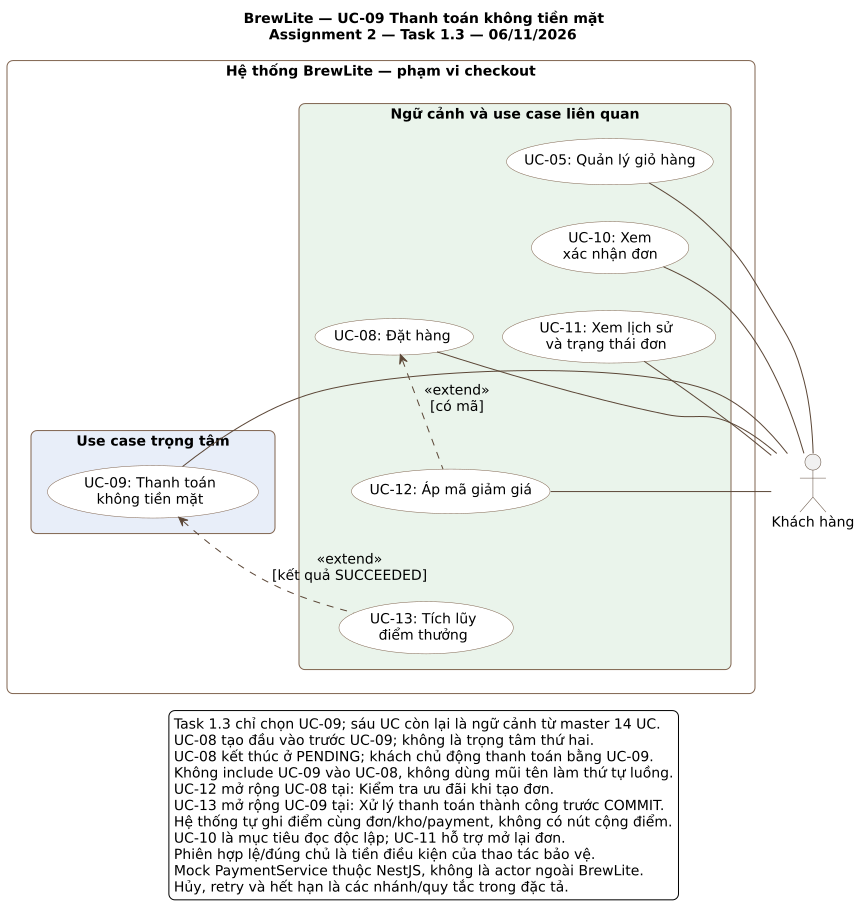

# BrewLite Assignment 2 — UC-09 Thanh toán không tiền mặt

| Thông tin | Giá trị |
|---|---|
| Tạo phẩm | Task 1.3 — Đặc tả một use case trọng tâm |
| Phiên bản / ngày | 0.6 / 06/11/2026 |
| Trạng thái | Nháp để nhóm review; chưa xác nhận code/test hoặc nghiệm thu |
| Use case trọng tâm duy nhất | UC-09 — Thanh toán không tiền mặt |
| Actor chính | Khách hàng |
| Thành phần nội bộ | Next.js UI/BFF, NestJS API, PostgreSQL, PaymentService mock nội bộ NestJS |
| Đầu vào / UC liên quan | UC-08 tạo Order trước khi bắt đầu; UC-10/11 đọc kết quả/lịch sử; UC-13 tích lũy điểm khi thành công |
| Sơ đồ phạm vi | [SVG](../diagrams/use-case-checkout.svg) · [PlantUML](../diagrams/use-case-checkout.puml) |
| Căn cứ | [SRS](srs.md), [ngữ cảnh hỗ trợ](checkout-supporting-flows.md), [contract](../assignment2/CONTRACTS.md) |

## 1. Mục tiêu và ranh giới

Khách thanh toán Ví/Thẻ mô phỏng cho một Order đã tồn tại và nhận kết quả đáng tin cậy, kể cả khi gửi lại yêu cầu. **Task 1.3 chỉ đặc tả UC-09**; UC-08 không đồng trọng tâm. Giữ master 14 mã UC, 17 FR, 12 NFR, 59 AC và thiết kế Sprint 3 v1.3 trên nền Sprint 2 a1a0e4a.

Tạo đơn, preview/ưu đãi và giữ hàng ban đầu nằm trước điểm bắt đầu UC-09; chi tiết được giữ tại [ngữ cảnh hỗ trợ](checkout-supporting-flows.md). Hủy/hoàn và expiry là luồng/tác vụ liên quan được tham chiếu khi chúng thay đổi trạng thái Order, không phải mục tiêu chính thứ hai. Không gọi tạo đơn lại khi thử lại payment.

PaymentService là thành phần nội bộ NestJS, không là actor/cổng ngoài. Không chuyển tiền thật, không nhập dữ liệu thẻ thật, không worker đối soát mới, không API quote/payment-read/refund riêng. Số tiền lấy từ snapshot Order do backend tính; preview không quyết định số tiền thanh toán.

## 2. Trigger, tiền điều kiện và bảo đảm

**Trigger:** khách mở đơn của mình, chọn WALLET/CARD và chủ động xác nhận thanh toán. Khi có recovery chưa rõ, khách chủ động thử lại đúng yêu cầu đã lưu; đây là nhánh A-07/E-04, không phải lần thanh toán mới. Đăng nhập thành công không tự POST payment.

**Tiền điều kiện luồng chính lần mới:** phiên hợp lệ, đúng chủ; Order hiện tại PENDING hoặc PAYMENT_FAILED còn hạn, đủ policy/reservation ACTIVE; không recovery chưa rõ đang chặn lần mới; có khả năng lưu recovery an toàn; khách được xem tổng chính thức và xác nhận. Backend kiểm tra lại trạng thái/deadline sau lock, không tin canPay của UI. GET lỗi hoặc sai chủ không cho bắt đầu POST.

**Hậu điều kiện SUCCEEDED:** Payment attempt cuối, Order PAID, consume kho và entry/User points cùng commit, tác động đúng một lần. UI đọc Order hiện tại trước thông báo và dọn đúng binding; trạng thái có thể đã tiến PREPARING/READY/COMPLETED, không kéo lùi về PAID.

**Hậu điều kiện FAILED đã xác nhận:** attempt FAILED và Order PAYMENT_FAILED cùng commit; không trừ stock thực/cộng điểm, giữ reservation đến hạn và giữ giỏ. Khách có thể chọn lần mới khi còn hợp lệ.

**Bảo đảm tối thiểu:** trước commit lỗi phải rollback toàn bộ; timeout không chứng minh FAILED hoặc rollback. Commit rồi mất response phải phục hồi cùng owner/key/body, không sinh lần thanh toán mới. Không có trạng thái server PROCESSING/UNKNOWN bền trong workflow mock mới; UNKNOWN/UNRESOLVED chỉ mô tả sự chưa rõ phía client.

## 3. Sơ đồ và luồng chính

Chỉ UC-09 ở nhóm trọng tâm; UC-08/05/10/11/12/13 là ngữ cảnh. Liên kết actor–UC không thể hiện thứ tự. Không thêm include UC-09 vào UC-08: tạo đơn kết thúc PENDING, khách xác nhận payment riêng. UC-13 extend UC-09 tại xử lý SUCCEEDED trước COMMIT; UC-12 extend UC-08 được giữ trong vùng ngữ cảnh của master.

**M-01 — Chuẩn bị thanh toán:** khách mở Order; UI GET /orders/:id bằng phiên hiện tại, kiểm owner/phiên/version và hiển thị subtotal/discountTotal/total chính thức cùng hành động được phép. Có recovery chưa rõ thì đi A-07/E-04 trước canPay lần mới. Trường hợp không cho trả đi A-09/A-10/E-07. M-01 không tạo Order hoặc giữ thêm kho.

Luồng chính M-01…M-05 chỉ bao gồm thanh toán trên Order đã có. Các bước tạo đơn C-01…C-06 nằm trong tài liệu hỗ trợ.

| Bước | Khách hàng | Hệ thống và kết quả quan sát được | FR |
|---|---|---|---|
| M-01 | Mở Order của mình để thanh toán | GET /orders/:id; kiểm owner/phiên/version và hiển thị subtotal/discountTotal/total chính thức. Recovery chưa rõ đi A-07/E-04 trước kiểm canPay lần mới; không tạo Order mới | FR-03/09/11 |
| M-02 | Chọn WALLET/CARD, xem tổng chính thức và xác nhận | Kiểm owner/phiên/binding/trạng thái, lưu recovery bất biến owner/key/body an toàn trước HTTP. BFF kiểm Origin/media/header, capture token T một lần; GET /auth/me và POST /payments dùng cùng T, mismatch thì dừng | FR-03/05/09/10 |
| M-03 | Chờ kết quả | NestJS xác minh JWT/AuthSession, validate key/DTO; BEGIN RR, phân xử key và tra attempt trước state/deadline lần mới. Key mới lock Order, kiểm owner/policy/reservation và DB clock sau lock; amount lấy snapshot. Không giữ transaction qua thao tác người dùng | FR-09/10/13 |
| M-04 | — | Mock evaluate cục bộ không I/O cho SUCCEEDED. Cùng transaction ghi attempt success, PAID/version/paidAt, consume kho/CAS, entry/User points. Chỉ trả sau commit; lỗi ghi rollback. FAILED đi A-05. PAYMENT_FAILED → PENDING → kết quả cuối trong cùng transaction nếu A-06, không commit trung gian | FR-09/10/14/16 |
| M-05 | Xem kết quả hoặc mở xác nhận/lịch sử | UI GET Order hiện tại đúng chủ; thông báo trạng thái và tổng chính thức. PAID/PREPARING/READY/COMPLETED mới dọn đúng owner/order/revision/snapshot còn khớp. GET lỗi giữ binding/recovery; response cũ không ghi đè CANCELLED hoặc phiên mới | FR-03/11/12 |

## 4. Luồng thay thế

| Nhánh | Điều kiện và xử lý | Điểm tiếp tục/kết thúc | FR |
|---|---|---|---|
| A-01 | Chưa đăng nhập/hết phiên đã xác nhận: mời login, giữ recovery theo chủ; đổi chủ không dùng yêu cầu cũ. Lỗi DB/mạng khi kiểm phiên không giả thành logout | Đúng chủ đăng nhập và chủ động quay lại M-01; không tự POST | FR-03/05 |
| A-05 | Mock trả FAILED: commit attempt FAILED/PAYMENT_FAILED, giữ ACTIVE đến hạn, không trừ stock thực/cộng điểm | GET Order rồi hiển thị thất bại; giữ giỏ; A-06 hoặc dừng | FR-09/10/14 |
| A-06 | FAILED cuối đã xác nhận, không recovery chưa rõ, server còn cho trả: khách xác nhận lần mới trên cùng orderId, key mới. Không tạo Order mới hoặc gia hạn hold | M-01/M-02; state PAYMENT_FAILED → PENDING → PAID hoặc PAYMENT_FAILED trong cùng tx | FR-09/10/17 |
| A-07 | Cùng owner/key/body đã commit: replay attempt gốc/current PaymentView theo contract, không gọi mock/consume/cộng điểm lần nữa; khác body conflict, không tự đổi key/body | GET Order rồi M-05/A-05/A-10. Replay key đã commit được xét trước điều kiện state/deadline của lần mới | FR-10/11 |
| A-09 | Đến/sau deadline hoặc Order đã bị expiry/hủy: chặn payment mới; browser đếm về 0 chỉ khóa lần mới và đọc lại, không tự release | GET Order; CANCELLED thông báo hủy, chỉ mở khóa binding còn khớp. Expiry xem C-X01; replay đã commit vẫn A-07 | FR-10/13/14/17 |
| A-10 | Order hiện tại đã PAID/PREPARING/READY/COMPLETED hoặc CANCELLED | Hiển thị hiện tại; không payment mới; dọn/mở khóa theo M-05 và policy. Yêu cầu hủy chủ động xem C-A08 trong ngữ cảnh hỗ trợ | FR-03/11/12/13 |

## 5. Ngoại lệ và phục hồi

| Nhánh | Điều kiện và xử lý | Điểm tiếp tục/kết thúc | FR/NFR |
|---|---|---|---|
| E-01 | Token/owner/DTO/key sai: từ chối trước mutation không được phép; tài nguyên khác chủ 404 theo contract. Không lộ dữ liệu, không coi mọi 4xx là đủ để xóa recovery | Phiên đi A-01; key/body bất biến chưa rõ cần xác minh, không sửa ngầm | FR-05/09; NFR-02/03 |
| E-02 | Storage/khóa thiếu, lỗi ghi hoặc lock timeout: báo lỗi, giữ bytes hiện có, không gửi POST mới khi chưa lưu recovery an toàn | Chỉ tiếp tục khi lưu/khôi phục an toàn | FR-03/10; NFR-11 |
| E-04 | Timeout/mất response/body sai/5xx payment: chưa rõ kết quả, không ghi PAYMENT_FAILED hoặc đổi key/phương thức | Giữ đúng owner/key/body; khách chủ động replay A-07. Nếu rollback trước đó, handler cùng key xử lý an toàn. GET latestPayment không thay phục hồi attempt cụ thể | FR-03/10/11; NFR-05 |
| E-05 | Lỗi DB/kho/điểm hoặc crash trước commit: rollback toàn bộ; retry hữu hạn đúng classifier cùng operation, không retry lồng. Không giả FAILED nghiệp vụ để che lỗi hệ thống | Giữ recovery; commit rồi mất response đi E-04, không tự khẳng định rollback | FR-10/14/16; NFR-04 |
| E-06 | GET lỗi, owner/phiên đổi hoặc response cũ: giữ binding/giỏ/recovery, không dọn theo attempt lịch sử. Logout A9 không để phản hồi phiên cũ xóa phiên mới kể cả cùng owner | Đúng chủ chủ động đọc lại; version mới không bị kéo lùi | FR-03/11/12; NFR-03/05 |
| E-07 | Đơn legacy thiếu policy/reservation hoặc attempt cũ PROCESSING/UNKNOWN: không đủ điều kiện payment mới, không tự coi FAILED để release | Theo kế hoạch rollout SRS O-04; không dựng worker mới hoặc chắp dữ liệu | FR-10/17; NFR-11 |

Hai key đồng thời trên cùng Order không tạo hai success. Payment/expiry/cancel/advance cùng Order row lock. Request tới web trước hạn chưa đủ: phải được phân xử hợp lệ theo DB clock sau lock; commit có thể sau hạn. UI15s/BFF10s chỉ giới hạn chờ, không xác định kết quả transaction.

## 6. Quy tắc kế thừa

| SRS | Áp dụng trong đặc tả |
|---|---|
| BR-01 — giỏ | PENDING chưa dọn; binding đúng owner/order/revision/snapshot. Dọn theo Order hiện tại xác nhận đã trả, hủy không tự chèn lại dữ liệu |
| BR-02 — kho/hạn | Đề xuất giữ 15 phút, retry không gia hạn; chỉ Product theo ly, gộp qty theo productId; Topping không có kho. Transaction + optimistic locking; không thêm tồn kho nguyên liệu khác |
| BR-03 — mock | WALLET/CARD cùng cơ chế cấu hình backend SUCCEEDED/FAILED; mặc định SUCCEEDED. Không nhận amount/kết quả mong muốn/thông tin thẻ thật từ browser; không có tác động ngoài DB |
| BR-04 — hủy | Trước trả release; sau PAID trước PREPARING hoàn mock/kho/điểm toàn phần, một lần và nguyên tử; giữ lịch sử success |
| BR-05 — ưu đãi/điểm | Đề xuất DEMO10 giảm 10%, trần 20.000đ, subtotal tối thiểu 50.000đ; điểm floor(total thực trả/10.000), có thể ghi entry 0. Tổng tiền nguyên VND từ 1đ |
| BR-06 — tạo/xem đơn | Preview dự kiến → lưu pending v2 → POST /orders → GET Order/tổng chính thức → xác nhận payment riêng. Không API quote; v1/v2 chưa rõ giữ nguyên key/body và canonical |

Các con số/cấu hình demo này chưa được cả nhóm chốt. Chi tiết schema, API path và chiến lược migration thuộc thiết kế/tích hợp tiếp theo; không tự thêm endpoint hoặc bảng chỉ từ một dòng trong luồng.

## 7. Truy vết và kịch bản kiểm chứng

| Kịch bản | Bước/nhánh | AC cần kiểm chứng |
|---|---|---|
| WALLET/CARD thành công | M-01…M-05 | AC-FR-09-1, AC-FR-11-1, AC-FR-16-1 |
| Không phiên/login không tự gửi | A-01/E-01 | AC-FR-05-2, AC-NFR-02-1, AC-NFR-03-1 |
| FAILED rồi trả lần mới cùng Order | A-05/A-06 | AC-FR-09-1, AC-FR-10-2 |
| Replay và mất response không ghi tác động hai lần | A-07/E-04 | AC-FR-10-1, AC-FR-16-1 |
| Lỗi ghi payment/kho/điểm rollback | E-05 | AC-FR-10-2, AC-NFR-04-1 |
| Payment tranh expiry/hủy, chặn sau deadline | A-09/A-10; C-A08/C-X01 hỗ trợ | AC-FR-17-1, AC-FR-17-2, AC-FR-14-2 |
| Đổi chủ, storage/GET lỗi, response cũ | E-02/E-06/M-05 | AC-FR-03-2, AC-FR-03-3, AC-FR-11-2, AC-NFR-03-1 |
| Mạng/DB gián đoạn, recovery/legacy | E-04/E-05/E-06/E-07 | AC-NFR-05-1, AC-NFR-05-2, AC-NFR-11-1, AC-NFR-11-2 |

FR-07/08/15 và phần reserve FR-14 thuộc ngữ cảnh tạo đơn, xem [C-01…C-06](checkout-supporting-flows.md). Chúng vẫn nằm trong SRS và [ma trận truy vết toàn hệ thống](../traceability-matrix.md); không bị bỏ khỏi A2 vì Task 1.3 chỉ chọn UC-09. Những dòng trên là thiết kế test, tất cả code/test thực tế vẫn CHỜ đối chiếu/chạy.

## 8. Review và lịch sử

- [x] Chỉ một trọng tâm UC-09; actor/trigger, tiền/hậu điều kiện, luồng chính/thay thế/ngoại lệ và FR/AC.
- [x] Sơ đồ Task 1.3 phân biệt UC-09 với ngữ cảnh; sequence payment là hình chính có đủ năm lifeline.
- [ ] Nhóm review BR-01…06/O-01…05, đưa đủ tạo phẩm lên repo với lịch sử thật.
- [ ] Kiểm chứng code/schema và AC; tài liệu không thay nghiệm thu hoặc test.

Bản v0.6 ngày 06/11/2026 kế thừa v0.5 ngày 05/11/2026; giữ UC-09 là trọng tâm và đồng bộ phần ngữ cảnh sequence, FR-13/D16, giá/canonical và lịch. Không đổi API/transaction/kho/giỏ; chưa sửa code hoặc hồ sơ S1/S2. [Kế hoạch A2](../assignment2/TEAM_PLAN.md) vẫn là lịch/lead đề xuất, chưa là capacity hay tiến độ thật.

## Diễn giải sequence ở v0.6

Hình sequence chính Task 2.2 hiển thị khung chuẩn bị UC-08 trước ranh giới “Bắt đầu UC-09”, gồm transaction tạo Order và optimistic locking/giữ kho. Khung này đáp ứng nội dung mô hình hóa của đề, không thay tiền điều kiện Order đã tồn tại hoặc thêm bước tạo đơn vào M-01…M-05. Khi đã có Order, không tạo lại; retry payment dùng đúng Order và identity đã lưu.
