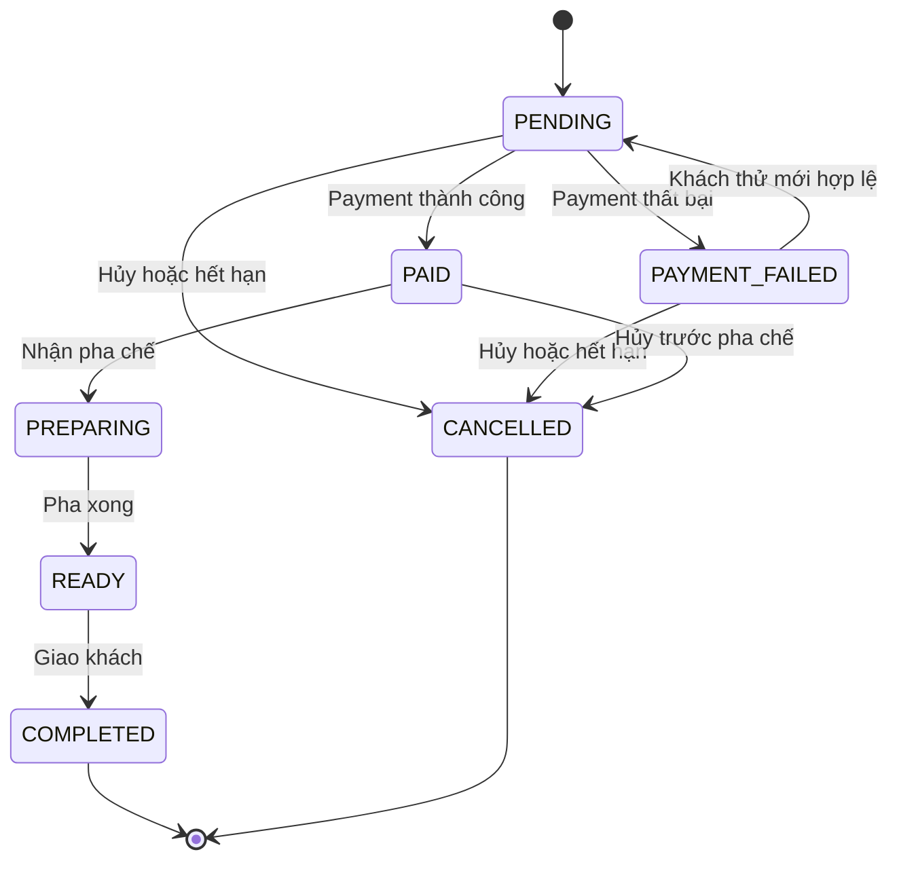

# BrewLite Sprint 3 thiết kế triển khai

Cập nhật • 06/11/2026 • Đã đồng bộ nền Sprint 2 main a1a0e4a • Assignment 1 • Gửi nhóm A–E.

Bản 1.3 kế thừa ba thay đổi đã được PO đồng ý: bỏ API quote riêng, bỏ GET payment riêng, chỉ kiểm soát tồn Product. Nhóm dùng bản này làm cơ sở triển khai Task 8–10. Các lựa chọn nghiệp vụ đã được PO cho phép cụ thể hóa; mỗi lead có đầu ra và tiêu chí kiểm tra riêng trong TEAM_PLAN.md. Không cần chờ một cuộc họp để bắt đầu các việc không bị chặn. Contract và schema ở CONTRACTS.md, ca nghiệm thu ở TEST_MATRIX.md. Khi phát hiện code nền khác contract, ghi đúng chỗ khác trên PR trước khi thay đổi; không tự mở rộng phạm vi.

Đây là thiết kế hoàn chỉnh để giao việc, chưa phải sản phẩm đã nghiệm thu. Toàn bộ 27 AC chưa chạy ở lượt soạn này. Nền triển khai đã chốt là main `a1a0e4ae92de681deac538685e24407b3190866b` sau PR #24, #26, #28 và #27. PO đã chấp nhận phạm vi chức năng Sprint 2 đã kiểm tra trong SPRINT2_CLOSEOUT.md; các ca có bằng chứng một phần vẫn giữ nguyên giới hạn. Sprint 3 kế thừa nền này; chưa khẳng định các API, migration hoặc 27 AC Sprint 3 đã triển khai/đạt.

## 1 Mục tiêu và phạm vi

Sprint Goal: khách đặt từ giỏ, thanh toán Ví hoặc Thẻ mô phỏng, xem xác nhận/lịch sử; backend bảo đảm đúng trạng thái, không nhân giao dịch/đơn, không bán vượt kho và tính đúng giảm giá/điểm. Thành viên khác chạy được ba dịch vụ bằng Compose và thực hiện demo có bằng chứng.

| Yêu cầu đề | Đầu ra và kiểm tra |
|---|---|
| Task 8 | POST /payments, WALLET/CARD, thành công PAID, thất bại PAYMENT_FAILED và giữ giỏ |
| Task 9 | Mã đơn/trạng thái hiện tại, GET /orders/me, frontend/backend/PostgreSQL qua Compose, README và demo |
| Task 10 | State machine, payment idempotency, transaction + optimistic locking kho, mã hợp lệ và điểm chỉ sau PAID |
| Test a | Chặn các cạnh sai; có kiểm tra retry PAYMENT_FAILED → PENDING |
| Test b | Hai request tạo đơn cùng key chỉ một Order; hai payment cùng key chỉ một attempt/tác động, không phát sinh thêm Order |
| Test c | Hai khách tranh Product cuối trên PostgreSQL; không âm hoặc bán vượt kho |

Giữ 13 model logic, 14 mã use case, 27 AC. Số model không phải quota cần tăng. Chín hình là các góc nhìn của năm nguồn PlantUML: master, hai activity, ba sequence, state và hai ERD. ERD A/B là cùng một mô hình 13 model.

## 2 Quyết định thực hiện

| Mã | Chọn trong Cập nhật |
|---|---|
| DEC-01 | Hủy PENDING/PAYMENT_FAILED giải phóng giữ hàng. PAID chỉ hủy trước PREPARING, hoàn giả lập toàn phần, trả kho và thu hồi đúng điểm đã cộng trong một transaction |
| DEC-02 | Mock là hàm cục bộ trong NestJS, không I/O hay tiền thật. Chỉ lưu PaymentAttempt FAILED/SUCCEEDED, cùng transaction với Order/kho/điểm. WALLET/CARD là nhãn mô phỏng |
| DEC-03 | DEMO10: 10%, trần 20.000 VND, subtotal từ 50.000 VND; điểm floor(total/10000), total ≥ 1. Không đổi điểm, quota hay FIXED |
| DEC-04 | Không API quote riêng. UI preview → tạo PENDING v2 → đọc tổng chính thức → khách xác nhận payment. Giữ DTO/canonical v1/v2 và envelope2 |
| DEC-05 | DB demo riêng, migration mới và seed có kiểm soát. Legacy giữ nguyên/kiểm kê, không tự hủy, reset hoặc tạo reservation/payment giả |
| DEC-06 | Tạo PENDING chưa dọn giỏ; giữ và khóa khi chưa kết thúc. Chỉ dọn đúng binding sau đọc trạng thái thanh toán thành công hiện tại; cancel mở khóa phần còn tồn tại |
| DEC-07 | Năm endpoint. GET Order có latestPayment; recovery chính attempt bằng POST /payments cùng key/body, không GET payment riêng. Hoãn phân trang/polling/badge đơn chờ |
| DEC-08 | RR transaction, Order row lock và CAS stockVersion. Một vòng retry tối đa ba lượt cho toàn operation, không lồng retry kho × idempotency |
| DEC-09 | Chỉ Product theo ly; Topping giữ menu/giá/liên kết, không tồn kho. Giữ 15 phút, expiry60s/batch50/startup và không gia hạn khi retry |

Ngoài phạm vi: cổng thật, worker đối soát payment, dữ liệu thẻ thật, admin/quầy đầy đủ, nguyên liệu ml/gram, hoàn một phần, đổi điểm. Badge số lượng giỏ Sprint 2 vẫn giữ. Script nội bộ chuyển pha chế phục vụ demo/test, không thêm actor, use case hoặc API public.

## 3 Kiến trúc và mô phỏng thanh toán

Next.js phụ trách giao diện và BFF; NestJS giữ quy tắc nghiệp vụ; PostgreSQL giữ dữ liệu/ràng buộc. Trình duyệt gọi BFF /api, BFF chuyển Bearer token đến NestJS. Database không nhận kết nối trực tiếp từ trình duyệt. Layered architecture phân trách nhiệm; client–server mô tả quan hệ giao tiếp giữa các thành phần.

PaymentService mock nằm bên trong NestJS. Lifeline/mũi tên NestJS → mock là lời gọi nội bộ, không chứng minh cần một server ngoài. Khi dùng nhà cung cấp thật sau này, chỉ adapter gọi API ở trong backend; hệ thống của nhà cung cấp vẫn ở ngoài, và thiết kế atomic DB hiện tại phải được thay bằng thiết kế đối soát thích hợp.

MOCK_PAYMENT_OUTCOME=SUCCEEDED|FAILED, mặc định SUCCEEDED, đọc từ backend lúc khởi động; giá trị sai làm startup fail. Browser không gửi mode/outcome/amount/card data. Mock không charge bên ngoài DB, không delay để giả lập network trong transaction. FAILED có failureCode PAYMENT_DECLINED; lỗi DB/network của app không được biến thành FAILED.

Mất response chỉ là chưa rõ ở client. Không thêm UNKNOWN hoặc PROCESSING vào enum server, không thêm activePayment/activePaymentId hoặc worker. Theo phạm vi đã chọn, code Sprint 2 hiện không có PaymentAttempt cũ cần hỗ trợ các trạng thái ấy.

## 4 Vòng đời đơn và kho

Chỉ cho chín cạnh dưới đây, ngoài cạnh khởi tạo và hai trạng thái kết thúc. Mọi mutation khóa cùng hàng Order; từ chối cạnh ngoài danh sách bằng 409 INVALID_ORDER_TRANSITION trong cơ chế nội bộ.

Retry sau FAILED: key mới, cùng orderId, còn hạn; áp PAYMENT_FAILED → PENDING rồi PENDING → PAID/PAYMENT_FAILED trong cùng transaction. Không cho cạnh trực tiếp PAYMENT_FAILED → PAID hoặc tự quay PAYMENT_FAILED → PAYMENT_FAILED. Không commit PENDING trung gian để chờ mock. Replay key cũ không tạo cạnh, không giữ thêm và không gia hạn.

stock là số lượng thực còn trong kho, reservedStock là phần ACTIVE đã giữ; có thể bán = stock − reservedStock. Luôn 0 ≤ reservedStock ≤ stock. Gộp nhu cầu theo productId trên toàn đơn, kể cả các dòng khác size/topping. Topping chỉ dùng cho chọn món, tính giá, validate liên kết và snapshot; không có stock/reservedStock/stockVersion hoặc reservation cho Topping.

| Sự kiện | Reservation | stock | reservedStock |
|---|---|---|---|
| Tạo đơn đủ kho | Tạo ACTIVE | Giữ nguyên | +qty |
| Payment FAILED | ACTIVE giữ trong hạn | Giữ nguyên | Giữ nguyên |
| Payment SUCCEEDED | ACTIVE → CONSUMED | −qty | −qty |
| Cancel/expiry trước PAID | ACTIVE → RELEASED | Giữ nguyên | −qty |
| Cancel PAID trước PREPARING | CONSUMED → RETURNED | +qty | Giữ nguyên |

Mỗi lần update tài nguyên dùng stockVersion đã đọc, tăng version; CAS không cập nhật đúng một hàng làm rollback toàn operation. Precheck tất cả nguồn trước khi ghi; thiếu thật thì ghi REJECTED mà chưa có giữ kho. CAS conflict phải rollback rồi retry snapshot mới, không dùng savepoint để tiếp tục transaction đã lỗi.

Thời hạn = mốc DB lúc tạo đơn + 15 phút. Payment mới chỉ nhận khi clock_timestamp() < paymentDeadline sau khi khóa Order. Expiry dùng now ≥ deadline và chỉ policy 2 ở PENDING/PAYMENT_FAILED. Payment đã được nhận trước hạn có thể commit sau hạn. Backend startup catch-up rồi tick mỗi 60 giây, batch 50, không chạy hai vòng quét chồng nhau; mỗi Order một transaction và recheck. Tick lỗi giữ để lần sau xử lý, ghi log. Không hứa mọi đơn được release đúng giây thứ 60. GET không gây hủy.

PAID cancel xác minh một success cùng chủ, reservation CONSUMED và LoyaltyEntry; ghi refund metadata, trả kho, reversal điểm và CANCELLED cùng transaction. Payment vẫn SUCCEEDED để giữ lịch sử; refundedAmount=amount, refundedAt có giá trị. CANCELLED gọi lại không bù trừ. PREPARING trở đi từ chối. Script nội bộ cũng khóa Order trước đổi pha chế nên race cancel/PREPARING có một cạnh thắng.

## 5 Giá giảm và điểm

Kế thừa seed thật: coffee-milk 35.000, americano 40.000, cappuccino 45.000, peach-tea 39.000 VND; size S +0, M +5.000, L +10.000. Seed hiện chỉ gắn cream 7.000 và pearl 5.000 cho coffee-milk. Không tự dùng topping không liên kết. Ca topping dùng chung hai Product dùng fixture kiểm thử riêng.

Khách xem giỏ và nhập mã → UI tính tổng dự kiến theo cấu hình DEMO10 → khách bấm Tạo và xem đơn → lưu pending v2 bền rồi POST /orders → backend tính/kiểm tra giá, mã và giữ kho Product → GET /orders/:id → hiển thị subtotal/discountTotal/total chính thức và trạng thái mã → khách chọn Ví/Thẻ, xác nhận số tiền → POST /payments. Không tự gửi payment ngay sau tạo đơn.

Giữ DTO v2, expectedTotal và canonical/hash theo contract; không đổi version của body đã có. UI chỉ tính preview từ giá giỏ và cấu hình cố định DEMO10 (10%, trần20.000, min50.000), ghi rõ là dự kiến, chưa xác nhận hiệu lực mã. Với mã khác, không tự coi là hợp lệ; preview chưa giảm và backend quyết định khi create. Backend vẫn kiểm active/window/min, giá và expectedTotal; sai trả rejection đã ledger, không tự sửa payload/key. Sau từ chối đã xác nhận, khách xem lại giá từ details hoặc catalog API hiện có rồi xác nhận request mới. Khi create thành công, UI GET Order hiển thị tổng chính thức trước nút Xác nhận thanh toán; không chỉ dựa vào preview. Không tạo API báo giá thay thế.

DEMO10 áp khi active và startsAt ≤ DB now < endsAt, subtotal ≥ 50.000; discount=min(floor(subtotal×10/100),20000), total=subtotal−discount. Một mã, chuẩn hóa trim rồi ASCII uppercase, chuỗi rỗng thành null; mã khác định dạng [A-Z0-9_-]{1,32} bị 400. Mã hợp lệ nhưng không áp được trả PROMOTION_NOT_APPLICABLE, không âm thầm bỏ mã. Tổng và mọi phép nhân phải là số nguyên an toàn không vượt PostgreSQL Int 2.147.483.647, total ít nhất 1.

Seed demo chọn startsAt=2026-11-01T00:00:00.000Z, endsAt=2026-12-01T00:00:00.000Z. Đây là cấu hình cần E thực hiện, chưa được seed ở lượt soạn. Test thời gian dùng clock/fixture riêng, không sửa đồng hồ máy. Giá/mã/điểm policy snapshot tại tạo đơn; payment không tính lại từ catalog/promotion hiện tại. Điểm floor(total/10000) chỉ cộng khi PAID, có một LoyaltyEntry/order kể cả điểm 0. Hủy PAID thu hồi đúng entry.points một lần; chưa có đổi điểm nên số dư không được âm.

Ví dụ đúng seed: 2 cappuccino M không topping = 100.000; DEMO10 giảm 10.000; trả 90.000; được 9 điểm. Subtotal 300.000 giảm 20.000 do trần, trả 280.000, được 28 điểm.

## 6 Hợp đồng API

Các DTO/response đầy đủ ở docs/sprint3/CONTRACTS.md. Đường dẫn dưới là NestJS; browser thêm /api. Mọi endpoint cần phiên, private,no-store; NestJS lấy userId từ phiên và kiểm tra chủ. ID khác chủ/không tồn tại trả cùng 404 RESOURCE_NOT_FOUND. Static GET /orders/me phải đăng ký trước GET /orders/:id. GET /orders/:id trả latestPayment đầy đủ id/version/orderId/method/amount/status/failureCode/createdAt/resolvedAt/refundedAmount/refundedAt hoặc null. Đây là lần gần nhất theo createdAt DESC,id DESC, không chứng minh đó là attempt của key đang phục hồi. Mất response payment phải replay POST /payments với đúng key/body đã lưu để tìm chính attempt đó, rồi GET Order hiện tại; không gán paymentId từ latestPayment khi chưa biết identity. Không gọi API đọc payment riêng. Hai attempts liên tiếp trên cùng Order phải có test chứng minh recovery key cũ không nhận nhầm kết quả mới.

| Endpoint | Request | Kết quả |
|---|---|---|
| POST /orders | V1 {items}; v2 {schemaVersion:2,items,promotionCode,expectedTotal}; Idempotency-Key | 201 mới/200 replay {id,status:PENDING,total}; business rejection được ledger lưu |
| GET /orders/:id | Không query | 200 OrderDetail hiện tại |
| GET /orders/me | Không query; query lạ 400 | 200 {items,serverTime}, createdAt DESC,id DESC |
| POST /payments | {orderId,method:WALLET hoặc CARD}; Idempotency-Key | 200 PaymentView có kết quả cuối, kể cả FAILED |
| POST /orders/:id/cancel | {} | 200 OrderDetail hoặc lỗi trạng thái |

Body orders tối đa 32 KiB UTF-8; payment/cancel 4.096 byte. UUID v4 cho request key; 1–20 dòng, qty 1–20, topping không lặp và không trùng cấu hình món. POST từ chối field dư. Tạo đơn v1 giữ validator/canonical/error/ledger lịch sử; v2 expected* chỉ là giá khách đã xem, server tự tính lại. Không gửi userId/status/amount từ UI.

UI timeout 15 giây, BFF 10 giây toàn lượt gồm đọc body, auth và upstream response; BFF không tự retry POST. UI lưu pending/recovery bền trước HTTP. Hủy request ở UI không chứng minh backend đã rollback.

## 7 BFF và đổi tài khoản

Mọi POST Sprint 3 dùng Origin/P04, Content-Type application/json, X-BrewLite-Request: 1 và X-BrewLite-Expected-Owner. Giá trị header owner là encodeURIComponent(ownerId) không rỗng và round-trip chính xác; đây là owner UI mong đợi, không phải bằng chứng xác thực, không đưa vào body hoặc canonical hash.

BFF đọc token cookie đúng một lần cho lượt xử lý, GET /auth/me bằng chính Bearer token đó, đối chiếu owner rồi chuyển tiếp mutation bằng cùng token. Thiếu/sai header hoặc khác chủ: 403 REQUEST_FORBIDDEN, tuyệt đối không gọi upstream mutation; giữ pending/key/body. Không xác thực owner bằng decode JWT chưa verify, cũng không đọc cookie lần hai trước POST. Cookie đổi sau khi BFF bắt đầu không đổi danh tính token đã chụp; token hết hạn/bị thu hồi để NestJS trả 401. NestJS vẫn tự xác minh phiên và quyền ở request thực tế.

UI nhận response chỉ nếu owner và thế hệ phiên còn khớp; cùng Order/Payment chỉ nhận version không thấp hơn đã hiển thị. Các GET phải no-store; kết quả đọc của phiên trước không được dùng để dọn giỏ phiên mới. BFF orders hiện tại đã có guard này ở commit nền; Sprint 3 tái sử dụng cho payment/cancel. Kế thừa hiệu đính P04/P05 đã được PO chấp nhận: login/me cung cấp session binding; logout gửi expected-session, BFF dùng cùng token và logout/me không gửi Set-Cookie xóa cookie. Sau 204, client kiểm tra lại phiên trong ngân sách 15 giây còn lại trước cleanup. Phiên mới cùng owner cũng phải được bảo vệ; pending/recovery vẫn giữ theo chủ. S3 chạy hồi quy khi sửa phần liên quan, không viết lại auth/logout theo cách cũ.

## 8 Giỏ storage và tương thích Sprint 2

Thay đổi có chủ đích so ORDER-AC-08/P01 bước 8 và test S2-ORDER-01/12: kể từ Sprint 3, 200/201 tạo PENDING chưa dọn giỏ. Đây là delta version mới, không sửa lại kết quả PASS hay lịch sử Sprint 2. Dọn chỉ khi đọc Order hiện tại ở PAID/PREPARING/READY/COMPLETED và khớp owner/orderId/cartRevision/cartSnapshot. CANCELLED mở khóa phần còn đúng binding; không tự dựng lại giỏ đã dọn. Khách muốn đặt lại phải thao tác rõ ràng và xác nhận giá mới.

Envelope version 2 dùng cùng storage key/Web Lock: giữ schemaVersion/cart/pendingRequests/lastOrderResult, thêm checkoutBindings và paymentRecoveries. Schema version envelope, body và canonical là ba khái niệm riêng. Payload pending v1 giữ nguyên {items}; v2 chứa schemaVersion:2. Maps theo own property, kiểm tra exact keys, opaque IDs, UTC timestamps, UUID key; không JWT/thẻ trong storage.

checkoutBindings[ownerId]={ownerId,orderId,cartRevision,cartSnapshot,orderVersion,boundAt}. paymentRecoveries[ownerId][requestKey]={ownerId,requestKey,body:{orderId,method},createdAt,paymentId:null|string,recoveryStatus:UNRESOLVED|RESOLVED}. Một owner tối đa một checkout chưa kết thúc với giỏ này; chưa cho key payment mới khi recovery cũ còn UNRESOLVED. Chỉ RESOLVED sau response cuối đúng identity và đọc được Order hiện tại; GET lỗi vẫn giữ key/body.

Migration dưới Web Lock: đọc lại bytes → validate v1/v2 → v1 copy nguyên cart/pending/result → envelope 2, maps mới rỗng → validate → một setItem. Không xóa trước ghi; quota/JSON sai/version lạ giữ bytes và chặn POST. SUBMITTING cũ đọc thành UNKNOWN ở client như nền v1, không sửa key/body/timestamp. lastOrderResult PENDING cũ không đủ để tự tạo binding hoặc tự khôi phục giỏ; đọc server và yêu cầu khách mở đơn tiếp tục.

Mọi writer v1 phải đọc/validate trong cùng lock và gặp envelope 2 thì dừng. Nếu chưa chứng minh được, demo rollout có kiểm soát: dừng thao tác, đóng/reload tất cả tab cũ, mới bật frontend mới; test hai tab trước mở lại. Không mở fallback ghi v1 đè v2. Logout giữ/ẩn recovery chưa rõ theo chủ; không tự POST sau login và không coi logout là hủy/FAILED.

Backend rollout trước frontend. V1 đã có ledger: replay nguyên response trước kiểm tra giá/mã/kho; v1 chưa có ledger: giữ body/key/hash v1, áp policy kho mới không mã. Cùng user/key nhưng khác canonicalVersion/hash trả IDEMPOTENCY_CONFLICT. Chính sách Order 1 legacy khác canonicalVersion của request: v1 mới sau rollout vẫn có thể tạo Order policy 2.

## 9 Dữ liệu và transaction

Nền main a1a0e4a có đúng chín Prisma model: User, AuthSession, Product, Topping, ProductTopping, Order, OrderItem, OrderItemTopping, OrderRequest. Thêm bốn: PaymentAttempt, StockReservation, Promotion, LoyaltyEntry. Tên Payment trong đề ánh xạ PaymentAttempt; không thêm bảng Payment song song. ERD là mô hình tiếp tục phát triển từ Sprint 1–2.

Schema delta với tên cột, nullable/default, FK và index nằm trong CONTRACTS.md. Existing mappings và các migration đã chạy giữ nguyên. E tạo migration mới; không áp snippet thiết kế trực tiếp lên DB cũ. Stock Product mới mặc định 0 để không tự suy đoán tồn thực; seed số lượng chỉ trên DB demo riêng. Legacy Order backfill subtotal=total, discountTotal=0, version=0, checkoutPolicyVersion=1; không tự cấp deadline/reservation/điểm. Payment/cancel legacy trả 409 LEGACY_ORDER_REQUIRES_REVIEW, GET canPay/canCancel=false. Không reset DB để thay kiểm thử chuyển tiếp.

D điều phối một Prisma transaction cho nghiệp vụ; C/E nhận TransactionClient, không tự commit hoặc gọi HTTP. RepeatableRead giữ nền; maxWait 1.000 ms/timeout 2.000 ms mỗi transaction, tối đa ba lượt cho toàn operation. Chỉ retry CAS conflict, P2034/SQLSTATE 40001/40P01, advisory lock chưa lấy được, và unique đúng constraint idempotency/success dự kiến; không retry mọi FK/data error. Mỗi lần retry rollback và tra ledger/snapshot mới. Hết lượt trả 503 TRANSACTION_RETRY_EXHAUSTED, UI giữ key/body. Không hứa mọi request thua tranh kho đều 409; OUT_OF_STOCK chỉ sau đọc mới xác nhận thiếu. Test an toàn cấm oversell, test hội tụ sau đó cùng key sẽ trả kết quả đã lưu hoặc thiếu hàng rõ ràng.

Lock order chung: advisory purpose/user/key (nếu có) → hàng Order đang có → Product ID tăng dần → hàng User khi đổi điểm. Namespace order advisory v1 hiện có giữ nguyên; v1/v2 dùng chung. Payment namespace riêng. Không giữ Web Lock qua HTTP. Quét expiry và CLI cũng dùng cùng service/lock/transaction, không update status bằng SQL rời.

Giữ StockReservation trong 13 model nhưng chỉ có productId bắt buộc, unique(orderId,productId); bỏ toppingId/XOR/partial index theo topping. Migration/triển khai hiện hành giả định nền S2 chưa có schema S3 đã áp. Nếu phát hiện code/schema S3 khác đã chạy, dừng rollout để kiểm kê tương thích, không tự drop cột/xóa reservation đang tồn tại.

### Kế thừa nền đã chốt

Giữ kiểm tra Order–OrderRequest đã lưu trước commit như bản sửa PR #28: cùng owner/key/hash, liên kết đúng orderId; sai thì rollback toàn bộ Order/snapshot/ledger và các tác động kho mới. Không bỏ kiểm tra này khi viết lại create cho v1/v2. Hồi quy ca cố ghi lệch dữ liệu và snapshot cũ của Sprint 2.

Hợp đồng lỗi tạo đơn v1 giữ `409 ORDER_REQUEST_IN_PROGRESS` khi không lấy được advisory lock; không gộp lỗi bận khóa đó vào vòng retry kho. Giữ `413 PAYLOAD_TOO_LARGE`, `PRICE_CHANGED` với details P03 và cách phân loại VALIDATION_ERROR của frontend nền. Request sai schema hoặc kết quả chưa rõ không được tự đổi key/body. Chi tiết tại CONTRACTS mục 3–4.

Môi trường theo nền: Node 24, Prisma 7.10.1 và PostgreSQL 17; Compose dùng PostgreSQL 17. Runtime auth đã dùng bcrypt native 6.0.0, cost 12; không quay lại bcryptjs cho runtime hoặc hạ cost. Chạy npm ci theo lockfile khi nhận nền. Không đổi cơ chế auth để làm payment.

## 10 Kế hoạch giao nhóm

Mốc lịch dùng giờ Việt Nam, hạn hai assignment 15/11/2026 theo thông tin PO đã cung cấp. Ngày dưới là kế hoạch cần cập nhật theo bàn giao thật, không phải cam kết từng thành viên đã nhận việc. Không dời D1 vô thời hạn chờ Sprint 2. Những task độc lập bắt đầu ngay 04/11; việc tích hợp thật phụ thuộc kiểm chứng nền.

| Ngày | Đầu ra dự kiến | Chủ trì |
|---|---|---|
| 04/11 | Phân việc theo TEAM_PLAN, nhận nền main a1a0e4a đã chốt và ghi phạm vi hồi quy auth/logout; schema delta/DTO và UI skeleton làm song song | A/B điều phối, C/D/E từng phần |
| 05/11 | Migration/test fixture + interface kho/giảm/điểm; backend đọc đơn, UI loading/error | E/C/D; A/B song song |
| 06–07/11 | Tạo đơn giữ kho, payment atomic/replay, cancel/expiry; UI giỏ/payment chạy contract | D/E/C và A/B |
| 08/11 | Tích hợp E2E trên DB demo, hai phương thức, FAILED/retry; ghi lỗi và owner | D phối hợp A/B/C/E |
| 09–10/11 | Test a/b/c, rollback/owner/storage/legacy; sửa lỗi và Compose chạy trên máy khác | D/E, từng lead tự test |
| 11/11 | Review/demo A1, Retro thật, đóng gói dự kiến; bàn giao delta để đối chiếu A2 riêng | A/B tổng hợp |
| 12–13/11 | Dự phòng tích hợp A1/A2 và hoàn thiện bàn giao theo kế hoạch riêng; A2 chuẩn bị song song | A/B điều phối |
| 14/11 | Freeze kiểm tra file/link/README và bộ nộp; không thêm tính năng | Cả nhóm |
| 15/11 | Nộp theo giờ hạn chính thức trên LMS; PO kiểm tra giờ cụ thể | A |

Nếu nền chưa kiểm chứng cuối 05/11 hoặc E2E chưa chạy 08/11, A/B báo rủi ro ngay với ticket/owner/mốc mới; không tự ghi đạt hoặc chuyển hết backend sang A. Hoãn các mục tùy chọn đã loại trước; không bỏ bốn ý Task 10 hoặc ba test a/b/c. Effort và ticket chi tiết trong TEAM_PLAN là ước lượng ban đầu; phải so capacity thật, không dùng làm bằng chứng burndown.

Cập nhật bất đồng bộ mỗi ngày: đã xong kèm PR/commit/test; tiếp theo; bị chặn bởi ai/cần gì trước mốc nào. PR nhỏ, có reviewer, không tự merge theo im lặng. Review/Retro có thể tổng hợp demo quay sẵn và góp ý viết nếu điều kiện môn cho phép; ghi cách làm thật. Không ghi họp/daily/burndown giả để đủ Scrum.

## 11 Tiêu chí nghiệm thu

Các dòng sau là tiêu chí cần kiểm thử, tất cả CHƯA CHẠY. TEST_MATRIX.md nêu fixture, thao tác, kỳ vọng và bằng chứng cần ghi. Mỗi AC có đúng một lead; người hỗ trợ không thay trách nhiệm lead.

| Mã AC | Điều kiện đạt | Task và phân công |
|---|---|---|
| S3-PAY-01 | Chọn WALLET hoặc CARD cho đơn hợp lệ; số tiền lấy từ snapshot đơn phía server; success đưa đến xác nhận có mã đơn và PAID | 8 / A; phối hợp: D |
| S3-PAY-02 | Cổng xác nhận FAILED: Order thành PAYMENT_FAILED, không cộng điểm/trừ kho thực tế; còn hạn thì reservation vẫn giữ | 8,10 / D; phối hợp: E,C |
| S3-PAY-03 | Timeout/mất phản hồi/body sai: giữ owner/key/body, không báo FAILED cuối hoặc sinh key mới. Replay chính payment key; latestPayment của Order có thể thuộc lần khác nên không thay kết quả replay | 8,10 / A; phối hợp: D |
| S3-PAY-04 | Cùng chủ/key/body, kể cả đồng thời, crash hoặc reload: cùng paymentId và một lần ghi success/kho/điểm. Replay tạo đơn cùng key cũng chỉ có một Order; không gọi mock lại sau kết quả đã commit | 10 / D; phối hợp: — |
| S3-PAY-05 | Cùng chủ/key khác orderId hoặc method trả conflict; không tạo attempt mới | 10 / D; phối hợp: — |
| S3-PAY-06 | Hai key khác nhau cùng đơn được phân xử: tối đa một success; sau success từ chối key mới. Nếu trước FAILED và còn hạn thì lần sau có thể là attempt riêng hợp lệ, không buộc hai failure gộp một | 10 / D; phối hợp: — |
| S3-PAY-07 | FAILED cuối và còn hạn: khách xác nhận lần mới cùng orderId, key mới; backend áp PAYMENT_FAILED → PENDING rồi xử lý kết quả, không giữ thêm/gia hạn. Replay key cũ không khởi động lại state machine | 8,10 / A; phối hợp: D,E |
| S3-PAY-08 | Tại DB, sau khi khóa Order: now < paymentDeadline mới nhận payment mới. Lần được nhận trước hạn commit nguyên tử; expiry dùng cùng khóa. Legacy policy 1 không được payment/expiry tự chuyển tiếp | 10 / D; phối hợp: E |
| S3-ORD-01 | Chỉ cho các cạnh mục 9.1 đề: retry hợp lệ PAYMENT_FAILED → PENDING → PAID/PAYMENT_FAILED; replay không tạo cạnh. Chặn cạnh trực tiếp PAYMENT_FAILED → PAID, self-edge PAYMENT_FAILED → PAYMENT_FAILED và các cạnh sai khác; khách không tự đổi pha chế (PAYMENT_FAILED là trạng thái Order) | 10 / D; phối hợp: — |
| S3-ORD-02 | Hủy PENDING/PAYMENT_FAILED release một lần; hủy PAID trước PREPARING hoàn mock/kho/điểm một lần; cancel lặp giữ kết quả. Race payment, expiry và PREPARING lấy cùng hàng Order | 10 / D; phối hợp: E |
| S3-ORD-03 | Xác nhận/chi tiết/lịch sử đọc trạng thái hiện tại từ server; replay tạo đơn lịch sử không ghi đè trạng thái hiện tại | 9 / B; phối hợp: C |
| S3-ORD-04 | Lịch sử chỉ có đơn đúng chủ, mới nhất trước theo createdAt/id; chưa có đơn trả items=[]; response {items,serverTime}, không cursor/phân trang trong MVP | 9 / C; phối hợp: B |
| S3-STK-01 | Hai khách tranh Product cuối trên PostgreSQL: chỉ giữ cho tối đa một khách; stock/reservedStock không âm và reservedStock không vượt stock. Topping vẫn chọn/tính giá nhưng chưa quản lý tồn | 10 / E; phối hợp: D |
| S3-STK-02 | Gộp qty theo productId trên toàn đơn kể cả khác size/topping; thiếu hoặc lỗi bất kỳ Product nào rollback toàn bộ, CAS conflict retry hữu hạn. Không giữ/trừ/trả kho Topping | 10 / E; phối hợp: D |
| S3-STK-03 | Lỗi tại bất kỳ bước ghi success làm payment/order/kho/điểm cùng rollback; mock không có tác động ngoài DB, retry cùng key an toàn; response mất sau commit replay không áp lại | 10 / D; phối hợp: E,C |
| S3-PRO-01 | UI hiển thị tổng dự kiến; backend kiểm mã/giá/tổng khi tạo đơn, từ chối mã không áp được rõ ràng. Sau create, GET Order hiển thị subtotal/discount/total chính thức trước khách xác nhận payment; không API quote | 10 / C; phối hợp: D,A,B |
| S3-PRO-02 | Mã hết hạn sau tạo đơn không đổi ưu đãi snapshot khi thanh toán lại cùng đơn; đơn mới kiểm tra lại | 10 / C; phối hợp: D |
| S3-LOY-01 | Chỉ cộng sau PAID theo chính sách chốt; lịch sử duy nhất theo orderId. Hủy PAID ghi reversedAt/thu hồi đúng lượng đã cộng một lần, giữ lịch sử điểm gốc và số dư không âm | 10 / C; phối hợp: D |
| S3-CART-01 | Tạo PENDING chưa dọn cart; PAYMENT_FAILED vẫn giữ đầy đủ món/cấu hình/qty/giá và liên kết đúng orderId, khóa chỉnh sửa phần đang chờ | 8 / A; phối hợp: B |
| S3-CART-02 | Reload/đăng nhập lại đúng chủ phục hồi current Order/latestPayment; payment chưa rõ replay đúng key/body để biết attempt tương ứng, không suy identity từ latestPayment; không tự POST sau login | 8,9 / A; phối hợp: B,C,D |
| S3-CART-03 | Chỉ dọn sau trạng thái thanh toán thành công hiện tại, đúng owner/order/revision/snapshot; response cũ, CANCELLED mới hơn hoặc giỏ khác không bị xóa/ghi đè | 8 / A; phối hợp: — |
| S3-CART-04 | Retry payment giữ cùng orderId; chỉ đổi payment key sau FAILED cuối và hành động xác nhận mới của khách | 8,10 / A; phối hợp: D |
| S3-CART-05 | Đơn hết hạn không nhận payment mới; đặt lại xem lại giá/kho Product/mã và chờ khách xác nhận; không ghi đè giỏ mới, không tự POST payment | 8,10 / A; phối hợp: B,C,D,E |
| S3-SEC-01 | Mọi đọc/ghi xác minh phiên và quyền; ID khác chủ trả 404. BFF mutation đối chiếu X-BrewLite-Expected-Owner bằng chính token chuyển tiếp; lệch chủ không gửi mutation. Response cũ/cache không rò hoặc đổi dữ liệu chủ mới | 8,9,10 / C; phối hợp: D,A,B |
| S3-MIG-01 | Replay v1 giữ key/body/hash/ledger; migrate storage giữ identity. Migration DB không reset/hủy legacy hoặc dựng lịch sử giả; seed kho chỉ ở DB demo riêng. Writer v1 không ghi đè envelope 2 | 10 / E; phối hợp: D,A |
| S3-DEL-01 | Thành viên khác chạy được frontend/backend/DB từ Compose, migration/seed và README; demo cả Ví/Thẻ success, FAILED/retry, mất response/same-key replay, rollback và lịch sử | 9 / E; phối hợp: A,B,C,D |
| S3-DEL-02 | Build/check phù hợp dự án đạt; PR được review; có bằng chứng kiểm thử, Review/Retro và backlog còn lại | 8,9,10 / B; phối hợp: D,A,C,E |

## 12 Truy vết và hoàn thành

| Use case | AC chính | Bằng chứng |
|---|---|---|
| UC-08 Đặt hàng kế thừa | STK-01/02, PRO-01, MIG-01, CART-01/02 | Test tạo/replay Order, giữ kho, v1/v2 |
| UC-09 Thanh toán | PAY-01…08, ORD-01/02, STK-03, CART-01…05, SEC-01 | WALLET/CARD, lỗi, replay, race và giỏ |
| UC-10 Xác nhận | ORD-03, PAY-01, CART-03, SEC-01 | Mã đơn/trạng thái hiện tại |
| UC-11 Lịch sử | ORD-03/04, SEC-01 | Đúng chủ, thứ tự, empty/error |
| UC-12 Mã giảm | PRO-01/02 | Mã hợp lệ/biên thời gian/snapshot |
| UC-13 Điểm | LOY-01, PAY-04, STK-03, ORD-02 | Một lần cộng/thu hồi/rollback |

Mã AC rút gọn trong bảng trên đều có tiền tố S3-. UC-01…07 và S2-UC-LOGOUT giữ hồi quy Sprint 2. Master giữ hai extend UC-12 → UC-08 [có mã] và UC-13 → UC-09 [success]; mock nội bộ không là actor ngoài. Đăng nhập là tiền điều kiện, không include đăng nhập lại cho từng đặt đơn.

Definition of Done: build/typecheck/lint/tests phù hợp từng package đạt trên SHA ghi rõ; PR được người khác review; backend validate/permission, UI loading/error/recovery đủ; a/b/c và các AC có kết quả/log; migration sạch và fixture chuyển tiếp đạt; thành viên khác chạy Compose/README; demo, Review, Retro/backlog thật được lưu. Không ghi PASS cho việc chỉ xem hình hoặc kiểm tra cú pháp tài liệu. API <500 ms theo NFR cần đo endpoint/read workload mẫu, ghi dữ liệu/máy/số request và không loại bỏ số đo lỗi; timeout bảo vệ khác mục tiêu hiệu năng.

Assignment 2 được chuẩn bị song song; gói Task 1–2 đồng bộ cùng đợt. Khi thay đổi, đối chiếu SRS/AC, use case, activity, sequence và dữ liệu theo delta state/cart/owner; chưa đồng nghĩa A2 đã hoàn thành. Hồ sơ Sprint 1 v1.1 và Sprint 2 v0.6 lịch sử giữ nguyên.

## 13 Cách đọc và nguồn

1. Word là hướng dẫn đọc và chia việc cho cả nhóm.
2. TEAM_PLAN.md là ticket, lịch, phụ thuộc và bằng chứng nhận bàn giao.
3. CONTRACTS.md là contract DTO/storage/schema/transaction; TEST_MATRIX.md là nghiệm thu.
4. docs/diagrams/sprint3 gồm 5 nguồn và 9 SVG đồng bộ.
5. Tệp rà soát ghi lỗi tài liệu đã sửa và phần code chưa được kiểm chứng.

Nguồn dự án: đề Assignment 1 10-BrewLite-CongNghePhanMem.pdf, nhất là Task 8–10 và sơ đồ 9.1; Sprint 1 Analysis Design; Sprint 2 Phân tích Thiết kế và bộ diagram v0.6. Đã đối chiếu seed/schema/canonical/OrdersService/BFF tại commit nền được nêu đầu tài liệu. Nền bất biến: https://github.com/giabaot400-boop/BrewLite/tree/a1a0e4ae92de681deac538685e24407b3190866b. Hồ sơ chốt: docs/SPRINT2_CLOSEOUT.md; PR #26 (bcrypt native cost 12), #28 (đối chiếu Order/ledger) và #27 (nghiệm thu PO). Hiệu đính P04/P05: https://github.com/giabaot400-boop/BrewLite/pull/24#issuecomment-6622283966.

Tài liệu kỹ thuật đối chiếu: Prisma ORM v7 Transactions https://www.prisma.io/docs/orm/v7/prisma-client/queries/transactions; PostgreSQL Serialization Failure Handling https://www.postgresql.org/docs/15/mvcc-serialization-failure-handling.html; PostgreSQL Date Time Functions https://www.postgresql.org/docs/current/functions-datetime.html. Các nguồn này hỗ trợ retry toàn transaction và chọn đồng hồ DB sau khóa; không chứng minh implementation của nhóm đã đạt.
